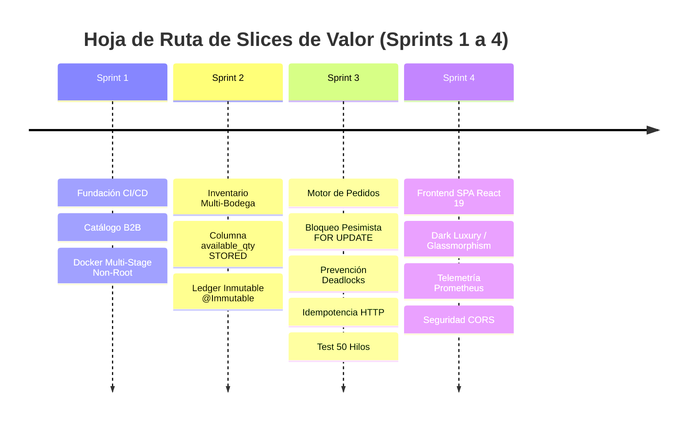

# StockPilot ✈️📦 — High-Concurrency B2B Inventory & Order Engine

> **Plataforma de Misión Crítica B2B para Gestión de Inventario Multi-Bodega, Prevención de Sobreventa (Zero Overselling) y Concurrencia ACID Extrema.**  
> *Diseñado e Implementado por Víctor Venegas como Proyecto Central de Portafolio Profesional de Nivel Senior / Solutions Architect.*

[](https://github.com/vivenegasl/stockpilot-b2b/actions)
[](https://www.oracle.com/java/)
[](https://spring.io/projects/spring-boot)
[](https://www.postgresql.org/)
[](https://react.dev/)
[](https://tailwindcss.com/)
[](https://certiprof.com/)
[](https://certiprof.com/)

---

## 👨‍💻 Ingeniero y Autor

**Víctor Venegas**  
- **Ingeniería Civil Informática** — Pontificia Universidad Católica de Valparaíso (PUCV)
- **Analista Programador** — Inacap / Duoc UC
- **Credenciales Profesionales Evidenciadas en el Código**:
  - 🏅 **Scrum Master & Product Owner Track**: SFPC, SDPC, SPOPC, SMPC (Historias de Usuario BDD/Gherkin, DoD formal, Sprints 1 a 4 con Reviews y Retrospectivas).
  - 🚀 **DevOps Advanced Track**: DEPC, DFPC, DAPC (CI/CD GitHub Actions, Docker Multi-stage Non-root 1001, 12-Factor App, Observabilidad Prometheus/Micrometer).
  - 🛡️ **Ciberseguridad & Ethical Hacking Track**: CSFPC, CEHPC, LCSPC (Mitigación OWASP Top 10, RFC 7807, Trivy SAST/CVE Scanner, Threat Modeling STRIDE en `SECURITY.md`).

---

## 🏛️ Filosofía de Ingeniería: "Docs-as-Code" y Soberanía Técnica

En StockPilot no existen cajas negras ni código autogenerado sin fundamento. Toda decisión de diseño, estructura de datos y línea de código responde a los primeros principios físicos de la computación (RAM, CPU, sockets TCP y almacenamiento en disco):

### 🗺️ Navegación de la Documentación Viva

| Artefacto / Documento | Ruta en el Repositorio | Propósito y Contenido |
| :--- | :--- | :--- |
| 📖 **Guía Maestra de Estudio (Syllabus)** | [`docs/architecture/MASTER_STUDY_GUIDE.md`](docs/architecture/MASTER_STUDY_GUIDE.md) | **11 Módulos pedagógicos independientes** bajo el Sistema de las 3 Capas (Intuición, Mecánica RAM a Disco, Respuesta STAR). |
| 📐 **Documento de Arquitectura (SAD)** | [`docs/architecture/ARCHITECTURE.md`](docs/architecture/ARCHITECTURE.md) | Modelo de Bounded Contexts, Modelo ERD, Máquinas de Estados, Secuencia Concurrente y Golden Signals. |
| 🎯 **Backlog de Producto Priorizado** | [`docs/scrum/product_backlog.md`](docs/scrum/product_backlog.md) | 11 Historias de Usuario (US-001 a US-011) en Gherkin BDD, estimadas con Fibonacci Planning Poker. |
| 🔄 **Ceremonias Scrum (Sprints 1 a 4)** | [`docs/scrum/`](docs/scrum/) | Plannings formales, Sprint Reviews y Retrospectivas detalladas de los Sprints 1, 2, 3 y 4. |
| 🛡️ **Threat Model y Ciberseguridad** | [`SECURITY.md`](SECURITY.md) | Análisis STRIDE, mitigación de riesgos de inmutabilidad contable (SOX / ISO 27001) y escaneo SAST. |
| 📋 **Definition of Done (DoD) Formal** | [`.github/PULL_REQUEST_TEMPLATE.md`](.github/PULL_REQUEST_TEMPLATE.md) | Criterios inquebrantables de aceptación técnica para integración continua. |

---

## 📜 Registro de Decisiones Arquitectónicas (ADRs)

El sistema cuenta con **10 Decisiones Arquitectónicas (ADRs)** formalmente documentadas:

1. [**ADR-0001**: Adopción de Monolito Modular frente a Microservicios](docs/adr/0001-modular-monolith.md)
2. [**ADR-0002**: Mitigación de Sobreventa mediante Bloqueo Pesimista con Timeout (3000 ms)](docs/adr/0002-concurrency-locking.md)
3. [**ADR-0003**: Motor de Idempotencia HTTP Perimetral para Operaciones Mutantes](docs/adr/0003-idempotency-engine.md)
4. [**ADR-0004**: Cálculo de Stock Disponible mediante Columna Generada `STORED` en PostgreSQL 16](docs/adr/0004-database-generated-available-qty.md)
5. [**ADR-0005**: Estrategia de Despliegue en Oracle Cloud Infrastructure (OCI)](docs/adr/0005-oracle-cloud-oci-deployment.md)
6. [**ADR-0006**: Libro Mayor de Inventario Inmutable y Protección ORM `@Immutable`](docs/adr/0006-immutable-ledger-and-orm-immutability.md)
7. [**ADR-0007**: Máquina de Estados de Órdenes y Erradicación de Deadlocks por Ordenamiento Determinista (`productId ASC`)](docs/adr/0007-order-lifecycle-and-deadlock-prevention.md)
8. [**ADR-0008**: Arquitectura Frontend SPA en React 19 con Vite, TypeScript y Dark Luxury UI](docs/adr/0008-frontend-spa-react19-dark-luxury.md)
9. [**ADR-0009**: Observabilidad y Métricas Dimensionales de Negocio con Micrometer y Prometheus](docs/adr/0009-observability-metrics-prometheus-micrometer.md)
10. [**ADR-0010**: Seguridad Perimetral CORS y Exposición de Cabeceras Transaccionales de Auditoría](docs/adr/0010-cors-security-and-transational-headers.md)

---

## 🚀 Slices de Valor Implementados (Sprints 1 a 4)



* **Slice 1 (Sprint 1)**: Catálogo Industrial con control de versión optimista (`@Version`), paginación, sanitización y CI/CD en GitHub Actions.
* **Slice 2 (Sprint 2)**: Inventario Multi-Bodega regional, cálculo de existencias garantizado en base de datos (`total_qty - reserved_qty STORED`) y auditoría inmutable en `inventory_ledger` (norma SOX).
* **Slice 3 (Sprint 3)**: Motor de órdenes transaccionales, reservas atómicas pesimistas con timeout de 3000 ms, ruptura de la condición de Coffman ordenando por `productId ASC`, filtro de idempotencia Servlet con centinela en vuelo (`status = 0`) y test de estrés destructivo con 50 hilos concurrentes compitiendo por 1 unidad.
* **Slice 4 (Sprint 4)**: Consola de operaciones en React 19 + TypeScript + Vite + Tailwind v4, inyección notarial de UUID v4 en `client.ts`, detección visual de `X-Idempotent-Replay`, telemetría de negocio con Micrometer en `/actuator/prometheus` y visualizadores Recharts de contención y saturación de HikariCP / JVM.

---

## 🧰 Stack Tecnológico Completo

| Capa | Tecnologías | Propósito Arquitectónico |
| :--- | :--- | :--- |
| **Backend Core** | Java 21 LTS, Spring Boot 3.3.4 | Monolito Modular de alto rendimiento y bajo consumo |
| **Persistencia** | Spring Data JPA, Hibernate 6, PostgreSQL 16 | Transacciones ACID locales, Row-level Locking, Generated Columns |
| **Pool JDBC** | HikariCP | Conexiones ultrarrápidas con detección de leaks |
| **Migraciones** | Flyway Community | Versionado reproducible de esquemas DDL (V1 a V11) |
| **Frontend SPA** | React 19, TypeScript 5.x, Vite 8 | Consola reactiva estática desplegable a costo \$0 |
| **Estilos & UI** | Tailwind CSS v4, Lucide React, Recharts | Estética Dark Luxury & Glassmorphism con visualización de datos |
| **Observabilidad** | Spring Boot Actuator, Micrometer, Prometheus | Telemetría dimensional OpenMetrics de concurrencia y Golden Signals |
| **Testing** | JUnit 5, Mockito, AssertJ, MockMvc, Testcontainers | Pirámide de pruebas completa y estrés multi-hilo (`CountDownLatch`) |
| **DevSecOps** | Docker Multi-Stage (`USER 1001`), GitHub Actions, Trivy | Seguridad perimetral, escaneo CVE y CI/CD continuo |

---

## 💻 Instrucciones de Ejecución Local

### Prerrequisitos
- **Java 21 LTS** (OpenJDK 21 / Eclipse Temurin)
- **Node.js 20+** y **npm**
- **Docker** (para PostgreSQL 16 y Testcontainers)

### 1. Levantar el Backend (Spring Boot)

```bash
# Clonar el repositorio
git clone https://github.com/vivenegasl/stockpilot-b2b.git
cd stockpilot-b2b

# Iniciar base de datos PostgreSQL 16 con Docker Compose
docker compose up -d postgres

# Ejecutar migraciones Flyway y arrancar el servidor backend en http://localhost:8080
./gradlew bootRun
```

### 2. Levantar el Frontend (React 19 SPA)

En una nueva terminal:

```bash
# Navegar al directorio del frontend
cd frontend

# Instalar dependencias
npm install

# Iniciar servidor de desarrollo en http://localhost:5173
npm run dev
```

Abre tu navegador en `http://localhost:5173`. La aplicación cuenta con un proxy transparente que redirige automáticamente las peticiones `/api` y `/actuator` hacia el backend en el puerto 8080.

---

## 🧪 Ejecución de la Suite de Pruebas

```bash
# Ejecutar todas las pruebas unitarias y de integración de backend
./gradlew test

# Ejecutar el check de calidad y arquitectura completo
./gradlew check

# Verificar compilación TypeScript y bundling de producción en el frontend
cd frontend
npm run build
```

> **Verificación de Concurrencia**: La prueba `ReservationConcurrencyIntegrationTest` dispara 50 hilos simultáneos contra 1 sola unidad disponible mediante `CountDownLatch`, certificando empíricamente **exactamente 1 éxito (200 OK), 49 rechazos (409 Conflict) y Cero Sobreventa**.
