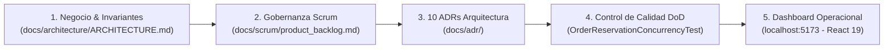

# StockPilot — Guía Maestra de Demostración: Project Leader TI (BDO Chile)

> **Candidato:** Víctor Venegas Lindzay  
> **Proyecto:** StockPilot — High-Concurrency B2B Inventory & Order Engine  
> **Propósito:** Guion de apoyo y presentación ejecutiva de 5 minutos para la entrevista técnica en BDO Chile.  
> **Rol Demostrado:** Project Leader TI / Software Architect / Agile PMO Lead  

---

## 1. La Frase de Entrada (Cuándo y Cómo Introducir StockPilot)

Durante la entrevista técnica, cuando surja alguna de estas tres preguntas habituales:
* *"¿Cómo te aseguras de que un proyecto tecnológico cumpla con los plazos y estándares de calidad?"*
* *"¿Tienes experiencia documentando requerimientos o liderando con metodologías ágiles?"*
* *"¿Tienes algún proyecto reciente donde hayas aplicado arquitectura de software o buenas prácticas?"*

**Respuesta de Transición:**
> *"Sí, absolutamente. De hecho, para consolidar los estándares que exijo en mis proyectos y al gobernar proveedores, desarrollé **StockPilot**, una plataforma B2B de distribución industrial de alta concurrencia. Si me permiten compartir pantalla dos minutos, me gustaría mostrarles brevemente cómo documento y gobierno un proyecto: desde el Product Backlog con criterios Gherkin y los Sprints de Scrum, pasando por 10 Registros de Decisiones de Arquitectura (ADRs), hasta un test de concurrencia de 50 hilos y su tablero de control operacional."*

---

## 2. El Recorrido de Demostración en 5 Minutos (Paso a Paso)

---

### Minuto 1: Contexto de Negocio e Invariantes Críticas
* **Archivo en Pantalla:** [`docs/architecture/ARCHITECTURE.md`](../architecture/ARCHITECTURE.md) (Sección 1 y 3)
* **Qué Decir:**
  > *"StockPilot resuelve un dolor crítico en distribución mayorista industrial: la sobreventa (overselling). Cuando clientes corporativos como mineras o plantas de celulosa compran componentes de alto valor con stock limitado (como PLCs Siemens), múltiples compradores compiten en milisegundos.
  >
  > Como líder técnico, lo primero que establecí no fue código, sino una **invariante matemática de negocio inviolable**:  
  > `available_qty = total_qty - reserved_qty >= 0`.  
  > Toda la arquitectura, la base de datos y la gestión del proyecto se subordinaron a garantizar esa regla."*

---

### Minuto 2: Gobernanza Ágil (Scrum & PMO)
* **Archivo en Pantalla:** [`docs/scrum/product_backlog.md`](../scrum/product_backlog.md) y [`docs/scrum/sprint-1-review-and-retro.md`](../scrum/sprint-1-review-and-retro.md)
* **Qué Decir:**
  > *"Como Product Owner y Scrum Master certificado, la gestión no se hace con listas de tareas informales. Aquí pueden ver el **Product Backlog formal**:
  > 1. Cada historia de usuario está escrita en formato **Gherkin (Dado-Cuando-Entonces)**, eliminando ambigüedades entre los usuarios de negocio y el equipo técnico.
  > 2. Definí una **Definition of Ready (DoR)** para no iniciar desarrollo sin contratos claros, y una **Definition of Done (DoD)** con 85% de cobertura de pruebas y escaneos de seguridad.
  > 3. Documenté **4 Sprints completos**: cada uno con su sesión de Planning, su Review con métricas de velocidad y su Retrospectiva analizando bloqueadores técnicos y acciones de mejora continua."*

---

### Minuto 3: Los Registros de Decisiones de Arquitectura (ADRs)
* **Archivo en Pantalla:** Directorio [`docs/adr/`](../adr/)
* **Qué Decir:**
  > *"Uno de los mayores riesgos al trabajar con proveedores tecnológicos es que toman decisiones técnicas opacas que luego se convierten en deuda técnica insostenible.
  > 
  > En StockPilot formalicé **10 ADRs (Architectural Decision Records)** que justifican cada decisión estratégica:
  > * **ADR-0001:** Por qué elegimos un Monolito Modular en lugar de microservicios para evitar la complejidad innecesaria de transacciones distribuidas.
  > * **ADR-0002:** Por qué usamos bloqueo pesimista `SELECT ... FOR UPDATE` en base de datos para erradicar condiciones de carrera.
  > * **ADR-0003:** Implementación de un motor de idempotencia HTTP con ventana de 24 horas para evitar cobros o reservas duplicadas ante reintentos de red.
  >
  > Este es el nivel de transparencia y justificación que exijo a cualquier proveedor externo antes de aprobar una solución."*

---

### Minuto 4: Control de Calidad para Proveedores (Testing Concurrente)
* **Archivo en Pantalla:** [`src/test/java/com/stockpilot/ordering/OrderReservationConcurrencyTest.java`](../../src/test/java/com/stockpilot/ordering/OrderReservationConcurrencyTest.java)
* **Qué Decir:**
  > *"Cuando un proveedor me dice 'el código ya está listo y funciona', mi criterio de aceptación no es su palabra. Exijo pruebas automatizadas con evidencia empírica.
  > 
  > En este test de integración ejecutamos **50 hilos concurrentes simulados** (`CountDownLatch`, Testcontainers con PostgreSQL 16 real) compitiendo exactamente en el mismo milisegundo por reservar las últimas 10 unidades de un producto:
  > * El resultado verificado: exactamente 10 peticiones obtienen reserva confirmada, y las otras 40 son rechazadas limpiamente con código de negocio controlado, sin bloqueos mutuos (deadlocks) y con stock libre en cero.
  >
  > Esa disciplina de aseguramiento de calidad es la que garantiza la continuidad operativa de los sistemas de BDO."*

---

### Minuto 5: Cuadro de Mando Operacional y Conexión con Power BI
* **Pantalla:** Frontend en `http://localhost:5173` (Vista Dashboard / Telemetría)
* **Qué Decir:**
  > *"Finalmente, el valor de la tecnología se materializa en la toma de decisiones. Este es el dashboard operacional que construí en React 19:
  > * Monitorea en tiempo real órdenes confirmadas, órdenes rechazadas por falta de inventario, latencia de base de datos y tasas de conflicto.
  > * Esta misma habilidad de modelar datos transaccionales, estructurar esquemas estrella y traducirlos en KPIs visuales e intuitivos es la que pondré al servicio de BDO para diseñar e implementar los **cuadros de mando y reportes en Power BI** que apoyen a los socios y directores de las distintas áreas de la firma."*

---

## 3. Matriz de Preguntas Técnicas Probables sobre StockPilot

| Pregunta del Evaluador BDO | Respuesta Estratégica (Enfoque Project Leader TI) |
| :--- | :--- |
| **"¿Por qué elegiste Java / Spring Boot y no Node o Python para este proyecto?"** | *"Elegí Java 21 y Spring Boot 3 porque en sistemas transaccionales de alta concurrencia y misión crítica, la robustez del tipado estricto, el ecosistema de gestión transaccional (`@Transactional`) y el control fino de concurrencia en la JVM son insuperables. Demuestra que selecciono el stack adecuado según el dominio de negocio, al igual que en ValVic seleccioné Python/FastAPI por la agilidad con modelos de IA."* |
| **"¿Qué es la idempotencia y por qué la implementaste en el ADR-0003?"** | *"En redes móviles o conexiones inestables, si un cliente hace clic en 'comprar' y la conexión titubea, el cliente suele hacer clic de nuevo. Sin idempotencia, se crean dos órdenes y se descuenta stock dos veces. El filtro de idempotencia captura una cabecera `Idempotency-Key` (UUID); si la clave ya fue procesada en las últimas 24 horas, retorna la misma respuesta almacenada sin re-ejecutar la lógica de negocio."* |
| **"¿Cómo se conecta este proyecto con lo que harás en BDO?"** | *"StockPilot demuestra mi método de trabajo: delimitación rigurosa de alcance, historias de usuario en Gherkin, documentación de decisiones en ADRs, exigencia de calidad en pruebas de estrés y reportería ejecutiva orientada a negocio. Eso es exactamente lo que hace un Project Leader TI al gobernar iniciativas tecnológicas y proveedores en BDO."* |

---

## 4. Checklist Pre-Entrevista

- [ ] Tener el frontend de StockPilot corriendo en segundo plano: abrir terminal y ejecutar `npm run dev` en `StockPilot/frontend`.
- [ ] Abrir en pestañas listas para compartir:
  1. `http://localhost:5173` (Dashboard de StockPilot).
  2. `ARCHITECTURE.md` (Documento de Arquitectura).
  3. `product_backlog.md` (Historias de Usuario Gherkin).
  4. La carpeta `docs/adr/`.
- [ ] Repasar mentalmente los 5 minutos del guion: serenidad, lenguaje de negocios y orgullo por el trabajo bien hecho.