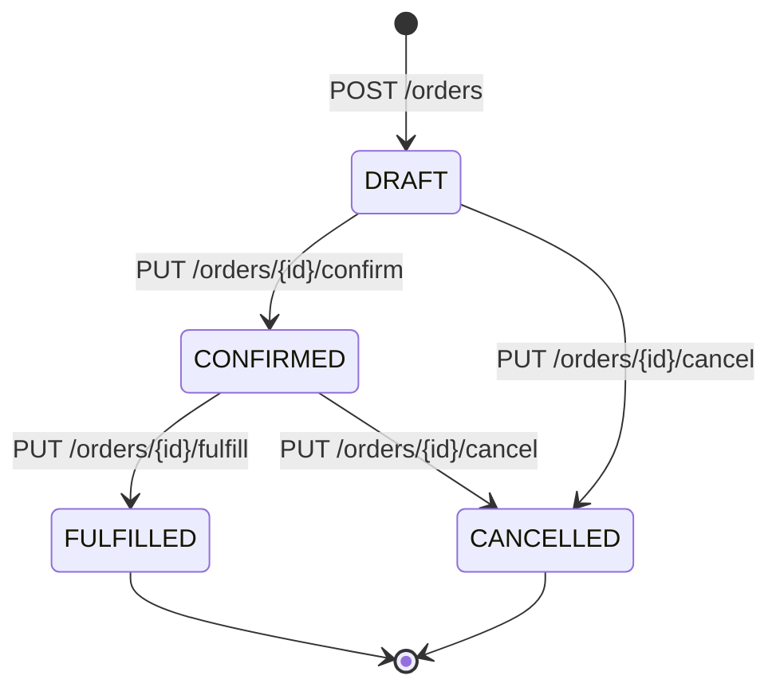

# ADR-0007: Máquina de Estados de Órdenes y Erradicación de Deadlocks por Ordenamiento Determinista

* **Estado**: Aceptado
* **Fecha**: 2026-10-24
* **Decisores**: Víctor Venegas (Software Architect)
* **Categoría**: Transaccionalidad / Concurrencia / Máquinas de Estado

## Contexto y Declaración del Problema

En **StockPilot**, los clientes B2B consolidan pedidos que contienen múltiples componentes industriales (ej. un PLC Siemens, dos variadores de frecuencia ABB y cuatro sensores inductivos). Cuando múltiples órdenes compiten por stock limitado simultáneamente, surgen dos desafíos críticos:

1. **Riesgo de Interbloqueos (Deadlocks)**: Si la Orden 1 solicita productos $[A, B]$ y la Orden 2 solicita productos $[B, A]$, bajo concurrencia masiva la Orden 1 puede adquirir el bloqueo sobre $A$ mientras la Orden 2 adquiere el bloqueo sobre $B$. Luego, la Orden 1 intenta bloquear $B$ (espera a la Orden 2) y la Orden 2 intenta bloquear $A$ (espera a la Orden 1). Ambas quedan congeladas indefinidamente en un ciclo de espera mutua.
2. **Inconsistencias de Ciclo de Vida**: Un pedido no debe poder cancelarse si ya fue despachado, ni confirmarse dos veces, ni despacharse si nunca fue confirmado.

## Factores de Decisión (Decision Drivers)

* **Prevención Proactiva de Deadlocks**: Eliminar la posibilidad matemática de ciclos de espera circular sin depender de la detección reactiva de PostgreSQL (`deadlock_timeout`, que aborta transacciones de forma traumática).
* **Consistencia Transaccional ACID**: La transición de estado de la orden, el incremento de reservas en inventario y el asiento inmutable en el ledger deben ocurrir atómicamente o no ocurrir en absoluto.
* **Trazabilidad Operacional**: Toda transición de estado debe registrar un asiento en el libro mayor de inventario (`inventory_ledger`).

## Decisión y Justificación

### 1. Erradicación de la Condición de Espera Circular de Coffman
Para que exista un Deadlock en sistemas computacionales, deben cumplirse simultáneamente las cuatro condiciones de Coffman:
1. Exclusión mutua (locks exclusivos a nivel de fila).
2. Retención y espera (mantener un lock mientras se pide otro).
3. No expropiación (el sistema no puede arrebatarle el lock a una transacción activa).
4. **Espera circular**: Existe un ciclo cerrado de procesos donde cada uno espera un recurso retenido por el siguiente.

**Regla de Arquitectura**: Antes de solicitar los bloqueos `SELECT ... FOR UPDATE` sobre `stock_level`, el sistema **ordena forzosamente todos los ítems de la orden por su identificador único primario**:
```java
List<ReservationItem> sortedItems = items.stream()
        .sorted(Comparator.comparing(ReservationItem::productId))
        .toList();
```
Al obligar a que toda transacción bloquee siempre los recursos en la misma secuencia matemática ascendente:
$$\text{Lock}(P_1) \rightarrow \text{Lock}(P_2) \rightarrow \dots \rightarrow \text{Lock}(P_n)$$
se rompe de raíz la cuarta condición de Coffman. Dos transacciones concurrentes jamás podrán formar un ciclo de espera, transformando el grafo de dependencias en un **Grafo Acíclico Dirigido (DAG)** libre de interbloqueos.

### 2. Máquina de Estados Estricta
El ciclo de vida de `PurchaseOrder` se restringe a 4 estados discretos:
* `DRAFT`: Estado inicial. No compromete stock. Permite agregar líneas y notas.
* `CONFIRMED`: Reserva stock exclusivamente. Requiere validación atómica de inventario.
* `FULFILLED`: Despacho físico. Descuenta `total_qty` y `reserved_qty`.
* `CANCELLED`: Anulación. Libera reservas activas restituyendo disponibilidad general.



## Consecuencias y Trade-offs

### Consecuencias Positivas:
* **Cero Deadlocks en Base de Datos**: Ausencia total de excepciones `CannotAcquireLockException` o `DeadlockLoserDataAccessException`.
* **Rendimiento Óptimo**: PostgreSQL no desperdicia ciclos de CPU corriendo el daemon detector de deadlocks periódicamente.
* **Integridad Garantizada**: Cualquier intento de transición inválida (ej. cancelar una orden ya despachada) es rechazado inmediatamente con `409 Conflict`.

### Consecuencias Negativas y Mitigaciones:
* **Sobrecarga de Ordenamiento en Memoria**: Requiere ordenar la lista de ítems en la CPU de la JVM.  
  * *Mitigación*: En pedidos B2B el número de líneas oscila entre 5 y 100 ítems. Un ordenamiento de 100 elementos con TimSort en memoria toma menos de 1 microsegundo ($0.001\text{ ms}$), costo totalmente despreciable frente a los 5 milisegundos de una consulta de red a base de datos.
