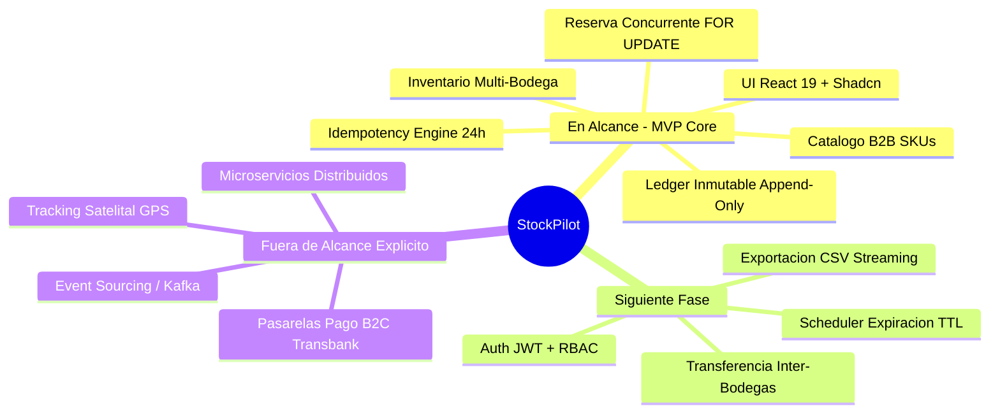
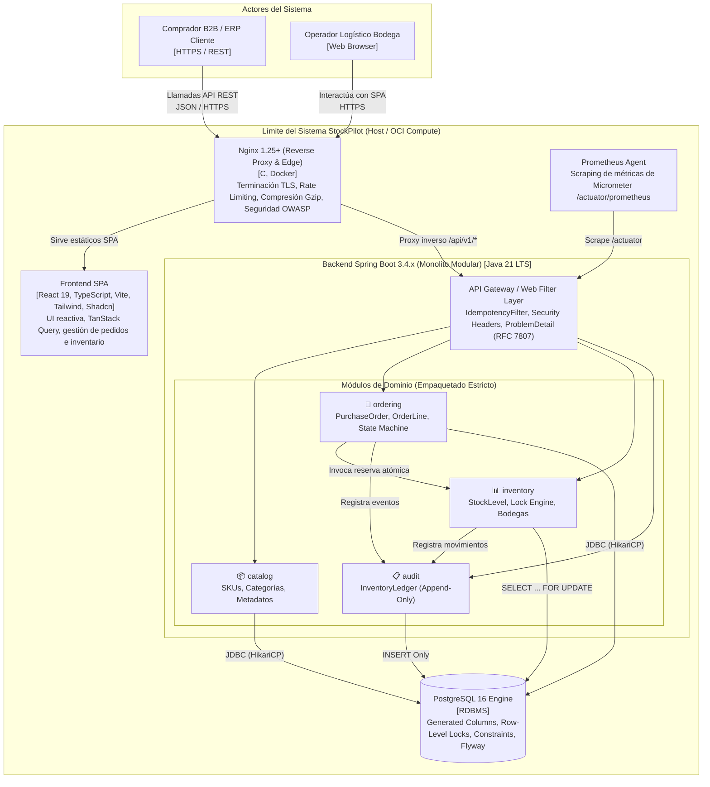
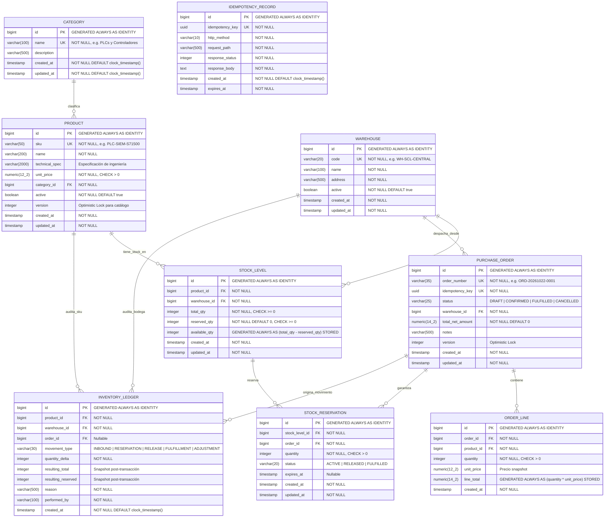
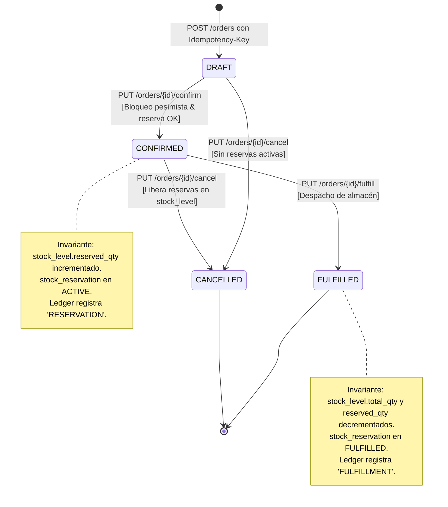
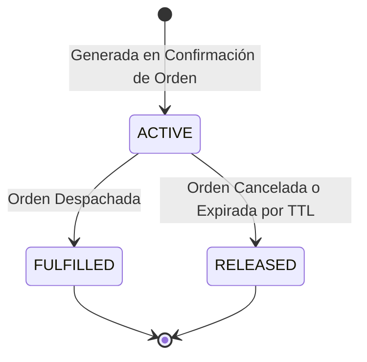
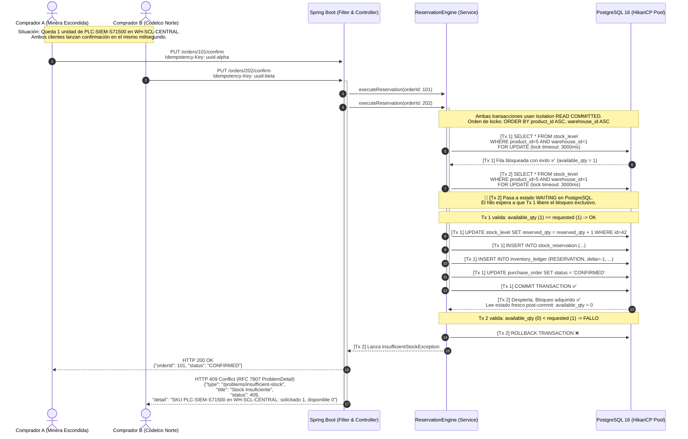

# StockPilot — Documento de Arquitectura de Software (SAD)

> **Estado**: Aprobado  
> **Versión**: 1.0.0  
> **Autor Principal**: Víctor Venegas — Lead Full-Stack Engineer & Software Architect  
> **Dominio de Negocio**: Distribución Mayorista B2B de Automatización y Suministros Industriales  

---

## 1. Contexto de Negocio y Dominio

**StockPilot** es una plataforma B2B de misión crítica orientada a la comercialización y despacho mayorista de componentes de automatización industrial, control eléctrico y repuestos de alta demanda en Chile y Latinoamérica (PLCs, variadores de frecuencia, sensores industriales, actuadores y protecciones eléctricas).

### 1.1 El Desafío de Negocio (High Concurrency & Zero Overselling)
En este sector, clientes corporativos (empresas mineras, plantas de celulosa, integradores de sistemas y constructoras EPC) operan con órdenes de compra de gran volumen y alta criticidad temporal. Cuando arriba un lote importado de componentes con stock limitado (ej. 10 unidades de un PLC Siemens S7-1500), múltiples compradores corporativos y sistemas de reaprovisionamiento automatizado lanzan solicitudes de compra simultáneas en cuestión de milisegundos.

**Impacto de la Sobreventa (Overselling):**
1. **Paradas de Planta y Multas Contractuales**: Vender stock inexistente paraliza contratos de integración industrial con multas diarias severas.
2. **Pérdida de Confianza B2B**: En el canal corporativo, la rotura de stock confirmada destruye acuerdos marco anuales.
3. **Invariante Crítica**: **Es una imposibilidad matemática y de negocio vender más unidades que las físicamente disponibles y aseguradas.**

---

## 2. Delimitación Rigurosa del Alcance

### 2.1 En Alcance (Slice 0 & MVP Core)
- **Catálogo B2B de SKUs Industriales**: Gestión de productos con código SKU normalizado, clasificación jerárquica por categoría, fichas técnicas, precios netos mayoristas y versionado optimista de metadatos.
- **Inventario Segregado Multi-Bodega**: Stock físico independiente por nodo logístico regional:
  - `WH-SCL-CENTRAL`: Centro de Distribución Pudahuel (Santiago).
  - `WH-VAP-PORT`: Hub Portuario Valparaíso.
  - `WH-ANF-MINER`: Hub de Suministro Minero Antofagasta.
- **Motor de Reserva Concurrente Pesimista**: Reserva atómica transaccional usando `SELECT ... FOR UPDATE` con timeout explícito de 3000 ms y ordenamiento determinista por `(product_id ASC, warehouse_id ASC)` para erradicar deadlocks.
- **Motor de Idempotencia HTTP**: Servlet Filter que intercepta cabeceras `Idempotency-Key` (UUID v4), impidiendo procesamiento duplicado ante timeouts de red o reintentos agresivos del cliente B2B.
- **Libro Mayor de Inventario (Append-Only Ledger)**: Registro inmutable de trazabilidad que documenta cada variación de stock (`INBOUND`, `RESERVATION`, `RELEASE`, `FULFILLMENT`, `ADJUSTMENT`) con instantánea posterior y autor.
- **Frontend SPA React 19 + TypeScript**: Tableros operacionales con feedback de inventario en tiempo real, catálogo interactivo y terminal de checkout de pedidos.

### 2.2 Siguiente Fase (Roadmap Post-MVP)
- **Motor de Expiración Automática de Reservas**: Tarea programada (`@Scheduled` en Spring Boot) que libera reservas no formalizadas tras una ventana TTL (ej. 15 minutos).
- **Enrutamiento Inteligente y Stock Multibodega**: Algoritmo de despacho que optimiza el surtido desde bodegas geográficamente más cercanas cuando la bodega principal no cuenta con inventario completo.
- **Exportación Masiva en Streaming**: Generación de reportes de auditoría e inventario vía `StreamingResponseBody` / Reactive Streams para evitar presión en el heap de la JVM.
- **Seguridad B2B (JWT + RBAC)**: Control de acceso basado en roles (`ROLE_SALES_REP`, `ROLE_WAREHOUSE_MGR`, `ROLE_AUDITOR`).

### 2.3 Fuera de Alcance Explícito (Out-of-Scope)
- **Microservicios Distribuidos**: Se descarta la fragmentación en microservicios por introducir transacciones distribuidas innecesarias (2PC/Sagas) y latencia de red en un dominio altamente acoplado.
- **Pasarelas de Pago B2C en Vivo**: En transacciones B2B rigen líneas de crédito a 30/60 días (Facturación Electrónica), no pasarelas de tarjeta de crédito web.
- **Telemetría y GPS de Flotas**: Excede el Bounded Context de gestión de stock y almacén (pertenece a un TMS externo).

---

## 3. Invariantes Fundamentales de Negocio

Toda operación del sistema debe garantizar bajo cualquier condición de estrés las siguientes leyes matemáticas:

$$\forall (p, w) \in \text{StockLevel}: \quad \text{reserved\_qty} \ge 0 \quad \land \quad \text{reserved\_qty} \le \text{total\_qty}$$

$$\text{available\_qty} = \text{total\_qty} - \text{reserved\_qty} \ge 0$$

$$\Delta \text{total\_qty} = \sum \text{LedgerEntries(movement\_type} \in \{\text{INBOUND}, \text{FULFILLMENT}, \text{ADJUSTMENT}\})$$

---

## 4. Diagramas de Arquitectura (C4, ERD, Estados, Secuencia)

### 4.1 C4 — Nivel 2: Diagrama de Contenedores

### 4.2 Modelo Entidad-Relación (ERD) Físico

### 4.3 Máquinas de Estado

#### Ciclo de Vida de la Orden de Compra (`PurchaseOrder`)

#### Ciclo de Vida de la Reserva de Stock (`StockReservation`)

### 4.4 Diagrama de Secuencia Concurrente: Carrera por la Última Unidad

---

## 5. Decisiones Arquitectónicas (Resumen de ADRs)

| Identificador | Título | Decisión Adoptada | Trade-off Principal Asumido |
|---|---|---|---|
| **ADR-001** | Arquitectura Monolito Modular vs Microservicios | Monolito Modular con paquetes por dominio | Menor escalabilidad independiente a cambio de transacciones ACID locales y cero latencia de red |
| **ADR-002** | Control de Concurrencia y Anti-Sobreventa | Bloqueo Pesimista (`SELECT FOR UPDATE`) con timeout de 3s | Serialización en filas calientes a cambio de exactitud matemática infalible |
| **ADR-003** | Motor de Idempotencia en Capa HTTP | Servlet Filter + Persistencia en PostgreSQL (TTL 24h) | Almacenamiento extra en BD a cambio de protección total ante reintentos de red |
| **ADR-004** | Cálculo de `available_qty` en Base de Datos | Columna Calculada `GENERATED ALWAYS AS STORED` | Rigidez en esquema DDL a cambio de erradicar desincronizaciones en la capa de aplicación |
| **ADR-005** | Estrategia de Despliegue en Oracle Cloud (OCI) | Compute VM + Docker Multi-stage + Nginx Edge Proxy | Gestión de infraestructura IaaS a cambio de costo \$0 (Free Tier) y soberanía de datos |

---

## 6. Convenciones de Empaquetado y Capas Limpias

Para preservar la pureza modular y asegurar que el código no degrade en un "big ball of mud", se establecen las siguientes reglas:

1. **Aislamiento de Módulos**: `com.stockpilot.catalog`, `com.stockpilot.inventory`, `com.stockpilot.ordering`, `com.stockpilot.audit`, `com.stockpilot.shared`.
2. **Dirección de Dependencias**:
   - `ordering` $\rightarrow$ `inventory`
   - `inventory` $\rightarrow$ `audit`
   - `ordering` $\rightarrow$ `audit`
   - **Prohibido**: `audit` $\rightarrow$ cualquier otro módulo.
   - **Prohibido**: Referencias circulares inter-módulo.
3. **Mapeo Estricto DTO vs Entity**:
   - **Jamás** exponer clases `@Entity` en controladores REST.
   - Todo request/response es un `java.lang.Record` inmutable con anotaciones `jakarta.validation.constraints`.
