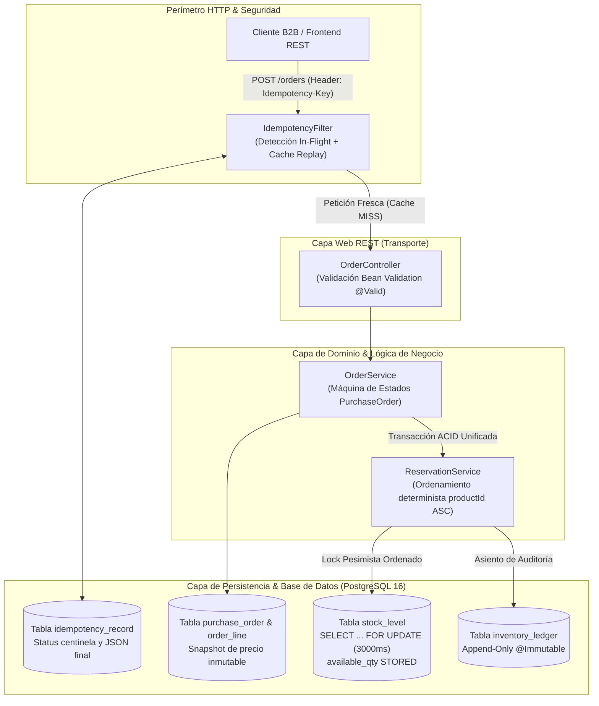

# StockPilot — Guía Maestra de Estudio de Arquitectura e Ingeniería (Master Study Guide)

> **Documento Vivo de Soberanía Técnica — Slices 1, 2, 3 y 4**  
> **Autor**: Víctor Venegas — Lead Full-Stack Engineer & Software Architect  
> **Propósito**: Dominio absoluto de cada decisión de diseño, línea de código, anotación de framework y comando SQL del sistema. Sin jerga circular, con rigor de ingeniería de sistemas de misión crítica.

---

## 🗺️ Índice General y Navegación Modular

Para facilitar el estudio enfocado y evitar la sobrecarga de un único documento gigante, la Guía Maestra de Estudio ha sido dividida en **módulos independientes y autocontenidos**. Cada módulo desglosa sus conceptos bajo el **Sistema de las 3 Capas** (Capa 1: Intuición del Mundo Real, Capa 2: Mecánica Exacta de la RAM al Disco, Capa 3: Respuesta de Solutions Architect en Entrevista).

| Módulo | Archivo Dedicado | Temas Principales y Tecnologías Desglosadas |
| :--- | :--- | :--- |
| **0. Glosario de Primeros Principios** | [📄 00-glosario-primeros-principios.md](study-guide/00-glosario-primeros-principios.md) | JVM, Heap vs Stack, Hilos KLT, Reflection, Proxies dinámicos, AOP, HikariCP, Transacciones ACID, MVCC, Flyway. |
| **1. Anatomía Básica y Persistencia** | [📄 01-anatomia-basica-persistencia.md](study-guide/01-anatomia-basica-persistencia.md) | Diferencia entre Java, Spring y Hibernate; anotaciones `@`; ciclo de vida ORM; costo de dirty checking y $N+1$; DTOs vs Entidades (`@Entity`, `@Table`, `@Id`, `@Column`, `@Version`). |
| **2. Slice 1: Catálogo, Monolito y CI/CD** | [📄 02-slice-1-catalogo-monolito-cicd.md](study-guide/02-slice-1-catalogo-monolito-cicd.md) | ADR-0001 (Monolito Modular vs Microservicios); Bounded Contexts; migraciones Flyway vs `ddl-auto=update`; Dockerfile multi-stage; usuario non-root (1001); escáner Trivy SAST/CVE. |
| **3. Slice 2: Concurrencia, Bodegas y Ledger** | [📄 03-slice-2-concurrencia-bodegas-ledger.md](study-guide/03-slice-2-concurrencia-bodegas-ledger.md) | PostgreSQL 16 `available_qty STORED`; mapeo Hibernate `@Generated`; ADR-0002 bloqueo pesimista `SELECT ... FOR UPDATE` (timeout 3000 ms); simulación de sobreventa; ADR-0006 `inventory_ledger` append-only; `@Immutable`; SOX / ISO 27001; STRIDE. |
| **4. Slice 3: Pedidos, Idempotencia y Concurrencia** | [📄 04-slice-3-pedidos-idempotencia-concurrencia.md](study-guide/04-slice-3-pedidos-idempotencia-concurrencia.md) | Idempotencia perimetral HTTP (`IdempotencyFilter`); detección de concurrencia en vuelo (`status = 0`); `ContentCachingResponseWrapper`; replay HTTP 201; erradicación de deadlocks con `productId ASC` (DAG de Coffman); máquina de estados `PurchaseOrder`; transacciones ACID multi-entidad; prueba de estrés con 50 hilos y `CountDownLatch`. |
| **5. Panorama Industrial: Los 8 Pilares** | [📄 05-panorama-industrial-8-pilares.md](study-guide/05-panorama-industrial-8-pilares.md) | Matriz comparativa mercado vs bare-metal: Redis `SETNX`, Redlock, Amazon QLDB, Immudb, Redis Hashes `HINCRBY`, Kafka, RabbitMQ DLX, Liquibase, Bytebase, OpenTelemetry, Jaeger; trade-offs y puntos de inflexión cuantitativos. |
| **6. Mapeo Curricular y Soberanía Académica** | [📄 06-mapeo-curricular-soberania-academica.md](study-guide/06-mapeo-curricular-soberania-academica.md) | Mapeo exhaustivo de asignaturas PUCV y Duoc UC vs código de StockPilot; vinculación con certificaciones CertiProf (Scrum, DevOps, Cybersecurity, AI); bibliografía canónica con capítulos y páginas exactas (Silberschatz, Elmasri, CLRS, Kurose, Kleppmann, Evans, Goetz). |
| **7. La Ciencia del Testing en Sistemas Críticos** | [📄 07-ciencia-del-testing-sistemas-criticos.md](study-guide/07-ciencia-del-testing-sistemas-criticos.md) | Pirámide de 5 niveles de pruebas (Mockito, `@WebMvcTest`, Filtros Servlet, Testcontainers PostgreSQL 16, Estrés con 50 hilos); bajo nivel de concurrencia en Java: `CountDownLatch` y AQS, `ExecutorService`, `AtomicInteger`, `volatile` vs visibilidad y la instrucción CPU `LOCK CMPXCHG`. |
| **8. Hoja de Ruta de Estudio (Syllabus)** | [📄 08-hoja-de-ruta-syllabus-estudio.md](study-guide/08-hoja-de-ruta-syllabus-estudio.md) | Syllabus de 8 semanas (4 niveles de madurez); protocolo de la Ventana Dorada de 90 minutos diarios (07:00 a 08:30 AM): 4 bloques de 20 min (Lectura, Diagramado a mano, Inspección de código, Feynman en voz alta) + 10 min de síntesis en Obsidian PKM. |
| **9. El Simulador de Entrevista Técnica (STAR)** | [📄 09-simulador-entrevistas-star.md](study-guide/09-simulador-entrevistas-star.md) | Top 8 preguntas de fuego para entrevistas de Senior Software Engineer y Solutions Architect estructuradas en Situación, Tarea, Acción y Resultado (Bloqueo pesimista, Deadlocks, Ledger inmutable, `@Immutable`, `@WebMvcTest`, Idempotencia en vuelo, `FilterRegistrationBean`, Testing de concurrencia y CAS). |
| **10. Protocolo de Gobierno Vivo y DoD** | [📄 10-protocolo-gobierno-vivo-dod.md](study-guide/10-protocolo-gobierno-vivo-dod.md) | Enmienda oficial a la Definition of Done: actualización obligatoria de la guía para cada Slice futuro y protocolo para incorporar nuevos módulos sin alterar archivos gigantes. |
| **11. Slice 4: Frontend React 19, Observabilidad y Métricas** | [📄 11-slice-4-frontend-observabilidad.md](study-guide/11-slice-4-frontend-observabilidad.md) | Frontend SPA en React 19 + TypeScript + Tailwind v4; preflight CORS y `Access-Control-Expose-Headers`; cliente HTTP con auto UUID v4; telemetría Actuator + Micrometer + Prometheus; saturación de pools HikariCP y memoria JVM Heap; gráficos Recharts. |

---

## 🏛️ Mapa de Arquitectura Global del Sistema (Slices 1, 2 y 3)

---

## 💡 Cómo Utilizar esta Guía de Estudio

1. **Para Estudio Diario**: Sigue el cronograma del [Módulo 8: Hoja de Ruta (Syllabus)](study-guide/08-hoja-de-ruta-syllabus-estudio.md) utilizando tu Ventana Dorada de 90 minutos (07:00 a 08:30 AM), apoyándote en las lecturas de los libros canónicos señalados en el [Módulo 6: Mapeo Curricular](study-guide/06-mapeo-curricular-soberania-academica.md).
2. **Para Preparación de Entrevistas**: Practica en voz alta las respuestas del [Módulo 9: Simulador STAR](study-guide/09-simulador-entrevistas-star.md) y repasa los contrastes tecnológicos del [Módulo 5: Panorama Industrial](study-guide/05-panorama-industrial-8-pilares.md).
3. **Para Nuevos Desarrollos (Slices Futuros)**: Consulta el [Módulo 10: Protocolo de Gobierno Vivo y DoD](study-guide/10-protocolo-gobierno-vivo-dod.md) para agregar módulos adicionales en `docs/architecture/study-guide/` manteniendo la soberanía técnica del proyecto intacta.
