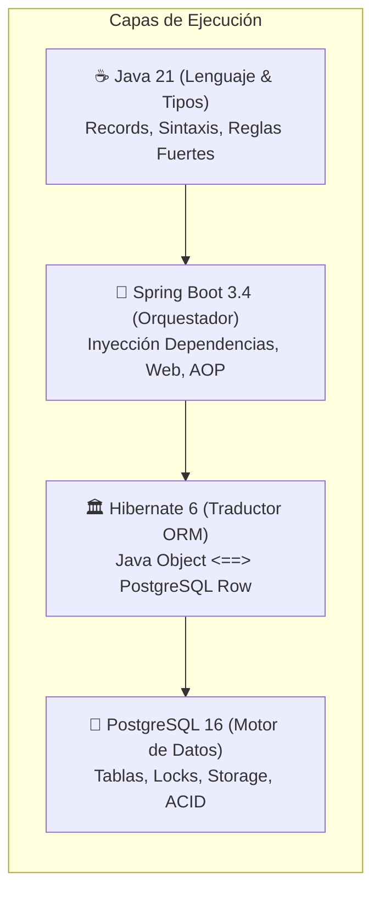
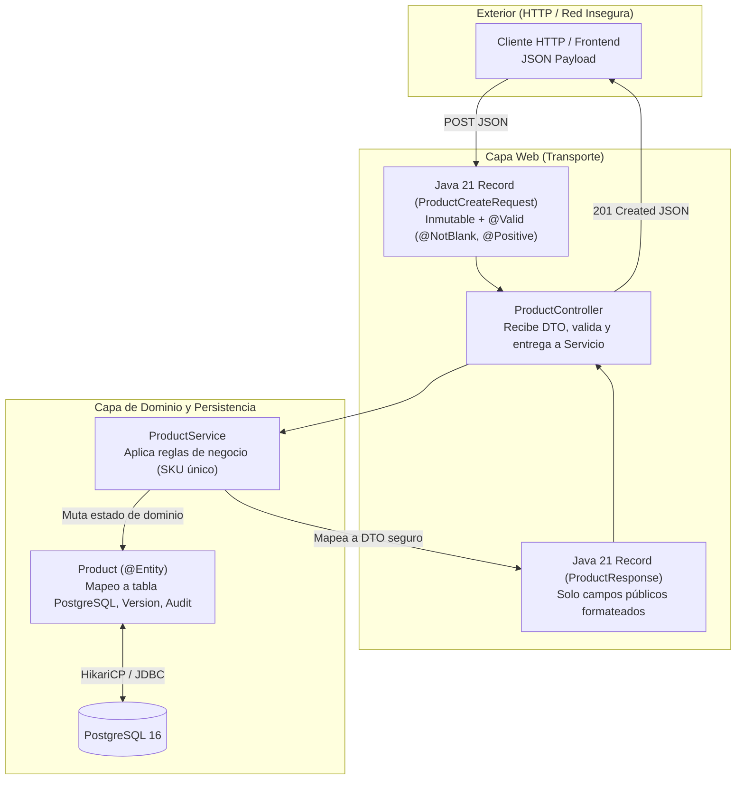
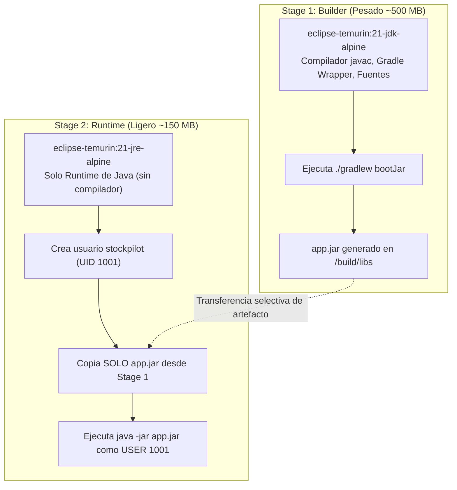
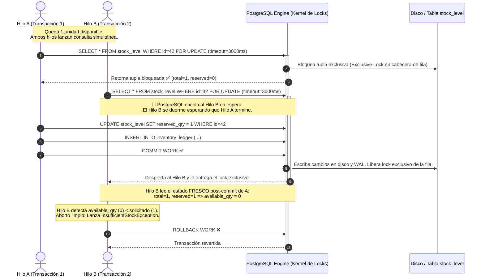

# StockPilot — Guía Maestra de Estudio de Arquitectura e Ingeniería (Master Study Guide)

> **Documento Vivo de Soberanía Técnica — Slices 1 y 2**  
> **Autor**: Víctor Venegas — Lead Full-Stack Engineer & Software Architect  
> **Propósito**: Dominio absoluto de cada decisión de diseño, línea de código, anotación de framework y comando SQL del sistema. Sin jerga circular, con rigor de ingeniería de sistemas de misión crítica.

---

## 🧭 Glosario de Primeros Principios (Fundamentos sin Jerga)

Para que este documento sea 100% autocontenido, antes de entrar a las capas desglosamos los términos fundamentales del ecosistema:

* **JVM (Java Virtual Machine / Máquina Virtual de Java)**: Programa ejecutable en C++ instalado en tu sistema operativo que toma el código compilado de Java (archivos `.class` con *bytecode*) y lo traduce a instrucciones binarias nativas que la CPU de tu máquina entiende.
* **Memoria Heap vs. Stack**:
  * *Stack (Pila)*: Memoria ultrarrápida donde vive el hilo de ejecución actual, sus variables locales primitivas (ej. `int i = 5`) y las referencias a los objetos. Se libera automáticamente al salir del método.
  * *Heap (Montículo)*: Gran espacio de memoria compartida donde se instancian los objetos pesados creados con `new` (como `new Product(...)`). Es gestionado por el Garbage Collector (limpiador automático de memoria).
* **Hilo de Ejecución (Thread)**: Secuencia más pequeña de instrucciones que el procesador ejecuta. En Spring Boot tradicional, cada petición HTTP entrante es atendida por un hilo independiente proveniente de una piscina de hilos (*Thread Pool* del servidor Tomcat).
* **Reflection (Reflexión de Java)**: Capacidad que tiene Java para inspeccionar en tiempo de ejecución sus propias clases, métodos y atributos privados, permitiendo a frameworks como Spring y Hibernate leer campos privados (`private Long id`) e invocar métodos sin que el desarrollador escriba código explícito para ello.
* **Proxy Dinámico (Dynamic Proxy)**: Objeto intermediario invisible creado en memoria por Spring que envuelve a tu clase real (como un cascarón). Cuando alguien llama a un método de tu servicio, primero entra al proxy (que abre la transacción o verifica permisos) y luego el proxy llama a tu código real.
* **AOP (Aspect-Oriented Programming / Programación Orientada a Aspectos)**: Técnica que permite ejecutar lógica transversal (como abrir/cerrar transacciones o medir tiempos) antes o después de que se ejecute un método, sin ensuciar la lógica de negocio con código repetitivo. Spring usa Proxies Dinámicos para lograr AOP.
* **Pool de Conexiones (HikariCP)**: Colección de conexiones TCP abiertas previamente hacia la base de datos PostgreSQL y mantenidas vivas en la RAM. En lugar de gastar 50 milisegundos en abrir y cerrar una conexión TCP en cada petición HTTP, el hilo de Spring "pide prestada" una conexión a HikariCP, la usa en 5 milisegundos y la devuelve a la piscina.
* **Transacción ACID**: Grupo de operaciones en la base de datos que se comportan como una sola:
  * *Atomicidad*: O se ejecutan todas las operaciones o ninguna (si algo falla, se revierte todo con un `ROLLBACK`).
  * *Consistencia*: La base de datos pasa de un estado válido a otro, sin romper restricciones de negocio (constraints).
  * *Aislamiento (Isolation)*: Dos transacciones simultáneas no ven los datos a medio guardar de la otra.
  * *Durabilidad*: Una vez hecho el `COMMIT`, los datos quedan guardados en disco magnético o SSD aunque se corte la energía eléctrica inmediatamente después.
* **MVCC (Multi-Version Concurrency Control)**: Mecanismo de PostgreSQL mediante el cual, cuando una fila es actualizada, no se sobrescribe físicamente en el disco de inmediato; en su lugar, PostgreSQL escribe una nueva versión de la fila. Esto permite que los hilos que leen datos no bloqueen a los hilos que escriben datos ("lectores nunca bloquean a escritores").
* **Flyway**: Herramienta de software que ejecuta scripts SQL versionados (`V1__...`, `V2__...`) en orden secuencial al arrancar la aplicación, registrando en una tabla de auditoría (`flyway_schema_history`) qué migraciones ya fueron aplicadas para que la estructura de la base de datos sea idéntica en cualquier máquina o servidor.

---

## 🧩 Módulo 1: Anatomía Básica y Persistencia (Desarmando el Misterio)



### 1.1 ¿Qué es realmente Java frente a Spring y frente a Hibernate?
Para defender esta arquitectura, debes tener cristalina la frontera entre las tres tecnologías:

1. **Java (El Lenguaje de Programación y Tipos)**: Es la gramática, las palabras y las estructuras. Define que una clase tiene campos, que un `record` es inmutable, y que un `BigDecimal` maneja precisión monetaria exacta. Java no sabe qué es la web, no sabe qué es HTTP y no sabe qué es una base de datos relacional.
2. **Spring Boot (El Orquestador y Contenedor de Inversión de Control)**: Es el director de escena. Se encarga de levantar el servidor web embebido (Tomcat en el puerto 8080), escuchar las peticiones HTTP que llegan por la red, instanciar los controladores y servicios, e inyectar las dependencias (`Dependency Injection`) para que tú no tengas que hacer `new Service()` a mano.
3. **Hibernate / JPA (El Traductor Objeto-Relacional u ORM)**: JPA (*Jakarta Persistence API*) es la norma escrita en un papel (la especificación/interfaz). Hibernate es el motor real (la implementación). Hibernate toma un objeto en la memoria RAM de Java (como `new Product(...)`) y genera dinámicamente la sentencia SQL correspondiente (`INSERT INTO product...`) para enviarla por el cable de red a PostgreSQL, y viceversa: toma los bytes que devuelve PostgreSQL y los convierte en objetos Java.

---

### 1.2 ¿Qué es exactamente el símbolo `@` (Anotaciones de Java)?

#### Capa 1: La Intuición
Imagina que vas a enviar un paquete por encomienda. La caja contiene tu producto (el código Java). Pegado en la tapa de la caja, colocas un **Post-it adhesivo amarillo** que dice: *"FRÁGIL - MANTENER EN LUGAR FRESCO"*. El Post-it no hace que la caja se enfríe por sí misma; es una **etiqueta informativa** para que el operador logístico que la manipule tome medidas especiales.

#### Capa 2: La Mecánica Exacta (De la RAM al Disco)
Una anotación `@` no es código ejecutable. Si compilas una clase con `@Entity`, el procesador no ejecuta ninguna instrucción extra al momento de instanciarla.
Lo que ocurre en la RAM es lo siguiente:
1. El compilador de Java (`javac`) almacena el nombre y parámetros de la anotación dentro del archivo `.class` como **metadatos de bytecode**.
2. Cuando Spring Boot o Hibernate arrancan, utilizan **Reflection (Reflexión)** para escanear las clases en memoria (`Class.forName("com.stockpilot.catalog.domain.Product")`).
3. Hibernate llama a `clazz.isAnnotationPresent(Entity.class)`. Si devuelve `true`, Hibernate crea un modelo interno en memoria llamado `PersistentClass` y registra esa clase en su catálogo de mapeo relacional.
4. Si nadie lee la anotación mediante Reflexión, la anotación es simplemente texto inerte.

#### Capa 3: La Respuesta de Solutions Architect
> *"Las anotaciones en Java no contienen lógica de control de flujo imperativa; son metadatos declarativos procesados en tiempo de arranque mediante el API de Reflexión. En StockPilot las utilizamos para desacoplar el modelo de dominio de las librerías externas: la clase declara su intención semántica (ej. `@Entity`, `@Table`) y el framework construye proxies dinámicos y metamodelos relacionales sin que el código de negocio dependa directamente de sentencias SQL manuales."*

---

### 1.3 El Ciclo de Vida de Persistencia y el Costo Oculto del ORM

#### ¿Por qué no usamos SQL manual tipo `INSERT INTO` en Java?
Escribir consultas SQL a mano mediante JDBC clásico (`PreparedStatement`, `ResultSet.getString("name")`) obliga a escribir cientos de líneas repetitivas propensas a errores tipográficos y desalineaciones de tipos. Hibernate automatiza la hidratación de objetos (convertir filas de BD en grafos de objetos Java).

#### ¿Cuál es el costo oculto de usar un ORM (Trade-off)?
* **Dirty Checking (Verificación Sucia)**: Cada vez que lees una entidad en una transacción abierta, Hibernate guarda en la RAM una copia idéntica (*snapshot*). Al hacer `commit`, compara campo por campo el objeto actual con el snapshot para decidir si envía un `UPDATE`. Esto consume memoria Heap y ciclos de CPU.
* **El Problema de Consulta N+1**: Si cargas 20 productos y cada producto tiene una categoría en modo perezoso (*Lazy*), al intentar leer el nombre de la categoría en un bucle, Hibernate ejecutará 1 consulta para los productos + 20 consultas adicionales para las categorías (21 consultas a la base de datos en total).  
  *Cómo lo mitigamos*: En StockPilot utilizamos **`JOIN FETCH`** en `ProductRepository`, obligando a la base de datos a hacer un solo `INNER JOIN` en una única consulta SQL.

---

### 1.4 La Separación Sagrada: Entidad JPA (`@Entity`) vs. DTO (`record`)



#### ¿Por qué exponer una entidad `@Entity` en un Controller es considerado una mala práctica grave?
1. **Fuga de Abstracción de Base de Datos**: Expone nombres de columnas internas, claves foráneas y estructuras relacionales directamente en contratos públicos de la API.
2. **Vulnerabilidad de Asignación Masiva (Mass Assignment / Over-posting)**: Si expones la entidad y usas enlace automático de datos de Spring, un cliente malicioso puede enviar un JSON con `{"id": 1, "version": 999, "active": false}` y Spring inyectará esos valores en la entidad, permitiendo alterar campos críticos sin autorización.
3. **Serialización Cíclica y Fallos de Jackson**: Si la entidad tiene relaciones `@ManyToOne` o `@OneToMany`, Jackson (el serializador JSON) intentará serializar el hijo, luego el hijo al padre, luego el padre al hijo, causando un desbordamiento de pila fatal (`StackOverflowError`) o una excepción de carga perezosa (`LazyInitializationException`) al ejecutarse fuera de la transacción.
4. **Solución en StockPilot**: Las entidades son confinadas en la capa de persistencia y dominio. Toda entrada y salida hacia la red es un **Java 21 `record` inmutable**, donde cada campo está explícitamente seleccionado y validado con `jakarta.validation`.

---

### 1.5 Desglose de Anotaciones de Persistencia (Sistema de 3 Capas)

#### A. `@Entity` y `@Table(name = "product")`
* **Capa 1 (Intuición)**: Es una tarjeta de registro de nacimiento. Le dice al sistema: *"Cada vez que veas un objeto de este tipo, trátalo como un habitante registrado de la ciudad; no es un objeto cualquiera de la memoria, tiene una casa propia en la base de datos llamada 'product'"*.
* **Capa 2 (Mecánica)**:
  * *Spring/Hibernate*: Al escanear el classpath, Hibernate reconoce la clase y construye un objeto `EntityBinding`. Valida contra la base de datos que la tabla `product` exista (gracias a `spring.jpa.hibernate.ddl-auto: validate`).
  * *Red/PostgreSQL*: En cada consulta, Hibernate traduce cualquier instrucción HQL/JPQL (`SELECT p FROM Product p`) a SQL nativo apuntando a la tabla declarada: `SELECT p.id, p.sku FROM product p`.
* **Capa 3 (Solución Architect)**:
  * *Entrevista*: *"Utilizamos `@Entity` para definir clases de dominio ricas mapeadas al estándar relacional JPA, y desacoplamos el nombre de la clase en Java del esquema relacional mediante `@Table(name = "...")` para aislar el modelo de posibles divergencias de nomenclatura en base de datos."*

#### B. `@Id` y `@GeneratedValue(strategy = GenerationType.IDENTITY)`
* **Capa 1 (Intuición)**: El número de cédula de identidad o pasaporte emitido por el Registro Civil. El ciudadano no inventa su propio número de carnet al nacer; el Estado se lo asigna correlativamente en ventanilla.
* **Capa 2 (Mecánica)**:
  * *Hibernate*: Sabe que este campo es la clave primaria (PK). `GenerationType.IDENTITY` le advierte a Hibernate que **no puede saber el ID del objeto antes de insertarlo**, por lo que se ve obligado a ejecutar inmediatamente la sentencia SQL `INSERT INTO product (...) VALUES (...) RETURNING id;`.
  * *PostgreSQL*: Al recibir el `INSERT`, el motor de base de datos lee su objeto secuencia interno creado por la columna `GENERATED BY DEFAULT AS IDENTITY`, incrementa el número atómicamente y lo almacena en la página de disco de la tabla.
* **Capa 3 (Solución Architect)**:
  * *Trade-off*: *"Elegimos `IDENTITY` nativo de PostgreSQL en lugar de secuencias preasignadas en memoria (`SEQUENCE` con pooling de IDs) porque garantiza total compatibilidad con scripts de migración externos de Flyway y previene 'huecos' de secuencia en sistemas transaccionales directos."*

#### C. `@Column(name = "unit_price", precision = 12, scale = 2)`
* **Capa 1 (Intuición)**: Un casillero bancario de tamaño calibrado. Si intentas meter un billete doblado o monedas fuera de medida, el casillero no cierra.
* **Capa 2 (Mecánica)**:
  * *Java*: El campo se tipa como `BigDecimal`, impidiendo los errores de redondeo de coma flotante de `double` o `float` (ej. `0.1 + 0.2 = 0.30000000000000004`).
  * *Hibernate/PostgreSQL*: Hibernate valida que en PostgreSQL la columna sea de tipo `NUMERIC(12, 2)` (hasta 10 dígitos enteros y 2 decimales exactos). En el cable de red (protocolo binario PostgreSQL), el valor viaja codificado en base-10000 exacta sin pérdida de centavos.
* **Capa 3 (Solución Architect)**:
  * *Trade-off*: *"Bajo ninguna circunstancia se utilizan tipos primitivos de coma flotante IEEE 754 (`double`/`float`) para montos monetarios o inventario físico. `BigDecimal` combinado con `NUMERIC(12, 2)` a nivel DDL garantiza exactitud financiera absoluta."*

#### D. `@Version` (Optimistic Locking / Bloqueo Optimista)
* **Capa 1 (Intuición)**: Un sello de cera en una carta con un número estampado (ej. "Sello #3"). Dos personas leen la carta al mismo tiempo. Quien responde primero rompe el sello y deja la carta con el "Sello #4". Cuando la segunda persona intenta mandar su respuesta asumiendo que la carta estaba en el "Sello #3", el cartero la rechaza porque el número ya cambió.
* **Capa 2 (Mecánica)**:
  * *Java/Hibernate*: Cada vez que se lee un producto, se carga su campo `version` (ej. `0`). Cuando ejecutas `product.setName("Nuevo Nombre")` y finaliza la transacción, Hibernate emite exactamente el siguiente SQL:
    ```sql
    UPDATE product 
    SET name = 'Nuevo Nombre', version = 1, updated_at = now() 
    WHERE id = 10 AND version = 0;
    ```
  * *PostgreSQL*: Si otra transacción ya había modificado ese registro milisegundos antes, la fila en disco ya tiene `version = 1`. Por ende, el `WHERE id = 10 AND version = 0` no encuentra ninguna fila que actualizar (afecta 0 filas).
  * *Hibernate*: Al detectar que el `UPDATE` afectó 0 filas, lanza de inmediato una excepción **`OptimisticLockException`**, impidiendo que se sobreescriban cambios ajenos en silencio.
* **Capa 3 (Solución Architect)**:
  * *Entrevista*: *"Implementamos `@Version` en el agregado `Product` para metadatos del catálogo (nombres, especificaciones técnicas, precios base) porque en el catálogo la contención de escritura es baja: dos administradores rara vez editan el mismo producto al mismo segundo. El bloqueo optimista no requiere locks a nivel de base de datos, lo que maximiza la concurrencia de lectura."*

---

## 🏗️ Módulo 2: Slice 1 — Catálogo, Monolito y CI/CD

### 2.1 ADR-0001 (Monolito Modular vs. Microservicios)

#### ¿Qué es un Bounded Context en la práctica?
Es un término de *Domain-Driven Design (DDD)* que define los límites de significado de un modelo. Por ejemplo:
* En el módulo `catalog`, un producto es una entidad comercial con descripción, categoría y ficha técnica.
* En el módulo `inventory`, al sistema no le importa la ficha técnica ni el color; solo le importa el código SKU, la bodega y cuántas unidades físicas existen en estantería.
* Mantener paquetes separados (`com.stockpilot.catalog`, `com.stockpilot.inventory`, `com.stockpilot.ordering`, `com.stockpilot.audit`) permite que cada contexto evolucione de forma independiente sin contaminar el código ajeno.

#### ¿Por qué los microservicios prematuros matan a una empresa antes de tiempo?
* **Transacciones Distribuidas**: Si separas `ordering` e `inventory` en dos microservicios con dos bases de datos distintas conectadas por red, no puedes usar una transacción ACID. Si la reserva de stock falla después de haber creado el pedido, tienes que implementar el patrón Saga (mensajería asíncrona, eventos compensatorios, colas de reintento).
* **Latencia de Red y Fallos Parciales**: Una llamada interna en memoria tarda menos de 1 microsegundo ($0.001 \text{ ms}$). Una llamada HTTP entre dos contenedores tarda entre 5 y 30 milisegundos, y la red puede fallar en cualquier momento (*fallacies of distributed computing*).
* **Decisión en StockPilot**: Un **Monolito Modular** mantiene la separación limpia de dominios dentro de un solo proceso, permitiendo transacciones ACID locales ultrarrápidas (< 10 ms), con la posibilidad de extraer cualquier módulo a un microservicio en el futuro si la escala del equipo lo requiriera.

---

### 2.2 Flyway y Versionado de Base de Datos

#### ¿Por qué no dejamos que Hibernate cree las tablas automáticamente (`ddl-auto=update`) en producción?
* `ddl-auto=update` es una funcionalidad para prototipos rápidos. En producción es destructivo:
  1. Si renombras un campo en Java, Hibernate no renombra la columna en la BD; crea una columna nueva y deja la antigua huérfana con datos desincronizados.
  2. No tiene trazabilidad histórica: es imposible saber quién aplicó qué cambio o recrear la base de datos exactamente como estaba hace 3 meses.
  3. No puede generar índices condicionales avanzados ni columnas generadas en PostgreSQL como `GENERATED ALWAYS AS ... STORED`.
* **Solución en StockPilot**: `ddl-auto: validate` (Hibernate solo verifica que la estructura coincida) y **Flyway** gestiona scripts SQL versionados (`V1__...`, `V2__...`). Todo cambio de esquema está en el control de versiones de Git y es auditable.

---

### 2.3 Pipeline CI/CD, Docker Multi-Stage y Seguridad en Contenedores

#### ¿Qué hace exactamente el Dockerfile Multi-Stage?


1. **Stage 1 (Builder)**: Utiliza una imagen con el JDK completo (compilador `javac`, librerías de compilación). Descarga dependencias y construye el archivo ejecutable `app.jar`.
2. **Stage 2 (Runtime)**: Descarta por completo el Stage 1 (código fuente, caché de Gradle y compiladores desaparecen). Inicia desde una imagen limpia con solo el JRE (mínimo ejecutable de Java). Copia únicamente el archivo `app.jar`.
3. **Beneficio**: Reduce la superficie de ataque y el tamaño de la imagen Docker de ~700 MB a menos de ~200 MB.

#### ¿Por qué el contenedor se corre con usuario `non-root (USER 1001)`?
Si un atacante logra explotar una vulnerabilidad en una librería de Java (como un *Remote Code Execution* tipo Log4Shell) y el contenedor corre como `root` (usuario administrador por defecto en Docker), el atacante tiene privilegios de superusuario dentro del contenedor, facilitando técnicas de escape hacia el sistema operativo host. Al correr como `USER 1001` sin privilegios de sudo, cualquier intento de escribir en el sistema de archivos del sistema o acceder a dispositivos del kernel es bloqueado por el kernel de Linux.

#### ¿Qué busca Trivy al escanear?
Trivy es un escáner estático de vulnerabilidades para contenedores y sistemas de archivos. Cruza las dependencias de Gradle (`build.gradle.kts`) y los paquetes del sistema operativo Alpine contra bases de datos públicas de vulnerabilidades (CVE - *Common Vulnerabilities and Exposures*). Si una librería de terceros tiene un fallo de seguridad crítico documentado, Trivy hace que el pipeline de GitHub Actions aborte la compilación con código de salida `exit-code: 1`.

---

## ⚡ Módulo 3: Slice 2 — Concurrencia, Bodegas y Ledger Inmutable

### 3.1 PostgreSQL 16 y Columnas Generadas (`available_qty STORED`)

#### ¿Por qué delegar una resta matemática a la base de datos en lugar de hacer `total - reserved` en Java?
* **El Problema del Drift (Desincronización)**: Si la lógica de disponibilidad vive en Java, cualquier administrador que ejecute un script SQL directo para ajustar el inventario físico, o cualquier consulta externa de BI (Business Intelligence), vería datos inconsistentes si no se recalcula manualmente en cada query.
* **Indexabilidad Inmediata**: Al definir la columna como `STORED`, PostgreSQL calcula el resultado al momento de insertar o actualizar y **lo almacena físicamente en el bloque de disco de la tabla**. Esto permite crear índices B-Tree estándar:
  ```sql
  CREATE INDEX idx_stock_level_available ON stock_level (warehouse_id, available_qty) WHERE available_qty > 0;
  ```
  La consulta para ver qué productos tienen stock libre en una bodega tarda **0.1 milisegundos**, ejecutando un *Index Scan* directo en disco sin calcular restas en la CPU para millones de filas.

#### Desglose Técnico en Hibernate:
```java
@Generated(event = {EventType.INSERT, EventType.UPDATE})
@Column(name = "available_qty", insertable = false, updatable = false)
private Integer availableQty;
```
* **`insertable = false, updatable = false`**: Le indica a Hibernate: *"Cuando generes las sentencias `INSERT INTO stock_level (...)` o `UPDATE stock_level SET ...`, NUNCA incluyas la columna `available_qty` en el SQL"*. Si Hibernate intentara incluirla, PostgreSQL arrojaría un error fatal porque una columna `GENERATED ALWAYS` rechaza cualquier valor externo.
* **`@Generated`**: Le indica a Hibernate: *"Inmediatamente después de que hagas un INSERT o UPDATE sobre esta entidad, ejecuta internamente un `RETURNING available_qty` para refrescar el atributo en la memoria RAM de Java con el valor exacto que la base de datos acaba de calcular"*.

---

### 3.2 ADR-0002: Mitigación de Sobreventa mediante Bloqueo Pesimista (`SELECT ... FOR UPDATE`)

#### ¿Qué es una Condición de Carrera (Race Condition)? — Simulación al Milisegundo
Imagina que queda **1 sola unidad** del SKU `PLC-SIEM-S71500` en la bodega `WH-SCL-CENTRAL`. Dos clientes corporativos (Comprador A y Comprador B) presionan "Confirmar Pedido" exactamente en el mismo instante.

```
TIEMPO (ms)   HILO A (Comprador A)                    HILO B (Comprador B)                    BASE DE DATOS (stock_level)
-------------------------------------------------------------------------------------------------------------------------
t=0           Lee: total=1, reserved=0 (disp=1)       --                                      Fila libre (available=1)
t=1           --                                      Lee: total=1, reserved=0 (disp=1)       Fila libre (available=1)
t=2           Calcula en Java: 1 >= 1 (OK)            Calcula en Java: 1 >= 1 (OK)            --
t=3           UPDATE reserved_qty = 1                 --                                      reserved=1, available=0
t=4           --                                      UPDATE reserved_qty = 2                 reserved=2, available=-1 💥
```
**Resultado Catastrófico**: Se reservaron 2 unidades habiendo solo 1 física en almacén. **Sobreventa consumada (Overselling)**.

---

#### ¿Cómo lo soluciona `SELECT ... FOR UPDATE` a nivel de PostgreSQL?



#### ¿Por qué configuramos un timeout estricto de 3000 ms (`jakarta.persistence.lock.timeout`)?
Si una transacción adquiere un lock pesimista sobre un producto y por alguna anomalía (ej. lentitud de red o un proceso colgado) tarda más de la cuenta, todos los hilos que intenten reservar ese mismo producto se quedarán congelados esperando. Si se acumulan 20 hilos esperando indefinidamente, **agotan el pool de conexiones HikariCP** y tiran abajo el servidor completo. Con el timeout de 3000 ms, si en 3 segundos no se obtiene el lock, PostgreSQL aborta la espera y Spring lanza `PessimisticLockingFailureException`, la cual nuestro `GlobalExceptionHandler` captura y responde limpiamente al cliente con **`503 Service Unavailable`**, manteniendo el resto de la plataforma en pie.

#### ¿Qué es un Deadlock (Interbloqueo) y cómo se previene?
Un Deadlock ocurre cuando dos transacciones intentan bloquear múltiples recursos en orden inverso:
* Transacción 1: Bloquea el SKU A y luego intenta bloquear el SKU B.
* Transacción 2: Bloquea el SKU B y luego intenta bloquear el SKU A.
* **Resultado**: Ambas transacciones se quedan esperando mutuamente por siempre hasta que PostgreSQL detecta el ciclo y mata una de ellas forzosamente (`DeadlockException`).
* **Prevención en StockPilot**: **Ordenamiento determinista**. En Slice 3, cuando una orden reserve múltiples SKUs, la consulta siempre ordenará los bloqueos lexicográficamente:
  $$\text{ORDER BY product\_id ASC, warehouse\_id ASC}$$
  Al respetarse siempre este orden, es matemáticamente imposible que dos transacciones generen un ciclo cerrado de espera (se rompe la condición de espera circular de Coffman).

---

### 3.3 ADR-0006 e Inmutabilidad del Libro Mayor (`InventoryLedger`)

#### ¿Qué hace `@Immutable` a nivel de Hibernate?
```java
@Entity
@Table(name = "inventory_ledger")
@org.hibernate.annotations.Immutable
public class InventoryLedger { ... }
```
1. **Desactivación de Dirty Checking**: Le ordena a Hibernate que no cree una copia snapshot de la entidad en memoria RAM al cargarla. Esto ahorra hasta un 50% de memoria Heap en consultas de auditoría masivas.
2. **Prohibición de UPDATE**: Si algún programador intenta invocar un método o ejecutar un `save()` modificando atributos de una entrada existente del ledger, Hibernate arroja una excepción en tiempo de ejecución (`HibernateException: Entity is immutable`) y se niega a generar cualquier sentencia `UPDATE`.

#### ¿Por qué la tabla no tiene columna `updated_at` ni métodos setters?
Porque un libro mayor de contabilidad física representa un **hecho inmutable en la línea del tiempo**. En contabilidad real, si te equivocaste en un asiento contable, no borras la hoja con típex ni la arrancas del libro; generas un **nuevo asiento contable compensatorio**.
* Si ingresaron 10 unidades por error, se emite un nuevo registro de tipo `ADJUSTMENT` con delta `-10` y el motivo `"Corrección por error de digitación"`.
* Ambas líneas quedan grabadas con su fecha, hora y operador responsable.

#### Relación con Normativas SOX / ISO 27001 y Modelo STRIDE
* **Normativas SOX (Sarbanes-Oxley Act)**: Exigen que los registros de inventario que respaldan los estados financieros de una empresa pública o corporación no puedan ser manipulados de forma opaca por administradores de sistemas.
* **ISO/IEC 27001 (Control A.12.4 - Registro y Supervisión)**: Los eventos de modificación de activos críticos deben ser inalterables y conservarse para auditoría forense.
* **Mitigación STRIDE**:
  * **Tampering (Manipulación)**: Es imposible alterar registros pasados a través del software.
  * **Repudiation (No Repudio)**: Cada fila almacena el usuario exacto (`performedBy`), el motivo formal (`reason`) y la marca temporal de base de datos (`clock_timestamp()`).

---

## 🎯 Módulo 4: El Simulador de Entrevista Técnica (Top 5 Preguntas de Fuego)

Estructuradas bajo la metodología **STAR** (*Situación, Tarea, Acción, Resultado*), el estándar de oro en entrevistas para roles de Senior Software Engineer y Solutions Architect:

---

### ❓ Pregunta 1: *"¿Por qué implementaste Bloqueo Pesimista con `SELECT ... FOR UPDATE` en lugar de Bloqueo Optimista con `@Version` para el inventario?"*

* **S (Situación)**: En StockPilot manejamos ventas mayoristas B2B de suministros industriales donde lotes escasos reciben múltiples órdenes simultáneas en ventanas de milisegundos.
* **T (Tarea)**: El requerimiento no negociable era garantizar cero sobreventa y mantener un throughput predecible bajo altísima contención en las mismas filas de la base de datos.
* **A (Acción)**: Evalué el Bloqueo Optimista, pero bajo alta contención (ej. 50 hilos compitiendo por la última unidad), el 98% de los hilos fallan con `OptimisticLockException`. Si configuras reintentos automáticos con retroceso exponencial, desatas un *retry storm* que satura la CPU y agota conexiones de base de datos sin aportar valor. Por ello, opté por **Bloqueo Pesimista (`PESSIMISTIC_WRITE`)** configurando un **timeout explícito de 3000 ms** mediante `@QueryHints`.
* **R (Resultado)**: PostgreSQL serializa las peticiones limpiamente a nivel de kernel. El primer hilo reserva en < 10 ms; el segundo hilo entra, lee inmediatamente que el stock disponible es 0, y rechaza la operación sin reintentos inútiles. El comportamiento bajo estrés es determinista y estable.

---

### ❓ Pregunta 2: *"Si dos órdenes intentan reservar los mismos productos simultáneamente, ¿cómo garantizas que el sistema no termine en un Deadlock?"*

* **S (Situación)**: Una orden de compra B2B generalmente incluye múltiples líneas de productos (ej. un PLC y tres sensores). Si dos órdenes concurrentes incluyen los mismos productos pero en orden inverso, las transacciones pueden bloquearse mutuamente.
* **T (Tarea)**: Erradicar la posibilidad matemática de Deadlocks sin depender de reintentos ciegos a nivel de aplicación.
* **A (Acción)**: Apliqué la ruptura de la condición de Coffman mediante **ordenamiento determinista estricto**. Antes de solicitar los bloqueos `FOR UPDATE` en la base de datos, el servicio ordena la lista de líneas por su identificador único:
  $$\text{ORDER BY product\_id ASC, warehouse\_id ASC}$$
  Así, ninguna transacción intentará adquirir el Lock(B) antes que el Lock(A).
* **R (Resultado)**: Eliminación total de interbloqueos circulares en la capa de persistencia, reduciendo la tasa de excepciones `CannotAcquireLockException` a cero en escenarios concurrentes.

---

### ❓ Pregunta 3: *"¿Por qué decidiste calcular `available_qty` como una columna `STORED` en PostgreSQL en lugar de calcularla en memoria en la clase Java?"*

* **S (Situación)**: El inventario disponible se compone de la resta entre stock físico en estantería (`total_qty`) y stock comprometido en órdenes (`reserved_qty`).
* **T (Tarea)**: Necesitábamos una única fuente de la verdad inmutable que pudiera ser consultada con velocidad de milisegundos por el catálogo web sin riesgo de desincronización (*drift*).
* **A (Acción)**: En lugar de un campo transient en Java o un trigger procedural en PL/pgSQL, definí en el DDL de Flyway:
  ```sql
  available_qty INTEGER GENERATED ALWAYS AS (total_qty - reserved_qty) STORED
  ```
  y lo mapeé en Hibernate con `insertable = false, updatable = false` junto con `@Generated`.
* **R (Resultado)**: Es físicamente imposible que un bug en Java o una consulta manual directa en la base de datos desincronice el stock disponible. Además, al ser `STORED`, pudimos crear un índice B-Tree parcial (`WHERE available_qty > 0`), permitiendo que el catálogo filtre productos con disponibilidad en submilisegundos mediante *Index Scans*.

---

### ❓ Pregunta 4: *"Veo que la entidad `InventoryLedger` no tiene setters ni columna `updated_at`. ¿Cómo manejas un error humano si un operador registra mal un stock?"*

* **S (Situación)**: En entornos logísticos e industriales regulados, la trazabilidad de inventario equivale a un balance contable de dinero.
* **T (Tarea)**: Garantizar el principio de No Repudio y cumplimiento normativo (SOX / ISO 27001), impidiendo que cualquier usuario o proceso altere la historia contable.
* **A (Acción)**: Diseñé la tabla como un **Libro Mayor Append-Only** protegido a nivel de ORM con la anotación `@Immutable` de Hibernate, desactivando el dirty checking y bloqueando cualquier sentencia `UPDATE`. Si un operador comete un error, el sistema prohíbe editar la fila existente; en su lugar, la regla de negocio exige emitir un **asiento de ajuste compensatorio** de tipo `ADJUSTMENT` con el delta inverso y la justificación requerida.
* **R (Resultado)**: Integridad absoluta de auditoría. Es posible reconstruir con exactitud milimétrica el estado del inventario de cualquier bodega en cualquier segundo del pasado (*Point-in-Time Reconstruction*).

---

### ❓ Pregunta 5: *"En tus pruebas unitarias de controladores usas `@WebMvcTest`. ¿Por qué tus pruebas no cargan la base de datos completa y qué desafío arquitectónico resolviste al separar las configuraciones?"*

* **S (Situación)**: Al escribir pruebas unitarias para la capa web (`ProductControllerIntegrationTest`), el arranque fallaba con un error de inyección de dependencias en `jpaAuditingHandler`.
* **T (Tarea)**: Lograr pruebas rápidas de la capa HTTP y aislar los contratos de transporte de la capa de persistencia pesada.
* **A (Acción)**: Identifiqué que la anotación `@EnableJpaAuditing` estaba colocada en la clase raíz `@SpringBootApplication`. Como `@WebMvcTest` es un *slice test* que deliberadamente apaga Hibernate para que la prueba corra en 200 ms, el auditor de JPA no encontraba el `JpaMappingContext`. En lugar de meter mocks sucios, apliqué el principio de responsabilidad única extrayendo la configuración a una clase dedicada `JpaConfig.java`.
* **R (Resultado)**: Las pruebas de los controladores ejecutan de forma completamente desacoplada en milisegundos, validando serialización JSON, códigos HTTP y reglas de Bean Validation sin requerir contenedores de base de datos para pruebas puramente sintácticas.

---

## 📜 Módulo 5: Protocolo de Gobierno Vivo y Definition of Done (DoD)

A partir de este momento, y en cumplimiento estricto con las credenciales ágiles del proyecto (**SMPC, SPOPC, SDPC**):

> [!IMPORTANT]
> **Enmienda Oficial a la Definition of Done (DoD)**:  
> Ningún Pull Request o incremento de valor (Slice) podrá ser considerado `DONE` ni fusionado a la rama `main` sin que el archivo `docs/architecture/MASTER_STUDY_GUIDE.md` haya sido actualizado con las decisiones, desgloses en 3 capas de nuevas anotaciones/patrones y el simulador de preguntas técnicas correspondiente a dicho Slice.
