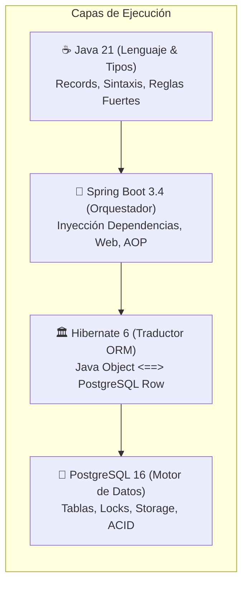
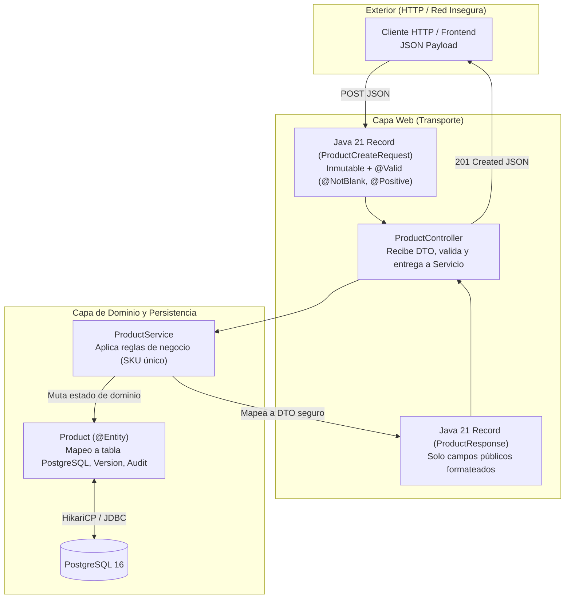

# 🧩 Módulo 1: Anatomía Básica y Persistencia (Desarmando el Misterio)

> **Módulo 1 de la Guía Maestra de Estudio de StockPilot**  
> **Propósito**: Comprender con precisión qué hace Java, Spring y Hibernate, cómo operan las anotaciones mediante Reflexión, y por qué se aísla la capa web de la base de datos.

---



### 1.1 ¿Qué es realmente Java frente a Spring y frente a Hibernate?
Para defender esta arquitectura, debes tener cristalina la frontera entre las tres tecnologías:

1. **Java (El Lenguaje de Programación y Tipos)**: Es la gramática, las palabras y las estructuras. Define que una clase tiene campos, que un `record` es inmutable, y que un `BigDecimal` maneja precisión monetaria exacta. Java no sabe qué es la web, no sabe qué es HTTP y no sabe qué es una base de datos relacional.
2. **Spring Boot (El Orquestador y Contenedor de Inversión de Control)**: Es el director de escena. Se encarga de levantar el servidor web embebido (Tomcat en el puerto 8080), escuchar las peticiones HTTP que llegan por la red, instanciar los controladores y servicios, e inyectar las dependencias (`Dependency Injection`) para que tú no tengas que hacer `new Service()` a mano.
3. **Hibernate / JPA (El Traductor Objeto-Relacional u ORM)**: JPA (*Jakarta Persistence API*) es la norma escrita en un papel (la especificación/interfaz). Hibernate es el motor real (la implementación). Hibernate toma un objeto en la memoria RAM de Java (como `new Product(...)`) y genera dinámicamente la sentencia SQL correspondiente (`INSERT INTO product...`) para enviarla por el cable de red a PostgreSQL, y viceversa: toma los bytes que devuelve PostgreSQL y los convierte en objetos Java.

---

### 1.2 ¿Qué es exactamente el símbolo `@` (Anotaciones de Java)?

#### Capa 1: La Intuición
Imagina que vas a enviar un paquete por encomienda. La caja contiene tu producto (el código Java). Pegado en la tapa de la caja, colocas un **Post-it adhesivo amarillo** que dice: *"FRÁGIL - MANTENER EN LUGAR FRESCO"*. El Post-it no hace que la caja se enfríe por sí misma; es una **etiqueta informativa** para que el operador logístico que la manipule tome medidas especiales.

#### Capa 2: La Mecánica Exacta (De la RAM al Disco)
Una anotación `@` no es código ejecutable. Si compilas una clase con `@Entity`, el procesador no ejecuta ninguna instrucción extra al momento de instanciarla.
Lo que ocurre en la RAM es lo siguiente:
1. El compilador de Java (`javac`) almacena el nombre y parámetros de la anotación dentro del archivo `.class` como **metadatos de bytecode**.
2. Cuando Spring Boot o Hibernate arrancan, utilizan **Reflection (Reflexión)** para escanear las clases en memoria (`Class.forName("com.stockpilot.catalog.domain.Product")`).
3. Hibernate llama a `clazz.isAnnotationPresent(Entity.class)`. Si devuelve `true`, Hibernate crea un modelo interno en memoria llamado `PersistentClass` y registra esa clase en su catálogo de mapeo relacional.
4. Si nadie lee la anotación mediante Reflexión, la anotación es simplemente texto inerte.

#### Capa 3: La Respuesta de Solutions Architect
> *"Las anotaciones en Java no contienen lógica de control de flujo imperativa; son metadatos declarativos procesados en tiempo de arranque mediante el API de Reflexión. En StockPilot las utilizamos para desacoplar el modelo de dominio de las librerías externas: la clase declara su intención semántica (ej. `@Entity`, `@Table`) y el framework construye proxies dinámicos y metamodelos relacionales sin que el código de negocio dependa directamente de sentencias SQL manuales."*

---

### 1.3 El Ciclo de Vida de Persistencia y el Costo Oculto del ORM

#### ¿Por qué no usamos SQL manual tipo `INSERT INTO` en Java?
Escribir consultas SQL a mano mediante JDBC clásico (`PreparedStatement`, `ResultSet.getString("name")`) obliga a escribir cientos de líneas repetitivas propensas a errores tipográficos y desalineaciones de tipos. Hibernate automatiza la hidratación de objetos (convertir filas de BD en grafos de objetos Java).

#### ¿Cuál es el costo oculto de usar un ORM (Trade-off)?
* **Dirty Checking (Verificación Sucia)**: Cada vez que lees una entidad en una transacción abierta, Hibernate guarda en la RAM una copia idéntica (*snapshot*). Al hacer `commit`, compara campo por campo el objeto actual con el snapshot para decidir si envía un `UPDATE`. Esto consume memoria Heap y ciclos de CPU.
* **El Problema de Consulta N+1**: Si cargas 20 productos y cada producto tiene una categoría en modo perezoso (*Lazy*), al intentar leer el nombre de la categoría en un bucle, Hibernate ejecutará 1 consulta para los productos + 20 consultas adicionales para las categorías (21 consultas a la base de datos en total).  
  *Cómo lo mitigamos*: En StockPilot utilizamos **`JOIN FETCH`** en `ProductRepository`, obligando a la base de datos a hacer un solo `INNER JOIN` en una única consulta SQL.

---

### 1.4 La Separación Sagrada: Entidad JPA (`@Entity`) vs. DTO (`record`)



#### ¿Por qué exponer una entidad `@Entity` en un Controller es considerado una mala práctica grave?
1. **Fuga de Abstracción de Base de Datos**: Expone nombres de columnas internas, claves foráneas y estructuras relacionales directamente en contratos públicos de la API.
2. **Vulnerabilidad de Asignación Masiva (Mass Assignment / Over-posting)**: Si expones la entidad y usas enlace automático de datos de Spring, un cliente malicioso puede enviar un JSON con `{"id": 1, "version": 999, "active": false}` y Spring inyectará esos valores en la entidad, permitiendo alterar campos críticos sin autorización.
3. **Serialización Cíclica y Fallos de Jackson**: Si la entidad tiene relaciones `@ManyToOne` o `@OneToMany`, Jackson (el serializador JSON) intentará serializar el hijo, luego el hijo al padre, luego el padre al hijo, causando un desbordamiento de pila fatal (`StackOverflowError`) o una excepción de carga perezosa (`LazyInitializationException`) al ejecutarse fuera de la transacción.
4. **Solución en StockPilot**: Las entidades son confinadas en la capa de persistencia y dominio. Toda entrada y salida hacia la red es un **Java 21 `record` inmutable**, donde cada campo está explícitamente seleccionado y validado con `jakarta.validation`.

---

### 1.5 Desglose de Anotaciones de Persistencia (Sistema de 3 Capas)

#### A. `@Entity` y `@Table(name = "product")`
* **Capa 1 (Intuición)**: Es una tarjeta de registro de nacimiento. Le dice al sistema: *"Cada vez que veas un objeto de este tipo, trátalo como un habitante registrado de la ciudad; no es un objeto cualquiera de la memoria, tiene una casa propia en la base de datos llamada 'product'"*.
* **Capa 2 (Mecánica)**:
  * *Spring/Hibernate*: Al escanear el classpath, Hibernate reconoce la clase y construye un objeto `EntityBinding`. Valida contra la base de datos que la tabla `product` exista (gracias a `spring.jpa.hibernate.ddl-auto: validate`).
  * *Red/PostgreSQL*: En cada consulta, Hibernate traduce cualquier instrucción HQL/JPQL (`SELECT p FROM Product p`) a SQL nativo apuntando a la tabla declarada: `SELECT p.id, p.sku FROM product p`.
* **Capa 3 (Solución Architect)**:
  * *Entrevista*: *"Utilizamos `@Entity` para definir clases de dominio ricas mapeadas al estándar relacional JPA, y desacoplamos el nombre de la clase en Java del esquema relacional mediante `@Table(name = "...")` para aislar el modelo de posibles divergencias de nomenclatura en base de datos."*

#### B. `@Id` y `@GeneratedValue(strategy = GenerationType.IDENTITY)`
* **Capa 1 (Intuición)**: El número de cédula de identidad o pasaporte emitido por el Registro Civil. El ciudadano no inventa su propio número de carnet al nacer; el Estado se lo asigna correlativamente en ventanilla.
* **Capa 2 (Mecánica)**:
  * *Hibernate*: Sabe que este campo es la clave primaria (PK). `GenerationType.IDENTITY` le advierte a Hibernate que **no puede saber el ID del objeto antes de insertarlo**, por lo que se ve obligado a ejecutar inmediatamente la sentencia SQL `INSERT INTO product (...) VALUES (...) RETURNING id;`.
  * *PostgreSQL*: Al recibir el `INSERT`, el motor de base de datos lee su objeto secuencia interno creado por la columna `GENERATED BY DEFAULT AS IDENTITY`, incrementa el número atómicamente y lo almacena en la página de disco de la tabla.
* **Capa 3 (Solución Architect)**:
  * *Trade-off*: *"Elegimos `IDENTITY` nativo de PostgreSQL en lugar de secuencias preasignadas en memoria (`SEQUENCE` con pooling de IDs) porque garantiza total compatibilidad con scripts de migración externos de Flyway y previene 'huecos' de secuencia en sistemas transaccionales directos."*

#### C. `@Column(name = "unit_price", precision = 12, scale = 2)`
* **Capa 1 (Intuición)**: Un casillero bancario de tamaño calibrado. Si intentas meter un billete doblado o monedas fuera de medida, el casillero no cierra.
* **Capa 2 (Mecánica)**:
  * *Java*: El campo se tipa como `BigDecimal`, impidiendo los errores de redondeo de coma flotante de `double` o `float` (ej. `0.1 + 0.2 = 0.30000000000000004`).
  * *Hibernate/PostgreSQL*: Hibernate valida que en PostgreSQL la columna sea de tipo `NUMERIC(12, 2)` (hasta 10 dígitos enteros y 2 decimales exactos). En el cable de red (protocolo binario PostgreSQL), el valor viaja codificado en base-10000 exacta sin pérdida de centavos.
* **Capa 3 (Solución Architect)**:
  * *Trade-off*: *"Bajo ninguna circunstancia se utilizan tipos primitivos de coma flotante IEEE 754 (`double`/`float`) para montos monetarios o inventario físico. `BigDecimal` combinado con `NUMERIC(12, 2)` a nivel DDL garantiza exactitud financiera absoluta."*

#### D. `@Version` (Optimistic Locking / Bloqueo Optimista)
* **Capa 1 (Intuición)**: Un sello de cera en una carta con un número estampado (ej. "Sello #3"). Dos personas leen la carta al mismo tiempo. Quien responde primero rompe el sello y deja la carta con el "Sello #4". Cuando la segunda persona intenta mandar su respuesta asumiendo que la carta estaba en el "Sello #3", el cartero la rechaza porque el número ya cambió.
* **Capa 2 (Mecánica)**:
  * *Java/Hibernate*: Cada vez que se lee un producto, se carga su campo `version` (ej. `0`). Cuando ejecutas `product.setName("Nuevo Nombre")` y finaliza la transacción, Hibernate emite exactamente el siguiente SQL:
    ```sql
    UPDATE product 
    SET name = 'Nuevo Nombre', version = 1, updated_at = now() 
    WHERE id = 10 AND version = 0;
    ```
  * *PostgreSQL*: Si otra transacción ya había modificado ese registro milisegundos antes, la fila en disco ya tiene `version = 1`. Por ende, el `WHERE id = 10 AND version = 0` no encuentra ninguna fila que actualizar (afecta 0 filas).
  * *Hibernate*: Al detectar que el `UPDATE` afectó 0 filas, lanza de inmediato una excepción **`OptimisticLockException`**, impidiendo que se sobreescriban cambios ajenos en silencio.
* **Capa 3 (Solución Architect)**:
  * *Entrevista*: *"Implementamos `@Version` en el agregado `Product` para metadatos del catálogo (nombres, especificaciones técnicas, precios base) porque en el catálogo la contención de escritura es baja: dos administradores rara vez editan el mismo producto al mismo segundo. El bloqueo optimista no requiere locks a nivel de base de datos, lo que maximiza la concurrencia de lectura."*

---

[⬅️ Módulo 0: Glosario](00-glosario-primeros-principios.md) | [Índice Principal](../MASTER_STUDY_GUIDE.md) | [Siguiente Módulo: Slice 1 ➡️](02-slice-1-catalogo-monolito-cicd.md)
