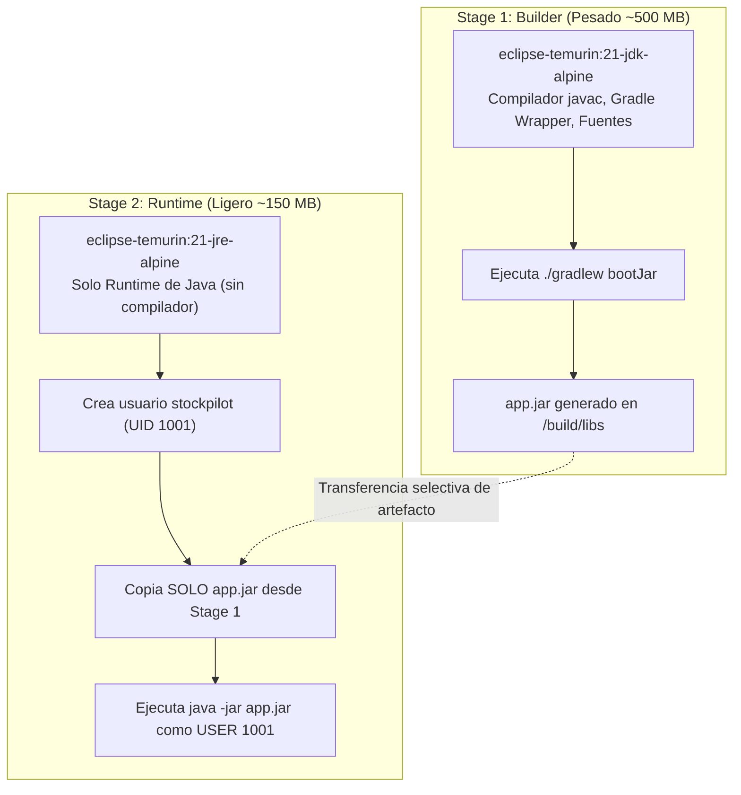

# 🏗️ Módulo 2: Slice 1 — Catálogo, Monolito y CI/CD

> **Módulo 2 de la Guía Maestra de Estudio de StockPilot**  
> **Propósito**: Comprender el ADR-0001 (Monolito Modular vs. Microservicios), las migraciones deterministas con Flyway y la seguridad en contenedores Docker multi-stage (usuario no-root, escaneo Trivy).

---

### 2.1 ADR-0001 (Monolito Modular vs. Microservicios)

#### ¿Qué es un Bounded Context en la práctica?
Es un término de *Domain-Driven Design (DDD)* que define los límites de significado de un modelo. Por ejemplo:
* En el módulo `catalog`, un producto es una entidad comercial con descripción, categoría y ficha técnica.
* En el módulo `inventory`, al sistema no le importa la ficha técnica ni el color; solo le importa el código SKU, la bodega y cuántas unidades físicas existen en estantería.
* Mantener paquetes separados (`com.stockpilot.catalog`, `com.stockpilot.inventory`, `com.stockpilot.ordering`, `com.stockpilot.audit`) permite que cada contexto evolucione de forma independiente sin contaminar el código ajeno.

#### ¿Por qué los microservicios prematuros matan a una empresa antes de tiempo?
* **Transacciones Distribuidas**: Si separas `ordering` e `inventory` en dos microservicios con dos bases de datos distintas conectadas por red, no puedes usar una transacción ACID. Si la reserva de stock falla después de haber creado el pedido, tienes que implementar el patrón Saga (mensajería asíncrona, eventos compensatorios, colas de reintento).
* **Latencia de Red y Fallos Parciales**: Una llamada interna en memoria tarda menos de 1 microsegundo ($0.001 \text{ ms}$). Una llamada HTTP entre dos contenedores tarda entre 5 y 30 milisegundos, y la red puede fallar en cualquier momento (*fallacies of distributed computing*).
* **Decisión en StockPilot**: Un **Monolito Modular** mantiene la separación limpia de dominios dentro de un solo proceso, permitiendo transacciones ACID locales ultrarrápidas (< 10 ms), con la posibilidad de extraer cualquier módulo a un microservicio en el futuro si la escala del equipo lo requiriera.

---

### 2.2 Flyway y Versionado de Base de Datos

#### ¿Por qué no dejamos que Hibernate cree las tablas automáticamente (`ddl-auto=update`) en producción?
* `ddl-auto=update` es una funcionalidad para prototipos rápidos. En producción es destructivo:
  1. Si renombras un campo en Java, Hibernate no renombra la columna en la BD; crea una columna nueva y deja la antigua huérfana con datos desincronizados.
  2. No tiene trazabilidad histórica: es imposible saber quién aplicó qué cambio o recrear la base de datos exactamente como estaba hace 3 meses.
  3. No puede generar índices condicionales avanzados ni columnas generadas en PostgreSQL como `GENERATED ALWAYS AS ... STORED`.
* **Solución en StockPilot**: `ddl-auto: validate` (Hibernate solo verifica que la estructura coincida) y **Flyway** gestiona scripts SQL versionados (`V1__...`, `V2__...`). Todo cambio de esquema está en el control de versiones de Git y es auditable.

---

### 2.3 Pipeline CI/CD, Docker Multi-Stage y Seguridad en Contenedores

#### ¿Qué hace exactamente el Dockerfile Multi-Stage?

1. **Stage 1 (Builder)**: Utiliza una imagen con el JDK completo (compilador `javac`, librerías de compilación). Descarga dependencias y construye el archivo ejecutable `app.jar`.
2. **Stage 2 (Runtime)**: Descarta por completo el Stage 1 (código fuente, caché de Gradle y compiladores desaparecen). Inicia desde una imagen limpia con solo el JRE (mínimo ejecutable de Java). Copia únicamente el archivo `app.jar`.
3. **Beneficio**: Reduce la superficie de ataque y el tamaño de la imagen Docker de ~700 MB a menos de ~200 MB.

#### ¿Por qué el contenedor se corre con usuario `non-root (USER 1001)`?
Si un atacante logra explotar una vulnerabilidad en una librería de Java (como un *Remote Code Execution* tipo Log4Shell) y el contenedor corre como `root` (usuario administrador por defecto en Docker), el atacante tiene privilegios de superusuario dentro del contenedor, facilitando técnicas de escape hacia el sistema operativo host. Al correr como `USER 1001` sin privilegios de sudo, cualquier intento de escribir en el sistema de archivos del sistema o acceder a dispositivos del kernel es bloqueado por el kernel de Linux.

#### ¿Qué busca Trivy al escanear?
Trivy es un escáner estático de vulnerabilidades para contenedores y sistemas de archivos. Cruza las dependencias de Gradle (`build.gradle.kts`) y los paquetes del sistema operativo Alpine contra bases de datos públicas de vulnerabilidades (CVE - *Common Vulnerabilities and Exposures*). Si una librería de terceros tiene un fallo de seguridad crítico documentado, Trivy hace que el pipeline de GitHub Actions aborte la compilación con código de salida `exit-code: 1`.

---

[⬅️ Módulo 1: Anatomía Básica](01-anatomia-basica-persistencia.md) | [Índice Principal](../MASTER_STUDY_GUIDE.md) | [Siguiente Módulo: Slice 2 ➡️](03-slice-2-concurrencia-bodegas-ledger.md)
