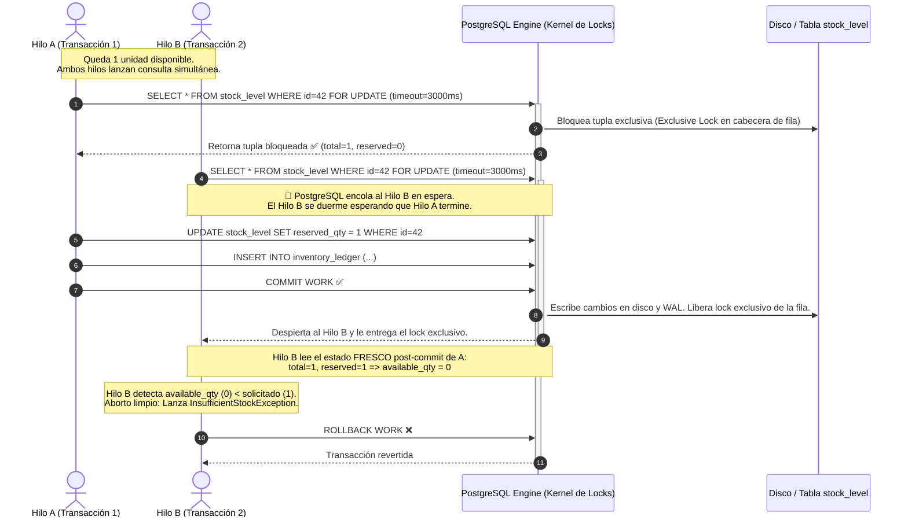

# ⚡ Módulo 3: Slice 2 — Concurrencia, Bodegas y Ledger Inmutable

> **Módulo 3 de la Guía Maestra de Estudio de StockPilot**  
> **Propósito**: Dominar el cálculo nativo de inventario con PostgreSQL 16 `available_qty STORED`, la erradicación de sobreventas con `SELECT ... FOR UPDATE` (ADR-0002) y la inmutabilidad regulatoria del `InventoryLedger` (ADR-0006).

---

### 3.1 PostgreSQL 16 y Columnas Generadas (`available_qty STORED`)

#### ¿Por qué delegar una resta matemática a la base de datos en lugar de hacer `total - reserved` en Java?
* **El Problema del Drift (Desincronización)**: Si la lógica de disponibilidad vive en Java, cualquier administrador que ejecute un script SQL directo para ajustar el inventario físico, o cualquier consulta externa de BI (Business Intelligence), vería datos inconsistentes si no se recalcula manualmente en cada query.
* **Indexabilidad Inmediata**: Al definir la columna como `STORED`, PostgreSQL calcula el resultado al momento de insertar o actualizar y **lo almacena físicamente en el bloque de disco de la tabla**. Esto permite crear índices B-Tree estándar:
  ```sql
  CREATE INDEX idx_stock_level_available ON stock_level (warehouse_id, available_qty) WHERE available_qty > 0;
  ```
  La consulta para ver qué productos tienen stock libre en una bodega tarda **0.1 milisegundos**, ejecutando un *Index Scan* directo en disco sin calcular restas en la CPU para millones de filas.

#### Desglose Técnico en Hibernate:
```java
@Generated(event = {EventType.INSERT, EventType.UPDATE})
@Column(name = "available_qty", insertable = false, updatable = false)
private Integer availableQty;
```
* **`insertable = false, updatable = false`**: Le indica a Hibernate: *"Cuando generes las sentencias `INSERT INTO stock_level (...)` o `UPDATE stock_level SET ...`, NUNCA incluyas la columna `available_qty` en el SQL"*. Si Hibernate intentara incluirla, PostgreSQL arrojaría un error fatal porque una columna `GENERATED ALWAYS` rechaza cualquier valor externo.
* **`@Generated`**: Le indica a Hibernate: *"Inmediatamente después de que hagas un INSERT o UPDATE sobre esta entidad, ejecuta internamente un `RETURNING available_qty` para refrescar el atributo en la memoria RAM de Java con el valor exacto que la base de datos acaba de calcular"*.

---

### 3.2 ADR-0002: Mitigación de Sobreventa mediante Bloqueo Pesimista (`SELECT ... FOR UPDATE`)

#### ¿Qué es una Condición de Carrera (Race Condition)? — Simulación al Milisegundo
Imagina que queda **1 sola unidad** del SKU `PLC-SIEM-S71500` en la bodega `WH-SCL-CENTRAL`. Dos clientes corporativos (Comprador A y Comprador B) presionan "Confirmar Pedido" exactamente en el mismo instante.

```
TIEMPO (ms)   HILO A (Comprador A)                    HILO B (Comprador B)                    BASE DE DATOS (stock_level)
-------------------------------------------------------------------------------------------------------------------------
t=0           Lee: total=1, reserved=0 (disp=1)       --                                      Fila libre (available=1)
t=1           --                                      Lee: total=1, reserved=0 (disp=1)       Fila libre (available=1)
t=2           Calcula en Java: 1 >= 1 (OK)            Calcula en Java: 1 >= 1 (OK)            --
t=3           UPDATE reserved_qty = 1                 --                                      reserved=1, available=0
t=4           --                                      UPDATE reserved_qty = 2                 reserved=2, available=-1 💥
```
**Resultado Catastrófico**: Se reservaron 2 unidades habiendo solo 1 física en almacén. **Sobreventa consumada (Overselling)**.

---

#### ¿Cómo lo soluciona `SELECT ... FOR UPDATE` a nivel de PostgreSQL?



#### ¿Por qué configuramos un timeout estricto de 3000 ms (`jakarta.persistence.lock.timeout`)?
Si una transacción adquiere un lock pesimista sobre un producto y por alguna anomalía (ej. lentitud de red o un proceso colgado) tarda más de la cuenta, todos los hilos que intenten reservar ese mismo producto se quedarán congelados esperando. Si se acumulan 20 hilos esperando indefinidamente, **agotan el pool de conexiones HikariCP** y tiran abajo el servidor completo. Con el timeout de 3000 ms, si en 3 segundos no se obtiene el lock, PostgreSQL aborta la espera y Spring lanza `PessimisticLockingFailureException`, la cual nuestro `GlobalExceptionHandler` captura y responde limpiamente al cliente con **`503 Service Unavailable`**, manteniendo el resto de la plataforma en pie.

#### ¿Qué es un Deadlock (Interbloqueo) y cómo se previene?
Un Deadlock ocurre cuando dos transacciones intentan bloquear múltiples recursos en orden inverso:
* Transacción 1: Bloquea el SKU A y luego intenta bloquear el SKU B.
* Transacción 2: Bloquea el SKU B y luego intenta bloquear el SKU A.
* **Resultado**: Ambas transacciones se quedan esperando mutuamente por siempre hasta que PostgreSQL detecta el ciclo y mata una de ellas forzosamente (`DeadlockException`).
* **Prevención en StockPilot**: **Ordenamiento determinista**. En Slice 3, cuando una orden reserve múltiples SKUs, la consulta siempre ordenará los bloqueos lexicográficamente:
  ```sql
  ORDER BY product_id ASC, warehouse_id ASC
  ```
  Al respetarse siempre este orden, es matemáticamente imposible que dos transacciones generen un ciclo cerrado de espera (se rompe la condición de espera circular de Coffman).

---

### 3.3 ADR-0006 e Inmutabilidad del Libro Mayor (`InventoryLedger`)

#### ¿Qué hace `@Immutable` a nivel de Hibernate?
```java
@Entity
@Table(name = "inventory_ledger")
@org.hibernate.annotations.Immutable
public class InventoryLedger { ... }
```
1. **Desactivación de Dirty Checking**: Le ordena a Hibernate que no cree una copia snapshot de la entidad en memoria RAM al cargarla. Esto ahorra hasta un 50% de memoria Heap en consultas de auditoría masivas.
2. **Prohibición de UPDATE**: Si algún programador intenta invocar un método o ejecutar un `save()` modificando atributos de una entrada existente del ledger, Hibernate arroja una excepción en tiempo de ejecución (`HibernateException: Entity is immutable`) y se niega a generar cualquier sentencia `UPDATE`.

#### ¿Por qué la tabla no tiene columna `updated_at` ni métodos setters?
Porque un libro mayor de contabilidad física representa un **hecho inmutable en la línea del tiempo**. En contabilidad real, si te equivocaste en un asiento contable, no borras la hoja con típex ni la arrancas del libro; generas un **nuevo asiento contable compensatorio**.
* Si ingresaron 10 unidades por error, se emite un nuevo registro de tipo `ADJUSTMENT` con delta `-10` y el motivo `"Corrección por error de digitación"`.
* Ambas líneas quedan grabadas con su fecha, hora y operador responsable.

#### Relación con Normativas SOX / ISO 27001 y Modelo STRIDE
* **Normativas SOX (Sarbanes-Oxley Act)**: Exigen que los registros de inventario que respaldan los estados financieros de una empresa pública o corporación no puedan ser manipulados de forma opaca por administradores de sistemas.
* **ISO/IEC 27001 (Control A.12.4 - Registro y Supervisión)**: Los eventos de modificación de activos críticos deben ser inalterables y conservarse para auditoría forense.
* **Mitigación STRIDE**:
  * **Tampering (Manipulación)**: Es imposible alterar registros pasados a través del software.
  * **Repudiation (No Repudio)**: Cada fila almacena el usuario exacto (`performedBy`), el motivo formal (`reason`) y la marca temporal de base de datos (`clock_timestamp()`).

---

[⬅️ Módulo 2: Slice 1](02-slice-1-catalogo-monolito-cicd.md) | [Índice Principal](../MASTER_STUDY_GUIDE.md) | [Siguiente Módulo: Slice 3 ➡️](04-slice-3-pedidos-idempotencia-concurrencia.md)
