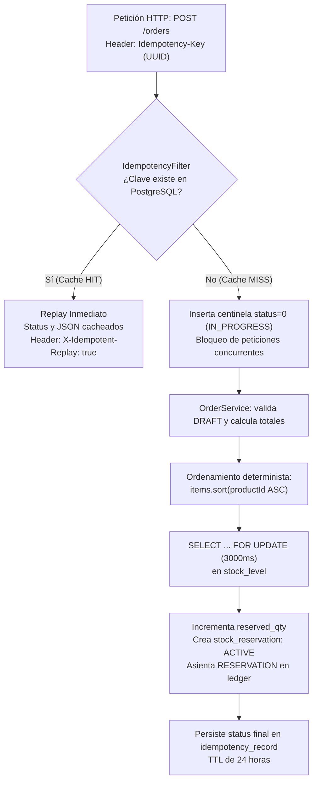

# ⚡ Módulo 4: Slice 3 — Motor de Pedidos, Idempotencia HTTP y Concurrencia Extrema

> **Módulo 4 de la Guía Maestra de Estudio de StockPilot**  
> **Propósito**: Comprender el flujo end-to-end de pedidos, idempotencia HTTP perimetral (`IdempotencyFilter`), prevención de deadlocks con ordenamiento lexicográfico, y testing de concurrencia extrema con 50 hilos.

---



---

### 4.1 Idempotencia HTTP y Filtros Servlet (`IdempotencyFilter` & `ContentCachingResponseWrapper`)

#### Capa 1: La Intuición / Analogía del Mundo Real
Imagina la ventanilla de recepción de encomiendas de una aduana internacional. Cuando entregas una caja, el funcionario estampa en el paquete un sello notarial con un código de barra único irrepetible (UUID v4). Si el camión de despacho sufre una avería en el camino y tú, presa de la impaciencia, vuelves al día siguiente al mostrador exigiendo respuesta con el mismo recibo en mano, el funcionario no te cobra un nuevo envío ni fabrica un segundo paquete idéntico; busca en su libro el código que ya tiene archivado, te entrega una copia exacta del recibo timbrado original y te dice: *"Aquí tiene su comprobante previo, su trámite ya fue procesado"*.

#### Capa 2: La Mecánica Exacta (De la RAM al Disco)
1. **Llegada y Validación Perimetral**: La petición HTTP (`POST /api/v1/orders` o `PUT /api/v1/orders/{id}/confirm`) entra a la JVM y es interceptada por `IdempotencyFilter`, el cual hereda de `OncePerRequestFilter`. El filtro busca la cabecera `Idempotency-Key`. Si no existe o no tiene formato de UUID v4 válido, aborta de inmediato con **HTTP 400 Bad Request** y un RFC 7807 `ProblemDetail`, sin gastar ciclos de CPU en controllers ni abrir transacciones JDBC.
2. **Detección de Concurrencia en Vuelo (*In-Flight Detection*)**: El filtro consulta la tabla `idempotency_record` en PostgreSQL por la clave UUID.
   - Si no existe: Inserta de inmediato una fila preliminar con `response_status = 0`, `response_body = 'IN_PROGRESS'` y `expires_at = now() + 24 hours`. Si dos peticiones idénticas llegan en el mismo nanosegundo, el índice `UNIQUE(idempotency_key)` de PostgreSQL hace que la segunda falle con `DataIntegrityViolationException`, retornando de inmediato **HTTP 409 Conflict** (*"A request with this Idempotency-Key is currently in progress"*), blindando al sistema contra carreras en la red.
3. **El Envoltorio de Memoria (`ContentCachingResponseWrapper`)**: En la arquitectura de Servlets tradicional, el flujo de respuesta HTTP (`ServletOutputStream`) se envía directamente por el socket TCP al cliente (*streaming*); una vez emitidos los bytes, no se pueden volver a leer en Java. Spring proporciona `ContentCachingResponseWrapper`, que intercepta la salida y copia cada byte JSON que el controlador escribe en un buffer interno en la memoria RAM (`ByteArrayOutputStream`).
4. **Persistencia Post-Ejecución**: Una vez que el `OrderController` retorna exitosamente (ej. HTTP 201 Created), el filtro toma el control de vuelta, extrae los bytes del buffer (`new String(wrappedResponse.getContentAsByteArray())`), actualiza la fila en PostgreSQL con el status real (`201`), el cuerpo JSON y persiste el registro. Finalmente, invoca `wrappedResponse.copyBodyToResponse()` para vaciar físicamente los bytes al cliente.
5. **Replay Inmediato (Cache HIT)**: Si el cliente reintenta la misma petición minutos después, el filtro encuentra la fila en PostgreSQL con `response_status > 0` y fecha válida. Escribe directamente el código HTTP y el cuerpo JSON en la respuesta, agrega la cabecera **`X-Idempotent-Replay: true`** y **cortocircuita la cadena de filtros**, retornando en menos de 1 milisegundo sin tocar controladores, sin consultar productos y sin bloquear stock.

#### Capa 3: La Respuesta de Nivel Solutions Architect
> *"En arquitecturas distribuidas y redes móviles corporativas rige el principio de entrega al menos una vez (At-Least-Once Delivery): los reintentos automáticos de clientes o proxys inversos (Nginx) ante caídas de conexión son inevitables. Para garantizar semántica de ejecución a lo sumo una vez (At-Most-Once Execution), implementamos un patrón de Idempotencia Perimetral a nivel de filtro Servlet respaldado por PostgreSQL.
>
> Descartamos Redis por dos factores de arquitectura: primero, para una plataforma B2B de suministros industriales con miles de órdenes diarias, PostgreSQL con un índice B-Tree sobre una columna UUID de 16 bytes resuelve la búsqueda en submilisegundos en almacenamiento NVMe, evitando introducir la sobrecarga operacional, costos de infraestructura y consistencia dual que acarrearía un cluster Redis. Segundo, al almacenar el código HTTP y el cuerpo de respuesta serializado con un TTL estricto de 24 horas, permitimos que clientes con redes degradadas reciban exactamente la misma respuesta original sin ejecutar una segunda transacción.
>
> Además, desacoplamos la registración del filtro mediante `FilterRegistrationBean` en `IdempotencyConfig.java` para proteger nuestros slice tests `@WebMvcTest`, impidiendo que las pruebas unitarias de capa web fallen por dependencias de persistencia JPA."*

---

### 4.2 Erradicación de Deadlocks por Ordenamiento Determinista (`productId ASC`)

#### Capa 1: La Intuición / Analogía del Mundo Real
Imagina un quirófano con dos cirujanos operando en mesas contiguas. Ambos necesitan simultáneamente dos instrumentos únicos: el bisturí (Instrumento 1) y el separador (Instrumento 2). Si el Cirujano A toma primero el bisturí y extiende la mano esperando el separador, mientras el Cirujano B toma el separador y espera el bisturí, ambos quedan congelados mirándose con las manos ocupadas: ninguno puede operar y ninguno soltará lo que ya tiene (interbloqueo mortal).
¿Cuál es la regla hospitalaria infalible que erradica este problema? La norma de protocolo: *"Todo cirujano que requiera múltiples instrumentos debe solicitar siempre primero el instrumento con el número de serie más bajo"*. Siguiendo esta regla, ambos intentarán tomar primero el bisturí (1). El que lo tome primero operará y luego tomará el separador (2); el segundo esperará con las manos vacías sin retener nada. Cero interbloqueos.

#### Capa 2: La Mecánica Exacta (De la RAM al Disco)
1. **Las 4 Condiciones de Edward G. Coffman (1971)**: En ciencias de la computación, un Deadlock sólo puede existir si se cumplen cuatro condiciones matemáticas de forma simultánea:
   - *Exclusión Mutua*: Los recursos no se comparten (bloqueo exclusivo `FOR UPDATE` sobre una fila).
   - *Retención y Espera*: Una transacción retiene un lock mientras solicita otro.
   - *No Expropiación*: La base de datos no puede quitarle un lock a una transacción activa a la fuerza sin matarla.
   - *Espera Circular*: Existe una cadena cerrada de transacciones donde $T_1$ espera a $T_2$ y $T_2$ espera a $T_1$.
2. **El Problema en PostgreSQL**: Cuando una orden B2B incluye el Producto 10 y el Producto 20, si la Orden A los bloquea en orden $[10 \rightarrow 20]$ y la Orden B en orden $[20 \rightarrow 10]$, en el kernel de PostgreSQL se genera un ciclo en el grafo de espera (*Wait-For Graph*). Tras cumplirse el parámetro `deadlock_timeout` (por defecto 1000 ms), el daemon detector de interbloqueos de PostgreSQL despierta, detecta el ciclo y ejecuta un `ABORT` forzoso sobre una de las transacciones arrojando `ERROR: 40P01: deadlock detected`.
3. **La Solución Algorítmica**: En `ReservationServiceImpl.java`, antes de iterar y solicitar los bloqueos a la base de datos, ordenamos la lista de ítems de forma ascendente:
   ```java
   List<ReservationItem> sortedItems = items.stream()
           .sorted(Comparator.comparing(ReservationItem::productId))
           .toList();
   ```
   Al imponer que toda transacción en el sistema operativo bloquee siempre en la dirección matemática estricta:
   $$\text{Lock}(P_1) \rightarrow \text{Lock}(P_2) \rightarrow \dots \rightarrow \text{Lock}(P_n) \quad \text{donde } P_1 < P_2 < \dots < P_n$$
   se **rompe matemáticamente la condición de Espera Circular de Coffman**. El grafo de dependencias de la base de datos se convierte en un **Grafo Acíclico Dirigido (DAG)**, haciendo que los deadlocks entre pedidos sean físicamente imposibles.

#### Capa 3: La Respuesta de Nivel Solutions Architect
> *"En sistemas de alta concurrencia transaccional, depender de la detección reactiva de deadlocks de la base de datos (`deadlock_timeout`) es un antipatrón costoso: desperdicia ciclos de CPU del motor corriendo algoritmos de detección de ciclos en grafos y produce cancelaciones aleatorias de transacciones que degradan la experiencia del usuario.
>
> En StockPilot implementamos prevención proactiva por diseño aplicando la ruptura de las condiciones de Coffman mediante ordenamiento determinista. Al forzar que todas las líneas de reserva se ordenen por `productId ASC` en la memoria de la JVM previo a la adquisición de bloqueos `PESSIMISTIC_WRITE`, transformamos cualquier contención concurrente en una cola ordenada FIFO a nivel de tupla en PostgreSQL. El costo computacional de ordenar 20 ítems en la JVM mediante TimSort es de fracciones de microsegundo, mientras que el beneficio es la eliminación total de excepciones `CannotAcquireLockException` en producción."*

---

### 4.3 Máquina de Estados de la Orden (`PurchaseOrder`) y Transaccionalidad ACID

#### Capa 1: La Intuición / Analogía del Mundo Real
Imagina un contrato de compraventa industrial. Mientras está en estado "Borrador" (`DRAFT`), puedes modificar los productos, cambiar cantidades o tirar el papel a la papelera sin consecuencias legales ni comerciales; el almacén no toca una sola caja. Cuando ambas partes firman formalmente el documento (`CONFIRMED`), en ese mismo segundo el almacén precinta las cajas en una jaula de seguridad exclusiva: esas unidades ya no existen para nadie más. Si la orden se anula (`CANCELLED`), los precintos se rompen y las cajas regresan al pasillo general. Pero si el camión ya cargó la mercadería y salió por la puerta del centro logístico (`FULFILLED`), el contrato está cerrado y el inventario rebajado: no puedes "cancelar" una orden que ya está en camino a una mina.

#### Capa 2: La Mecánica Exacta (De la RAM al Disco)
1. **La Máquina de Estados en el Dominio**: Las transiciones permitidas están codificadas en los métodos de negocio de la entidad `PurchaseOrder.java`:
   - `addLine()`: Permitido **únicamente** en `DRAFT`.
   - `confirm()`: Permitido **únicamente** desde `DRAFT`. Valida que existan líneas.
   - `cancel()`: Permitido desde `DRAFT` o `CONFIRMED`.
   - `fulfill()`: Permitido **únicamente** desde `CONFIRMED`.
   Cualquier intento de transición inválida (ej. llamar a `confirm()` sobre una orden `CANCELLED`) arroja `InvalidOrderStateException`, mapeada automáticamente a **HTTP 409 Conflict** en la capa API.
2. **Atomicidad Multi-Entidad en una Conexión JDBC**: Cuando el cliente invoca `PUT /api/v1/orders/{id}/confirm`, Spring abre una única transacción JDBC física (`@Transactional`):
   - Actualiza el estado de `PurchaseOrder` a `CONFIRMED`.
   - Llama a `ReservationService`, que adquiere bloqueos pesimistas ordenados en `stock_level`.
   - Incrementa `stock_level.reserved_qty`.
   - Inserta una fila en `stock_reservation` con estado `ACTIVE`.
   - Inserta un asiento de auditoría en `inventory_ledger` con tipo `RESERVATION` y el delta negativo correspondiente.
   - Si cualquiera de estas operaciones falla (por ejemplo, el tercer SKU no tiene stock suficiente y lanza `InsufficientStockException`), el interceptor transaccional de Spring ejecuta un **`ROLLBACK WORK` integral en PostgreSQL**. La base de datos revierte absolutamente todas las escrituras: la orden permanece en `DRAFT`, los dos primeros SKUs liberan sus locks y el ledger queda limpio.
3. **Snapshot de Precios Inmutable**: En B2B, los precios del catálogo fluctúan por inflación y tipo de cambio. Al crear una línea en `DRAFT`, `OrderLine` toma un snapshot inmutable de `product.getUnitPrice()`. La columna `line_total` es calculada directamente por PostgreSQL (`GENERATED ALWAYS AS (quantity * unit_price) STORED`), garantizando exactitud contable inalterable ante futuros cambios en el catálogo.

#### Capa 3: La Respuesta de Nivel Solutions Architect
> *"Frente a la tendencia común de desacoplar pedidos e inventario en dos microservicios separados mediante patrones de consistencia eventual (como Sagas orquestadas o coreografiadas), en StockPilot aplicamos el principio de Consistencia Local Fuerte.
>
> Al albergar ambos módulos dentro del mismo monolito modular y compartir el esquema de PostgreSQL, la confirmación de la orden y la reserva física de stock se ejecutan dentro de una única transacción ACID local. Obtenemos tiempos de respuesta de menos de 10 milisegundos, eliminamos la necesidad de colas de mensajería asíncronas para compensaciones de fallo y garantizamos a los clientes corporativos certeza inmediata sobre su disponibilidad."*

---

### 4.4 Demostración Empírica de Cero Sobreventa (`CountDownLatch` y 50 Hilos)

#### Capa 1: La Intuición / Analogía del Mundo Real
Imagina una carrera de 100 metros planos en los Juegos Olímpicos. Hay 50 velocistas colocados en sus tacos de salida con el corazón latiendo a 180 pulsaciones. Todos tienen los ojos fijos en la pistola de largada del juez árbitro. Mientras el juez no dispare (`await`), ningún atleta puede moverse un milímetro. En el instante exacto en que suena el disparo (`countDown`), los 50 velocistas salen eyectados al mismo microsegundo corriendo hacia la meta donde sólo hay una medalla de oro.

#### Capa 2: La Mecánica Exacta (De la RAM al Disco)
1. **La Hipótesis Científica**: Si dos o más hilos pueden reservar stock en paralelo sin el bloqueo adecuado, la columna `reserved_qty` terminará con un valor mayor a `total_qty` o se producirán dos reservas activas para una sola unidad física disponible.
2. **El Entorno Experimental**: Un contenedor real de PostgreSQL 16 levantado mediante Testcontainers en Docker, con una bodega que tiene **exactamente 1 unidad** de stock físico (`total_qty = 1, reserved_qty = 0, available_qty = 1`). Se crean 50 órdenes independientes en estado `DRAFT`.
3. **El Disparador de Largada (`CountDownLatch`)**:
   ```java
   ExecutorService executor = Executors.newFixedThreadPool(50);
   CountDownLatch startGun = new CountDownLatch(1);
   CountDownLatch finishLatch = new CountDownLatch(50);
   ```
   Se despachan 50 tareas al executor. Cada hilo entra y ejecuta `startGun.await()`. La JVM coloca a los 50 hilos en estado `WAITING`, suspendiendo su ejecución en el kernel del sistema operativo sin consumir CPU.
4. **El Disparo Simultáneo**: La hebra principal ejecuta `startGun.countDown()`. El cerrojo se abre y la JVM despierta a los 50 hilos simultáneamente.
5. **La Contención en el Motor Relacional**: Los 50 hilos solicitan conexiones a HikariCP y disparan al mismo microsegundo la consulta:
   ```sql
   SELECT * FROM stock_level WHERE product_id = 1 AND warehouse_id = 1 FOR UPDATE;
   ```
   PostgreSQL otorga el bloqueo exclusivo a la primera transacción que ganó la contención a nivel de kernel. Esa transacción verifica `available_qty = 1 >= 1`, incrementa `reserved_qty = 1`, asienta en el ledger y ejecuta `COMMIT`.
6. **Rechazo en Cascada sin Retry Storms**: Los 49 hilos restantes, que estaban esperando en la cola FIFO de PostgreSQL, despiertan uno a uno. Leen la fila fresca post-commit con `available_qty = 0`, detectan que no hay disponibilidad, lanzan de inmediato `InsufficientStockException`, ejecutan `ROLLBACK` y liberan su conexión.
7. **Aserción Científica de Cero Sobreventa**:
   - `successCounter.get() == 1` (exactamente 1 orden transiciona a `CONFIRMED`).
   - `conflictCounter.get() == 49` (exactamente 49 órdenes reciben `InsufficientStockException` y permanecen en `DRAFT`).
   - `stockLevel.total_qty == 1, stockLevel.reserved_qty == 1, stockLevel.available_qty == 0`.
   - **Invariante Matemática Demostrada**: Cero sobreventa bajo máxima presión de concurrencia.

#### Capa 3: La Respuesta de Nivel Solutions Architect
> *"En sistemas de misión crítica, la concurrencia no se asume en papel: se demuestra científicamente mediante pruebas de carga multi-hilo deterministas. Diseñé un harness de prueba de estrés en Java 21 utilizando `CountDownLatch` y Testcontainers con PostgreSQL 16 real. Al usar un latch de cuenta regresiva como barrera de sincronización, logramos que 50 hilos ataquen el pool HikariCP en el mismo nanosegundo compitiendo por una sola unidad física disponible.
>
> La prueba valida de extremo a extremo que el bloqueo pesimista `SELECT ... FOR UPDATE` serializa adecuadamente las peticiones en el motor de base de datos, logrando exactamente 1 éxito y 49 rechazos limpios por `InsufficientStockException`, con cero inconsistencias en el ledger de auditoría y cero sobreventa. Este test corre en nuestro pipeline de CI/CD en GitHub Actions, garantizando que ninguna regresión de concurrencia pueda llegar a producción jamás."*

---

[⬅️ Módulo 3: Slice 2](03-slice-2-concurrencia-bodegas-ledger.md) | [Índice Principal](../MASTER_STUDY_GUIDE.md) | [Siguiente Módulo: Panorama Industrial ➡️](05-panorama-industrial-8-pilares.md)
