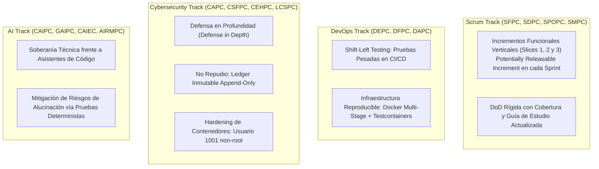

# 🎓 Módulo 6: Mapeo Curricular y Soberanía Académica (PUCV, Duoc UC y CertiProf)

> **Módulo 6 de la Guía Maestra de Estudio de StockPilot**  
> **Propósito**: Matriz de alineación curricular entre asignaturas universitarias formales (PUCV, Duoc UC), certificaciones internacionales (CertiProf) y el código fuente real de StockPilot. Bibliografía canónica obligatoria con capítulos y números de página exactos.

---

Para erradicar definitivamente la deuda cognitiva y el síndrome del impostor, es imperativo tender un puente explícito e indestructible entre las materias universitarias formales cursadas en la **Pontificia Universidad Católica de Valparaíso (PUCV)** y en **Duoc UC**, las certificaciones internacionales **CertiProf**, y los artefactos de código reales implementados en StockPilot. 

Cuando te sientes en una mesa técnica frente a un Senior Principal Architect o un tribunal evaluador, cada línea de código que escribiste en StockPilot debe ser defendida como la materialización práctica directa de un teorema, principio de ingeniería o norma internacional que estudiaste formalmente.

---

### 6.1 Matriz de Alineación: Asignaturas Universitarias vs. Código Real StockPilot

| Institución | Eje Académico / Asignatura | Conceptos Clave Formales | Componente / Implementación Exacta en StockPilot | Evidencia en el Código Fuente |
| :--- | :--- | :--- | :--- | :--- |
| **PUCV** | **Hardware y Sistemas Operativos** | Hilos de kernel vs. hilos de usuario, cambio de contexto (*context switching*), memoria virtual, paginación, exclusión mutua a nivel de procesador, instrucciones atómicas Compare-And-Swap (`CMPXCHG`). | `ReservationConcurrencyIntegrationTest` (pool de 50 hilos compitiendo simultáneamente); variables de control `AtomicInteger` sin cerrojos pesados; contención en el socket TCP de PostgreSQL. | `ReservationConcurrencyIntegrationTest.java` (uso de `CountDownLatch(50)` y `Executors.newFixedThreadPool(50)`). |
| **PUCV** | **Redes de Computadores** | Modelo OSI y TCP/IP, protocolo HTTP/1.1 (RFC 7231 / RFC 9110), semántica de métodos (seguridad e idempotencia de GET, PUT, DELETE vs. no-idempotencia de POST), cabeceras HTTP, sockets y pérdida de paquetes. | `IdempotencyFilter` (conversión de un `POST` no idempotente en una operación perimetralmente idempotente mediante cabecera `Idempotency-Key` UUID v4 y cabecera de repetición `X-Idempotent-Replay: true`). | `IdempotencyFilter.java` y `IdempotencyFilterTest.java`. |
| **PUCV** | **Bases de Datos & Taller de BD** | Álgebra relacional, formas normales (1FN a 3FN), aislamiento de transacciones ACID, control de concurrencia con Two-Phase Locking (2PL), bloqueo pesimista a nivel de tupla (*row-level locks*), índices B-Tree, columnas generadas y MVCC. | `V1__create_initial_schema.sql`, `V2__create_inventory_and_ledger.sql`, `V3__create_orders_and_idempotency.sql`; consulta pesimista `SELECT ... FOR UPDATE` en `StockLevelRepository`; columna generada `available_qty STORED`. | `StockLevelRepository.java` (`@Lock(LockModeType.PESSIMISTIC_WRITE)`). |
| **PUCV** | **Análisis y Diseño de Algoritmos** | Complejidad asintótica temporal y espacial ($O(N \log N)$, $O(1)$), ordenamiento determinista, grafos dirigidos acíclicos (DAGs) y prevención matemática de interbloqueos mediante ruptura de las condiciones de Coffman. | Ordenamiento determinista en memoria de la JVM de los identificadores de productos antes de solicitar bloqueos transaccionales (`items.sort(Comparator.comparing(ProductId))`), eliminando ciclos en el grafo de espera (*Wait-For Graph*). | `ReservationService.java` (línea de ordenamiento determinista previa a la iteración de reserva). |
| **PUCV** | **Ingeniería de Software & Modelamiento** | Patrones de arquitectura empresarial, Domain-Driven Design (DDD), separación de Bounded Contexts, Agregados, Entidades y Objetos de Valor (*Value Objects*), arquitectura limpia (*Clean Architecture*). | Separación modular de paquetes por contexto delimitado (`catalog`, `inventory`, `ordering`); diseño de `PurchaseOrder` como Raíz de Agregado (*Aggregate Root*) que encapsula sus `OrderLine` y protege sus invariantes. | `PurchaseOrder.java`, `OrderLine.java`, `Product.java`. |
| **PUCV** | **Ciberseguridad** | Modelo de amenazas STRIDE, principio de menor privilegio, ataques de repetición (*Replay Attacks*), inyección SQL, escaneo de vulnerabilidades en dependencias y análisis estático de seguridad (SAST). | Mitigación de Replay Attacks con `idempotency_record` e in-flight status (`status = 0`); Dockerfile multi-stage con usuario sin privilegios `non-root (1001)`; escaneo automático de vulnerabilidades CVE en el pipeline con Trivy. | `Dockerfile`, `.github/workflows/ci.yml`, `IdempotencyFilter.java`. |
| **Duoc UC** | **Desarrollo Orientado a Objetos I y II** | Encapsulamiento riguroso, inmutabilidad mediante Java Records, sobrecarga de constructores, herencia y polimorfismo, manejo estructurado de excepciones de negocio. | Clases de dominio inmutables como `Money`, `Sku`; records para DTOs de transporte (`ProductResponse`, `CreateOrderRequest`); jerarquía de excepciones de dominio (`InsufficientStockException`, `InvalidOrderStateException`). | `Money.java`, `ProductResponse.java`, `InsufficientStockException.java`. |
| **Duoc UC** | **Seguridad y Calidad en el Desarrollo** | Pirámide de pruebas automatizadas, pruebas unitarias aisladas con mocks, aserciones fluidas con AssertJ, verificación de contratos de API REST, manejo global de errores con RFC 7807 (`ProblemDetail`). | 50 pruebas automatizadas sin fallos (100% de éxito en `./gradlew check`); aislamiento web con `@WebMvcTest`; `GlobalExceptionHandler` capturando excepciones y mapeándolas a códigos HTTP semánticos (400, 404, 409). | `GlobalExceptionHandler.java`, `OrderControllerTest.java`. |
| **Duoc UC** | **Desarrollo Backend I, II y III** | Ecosistema Spring Boot 3, inyección de dependencias (IoC), configuración desacoplada con beans explícitos, Spring Data JPA, mapeo ORM con Hibernate 6 y gestión declarativa de transacciones con `@Transactional`. | Inyección por constructor en todos los servicios; desacoplamiento de configuración en `IdempotencyConfig` con `FilterRegistrationBean`; delimitación de fronteras transaccionales atómicas en `OrderService` y `ReservationService`. | `IdempotencyConfig.java`, `OrderService.java`, `ReservationService.java`. |
| **Duoc UC** | **Herramientas DevOps & Cloud Native** | Contenedores Docker, imágenes OCI reproducibles, compilación multi-etapa (*multi-stage build*), automatización de compilación con Gradle Wrapper, integración continua (CI) en GitHub Actions y contenedores de prueba con Testcontainers. | Pipeline en `.github/workflows/ci.yml` ejecutando linting, compilación, pruebas unitarias, pruebas de integración con PostgreSQL 16 real en Testcontainers y análisis de seguridad Trivy en cada push a `main`. | `.github/workflows/ci.yml`, `BaseIntegrationTest.java`. |

---

### 6.2 Vinculación con Certificaciones Internacionales CertiProf

Como profesional certificado por **CertiProf**, tus credenciales no son diplomas decorativos en un currículum: son directrices metodológicas que gobiernan cada decisión tomada en StockPilot:

1. **Línea Scrum (SFPC, SDPC, SPOPC, SMPC)**:
   - **Enfoque de Slices Verticales**: En lugar de construir la base de datos completa durante meses (enfoque en cascada), cada Slice (Slice 1 Catálogo, Slice 2 Inventario y Ledger, Slice 3 Pedidos e Idempotencia) constituye un **Incremento de Producto Potencialmente Desplegable (*Potentially Releasable Increment*)**.
   - **Definition of Done (DoD) Viviente**: Un Slice no se considera terminado hasta que cumple 100% de pruebas verdes, cero advertencias de compilador, documentación de arquitectura ADR y actualización obligatoria de esta Guía Maestra de Estudio.
2. **Línea DevOps (DEPC, DFPC, DAPC)**:
   - **Shift-Left Testing**: Las pruebas de estrés y de base de datos no se delegan a un equipo externo de QA al final del año; se ejecutan a la izquierda del ciclo de vida, en la máquina del desarrollador y en el runner de GitHub Actions con Testcontainers.
   - **Inmutabilidad y Trazabilidad del Software**: Cada imagen de Docker es inmutable, generada a partir de un hash de commit exacto, empaquetada con dependencias mínimas de ejecución (JRE de Eclipse Temurin) y sin herramientas innecesarias como compiladores o shells de depuración.
3. **Línea Ciberseguridad (CAPC, CSFPC, CEHPC, LCSPC)**:
   - **Defensa en Profundidad (*Defense-in-Depth*)**: La seguridad no depende únicamente del firewall perimetral. Cada capa valida sus contratos: el filtro de servlets sanitiza cabeceras maliciosas y claves inválidas; los DTOs aplican Bean Validation (`@Valid`); el dominio rechaza estados inconsistentes; y la base de datos aplica restricciones físicas `CHECK` y claves foráneas.
   - **Cumplimiento y No Repudio**: Implementación del modelo contable de partida doble en el `inventory_ledger` con autor, marca de tiempo y motivo, garantizando el principio de No Repudio frente a auditorías ISO 27001 o investigaciones forenses.
   - **Hardening de Contenedores**: El contenedor de producción corre bajo un usuario sin privilegios `USER 1001:1001` con sistema de archivos de solo lectura siempre que sea posible, mitigando ataques de escalada de privilegios y escape de contenedores (*container breakout*).
4. **Línea Inteligencia Artificial (CAIPC, GAIPC, CAIEC, AIRMPC)**:
   - **Mitigación del Riesgo de Alucinación y Soberanía Técnica**: La inteligencia artificial se utiliza exclusivamente como acelerador de pares (*Pair Programming*), pero la arquitectura, el diseño de invariantes y la comprensión profunda de cada instrucción residen exclusivamente en la mente del ingeniero.
   - **Gobernanza y Rigor Determinista**: Todo código asistido por IA es auditado contra libros canónicos de computación y validado empíricamente mediante pruebas de concurrencia multi-hilo donde ninguna alucinación puede sobrevivir a la ejecución de 50 hilos reales sobre el silicio del procesador.

---

### 6.3 Bibliografía Canónica y Lecturas Obligatorias por Asignatura

Para consolidar tu estudio honesto y libre de atajos en tu **Ventana Dorada de 90 minutos diarios**, esta es la lista oficial de textos canónicos de referencia mundial, indicando los capítulos y páginas exactas que fundamentan cada decisión técnica de StockPilot:

#### 1. Bases de Datos y Control de Concurrencia
* **Texto Canónico**: *Database System Concepts* (7th Edition, 2020) — Abraham Silberschatz, Henry F. Korth, S. Sudarshan (McGraw-Hill).
  * **Capítulo 14: Transactions** (Págs. 631–662):
    * Concepto formal de transacción, propiedades ACID (Atomicidad, Consistencia, Aislamiento, Durabilidad).
    * Estados de una transacción y serializabilidad por conflicto (*Conflict Serializability*).
  * **Capítulo 15: Concurrency Control** (Págs. 665–718):
    * **Sección 15.1: Lock-Based Protocols**: Protocolo de Bloqueo Bifásico (*Two-Phase Locking - 2PL*). Diferencia matemática entre Shared Locks (S) y Exclusive Locks (X).
    * **Sección 15.2: Deadlock Handling**: Algoritmos de prevención de Deadlocks (*Wait-Die* y *Wound-Wait*) y detección de ciclos en el grafo de espera (*Wait-For Graph*). Fundamento teórico del ordenamiento `productId ASC` usado en StockPilot.
    * **Sección 15.6: Multiple Granularity**: Bloqueos a nivel de base de datos, tabla, página y tupla (*row-level locks*).
  * **Capítulo 16: Recovery System** (Págs. 721–760):
    * Write-Ahead Logging (WAL), técnica de checkpoints y reconstrucción de estado tras fallos en disco.

* **Texto Complementario**: *Fundamentals of Database Systems* (7th Edition, 2016) — Ramez Elmasri, Shamkant B. Navathe (Pearson).
  * **Capítulo 20: Introduction to Transaction Processing Concepts and Theory** (Págs. 743–778).
  * **Capítulo 21: Concurrency Control Techniques** (Págs. 779–816): Comparación entre Locking, Timestamp Ordering y Multiversion Concurrency Control (MVCC) en motores modernos como PostgreSQL.

#### 2. Algoritmos, Grafos y Prevención de Interbloqueos
* **Texto Canónico**: *Introduction to Algorithms* (4th Edition, 2022) — Thomas H. Cormen, Charles E. Leiserson, Ronald L. Rivest, Clifford Stein (MIT Press - CLRS).
  * **Capítulo 22: Elementary Graph Algorithms** (Págs. 589–623):
    * **Sección 22.3: Depth-First Search (DFS)**: Clasificación de aristas (árbol, retroceso, avance, cruce).
    * **Sección 22.4: Topological Sort**: Demostración matemática de que un grafo dirigido tiene ordenamiento topológico si y solo si es un **Grafo Acíclico Dirigido (DAG)**. Este teorema es la demostración matemática formal de por qué ordenar recursos por clave evita los Deadlocks en bases de datos.

#### 3. Redes de Computadores y Protocolos de Aplicación
* **Texto Canónico**: *Computer Networking: A Top-Down Approach* (8th Edition, 2021) — James F. Kurose, Keith W. Ross (Pearson).
  * **Capítulo 2: Application Layer** (Págs. 85–188):
    * **Sección 2.2: The Web and HTTP**: Estructura de mensajes HTTP/1.1 y HTTP/2, métodos seguros vs. idempotentes, cabeceras de control de caché y semántica de códigos de estado RFC (200, 201, 400, 404, 409).
  * **Capítulo 3: Transport Layer** (Págs. 191–304):
    * **Sección 3.5: Connection-Oriented Transport: TCP**: Establecimiento de conexión (*Three-Way Handshake*), control de flujo con ventana deslizante, temporizadores de retransmisión ante pérdida de paquetes en la red, y por qué los clientes reintentan peticiones POST causando duplicación accidental.

#### 4. Arquitectura de Sistemas Distribuidos y Consistencia de Datos
* **Texto Canónico**: *Designing Data-Intensive Applications (DDIA)* (1st Edition, 2017) — Martin Kleppmann (O'Reilly Media).
  * **Capítulo 7: Transactions** (Págs. 221–272):
    * La verdad sobre ACID y los mitos de la industria.
    * Niveles de aislamiento débiles: *Read Committed*, *Snapshot Isolation*, fenómenos de anomalía de escritura (*Write Skew*, *Phantom Reads*, *Lost Updates*).
    * Comparación rigurosa entre Bloqueo Pesimista de dos fases (2PL) y Serializabilidad por Instantáneas (*Serializable Snapshot Isolation - SSI*).
  * **Capítulo 9: Consistency and Consensus** (Págs. 321–380):
    * Linealizabilidad vs. Serializabilidad, el problema del reloj monotónico vs. reloj de pared (NTP), y por qué los algoritmos de lock distribuido tipo Redlock fallan ante pausas de GC.
  * **Capítulo 11: Stream Processing** (Págs. 439–488):
    * Procesamiento de eventos en tiempo real, deduplicación e idempotencia a gran escala (*Exactly-Once Semantics*).

#### 5. Diseño Dirigido por el Dominio (DDD) y Arquitectura Limpia
* **Texto Canónico**: *Domain-Driven Design: Tackling Complexity in the Heart of Software* (2003) — Eric Evans (Addison-Wesley).
  * **Capítulo 5: A Model Expressed in Software** (Págs. 89–134):
    * Distinción fundamental entre **Entidades** (con identidad intrínseca mutable) y **Objetos de Valor (Value Objects)** (inmutables y definidos únicamente por sus atributos).
  * **Capítulo 6: The Life Cycle of a Domain Object** (Págs. 125–158):
    * **El Patrón Agregado (Aggregate Pattern)**: Reglas formales de diseño. La Raíz del Agregado (*Aggregate Root*) es la única entidad a la que el código exterior puede mantener referencias; los invariantes internos (como la consistencia de las líneas de una orden) deben ser aplicados exclusivamente por la raíz del agregado.

#### 6. Patrones de Diseño y Programación Concurrente en Java
* **Texto Canónico**: *Head First Design Patterns* (2nd Edition, 2020) — Eric Freeman, Elisabeth Robson (O'Reilly).
  * Patrón Intercepting Filter / Decorator: Fundamento conceptual del `OncePerRequestFilter` y `ContentCachingResponseWrapper`.
  * Patrón Strategy y Template Method: Usados en la jerarquía de validaciones y servicios de Spring.
* **Texto Canónico**: *Java Concurrency in Practice* (2006) — Brian Goetz, Tim Peierls, Joshua Bloch, Joseph Bowbeer, David Holmes, Doug Lea (Addison-Wesley).
  * **Capítulo 2: Thread Safety** (Págs. 15–34): Condiciones de carrera, operaciones atómicas y variables compuestas.
  * **Capítulo 3: Sharing Objects** (Págs. 35–54): Visibilidad de memoria, palabra clave `volatile`, publicación segura e inmutabilidad.
  * **Capítulo 5: Building Blocks** (Págs. 79–108): Sincronizadores avanzados de Java: `CountDownLatch`, `CyclicBarrier`, `Semaphore`.
  * **Capítulo 15: Nonblocking Synchronization and Atomic Variables** (Págs. 319–340): Instrucciones Compare-And-Swap (CAS) de hardware y clases atómicas del paquete `java.util.concurrent.atomic`.

---

[⬅️ Módulo 5: Panorama Industrial](05-panorama-industrial-8-pilares.md) | [Índice Principal](../MASTER_STUDY_GUIDE.md) | [Siguiente Módulo: Ciencia del Testing ➡️](07-ciencia-del-testing-sistemas-criticos.md)
