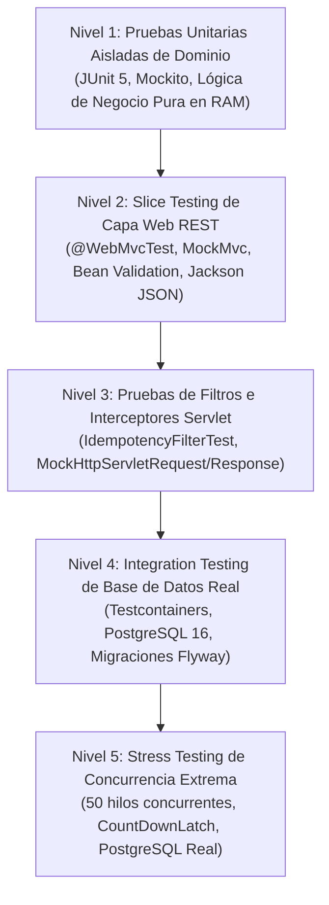

# 🔬 Módulo 7: La Ciencia del Testing en Sistemas de Misión Crítica

> **Módulo 7 de la Guía Maestra de Estudio de StockPilot**  
> **Propósito**: Desglose pedagógico profundo de los 5 niveles de testing implementados en StockPilot, y la mecánica de bajo nivel de primitivas de concurrencia: `CountDownLatch`, AQS, `ExecutorService`, `AtomicInteger` y la instrucción CPU `LOCK CMPXCHG`.

---

En sistemas financieros y transaccionales B2B, la calidad no es una aspiración filosófica ni un checklist burocrático: **es una demostración matemática y científica reproducible**. Si un sistema no puede demostrar su comportamiento correcto bajo condiciones de estrés destructivo, simplemente no está listo para producción.

En StockPilot hemos implementado una **Pirámide de Pruebas de 5 Niveles** que cubre desde la lógica de dominio pura en microsegundos hasta la contención física de 50 hilos en el kernel de Linux y el motor de base de datos relacional.



---

### 7.1 Los 5 Niveles de Testing Implementados en StockPilot

#### Nivel 1: Pruebas Unitarias Aisladas (`OrderServiceTest`, `ReservationServiceTest`)
* **Propósito**: Validar exclusivamente las ramas condicionales, máquinas de estado y reglas aritméticas del dominio en la memoria de la JVM, aislando completamente las dependencias de infraestructura (base de datos, red) mediante dobles de prueba (*mocks*).
* **Mecánica**:
  * Utiliza **JUnit 5** y **Mockito 5** (`@ExtendWith(MockitoExtension.class)`).
  * Las llamadas a repositorios JPA (`stockLevelRepository.findByProductIdAndWarehouseIdWithLock(...)`) se simulan con `when(...).thenReturn(...)` o `given(...).willReturn(...)`.
  * **Tiempo de ejecución**: < 10 milisegundos por prueba.
* **Lo que valida**:
  * Que una orden en estado `CONFIRMED` lance `InvalidOrderStateException` si alguien intenta agregarle una nueva línea.
  * Que el cálculo de totales de orden (`totalAmount = sum(line_total)`) sea exacto al centavo en `BigDecimal`.
  * Que si un producto no tiene existencias suficientes, se lance `InsufficientStockException` antes de intentar persistir en el ledger.

#### Nivel 2: Pruebas de Capa Web (*Slice Tests*) (`OrderControllerTest`, `ProductControllerIntegrationTest`)
* **Propósito**: Verificar los contratos de transporte HTTP: serialización/deserialización JSON con Jackson, validación perimetral de DTOs con Bean Validation (`@Valid`, `@NotNull`, `@Positive`), mapeo de rutas URL (`@PostMapping`, `@GetMapping`) y traducción de excepciones a códigos de estado HTTP semánticos (RFC 7807 `ProblemDetail`).
* **Mecánica**:
  * Utiliza **`@WebMvcTest(OrderController.class)`**.
  * **Aislamiento Arquitectónico**: `@WebMvcTest` es un *slice test* que deliberadamente apaga Hibernate, desactiva la conexión a bases de datos y no levanta el servidor Tomcat en un puerto de red real. En su lugar, utiliza **`MockMvc`**, que simula peticiones HTTP directamente contra el despachador de servlets de Spring (`DispatcherServlet`) en memoria RAM.
  * Los servicios de negocio se inyectan como `@MockBean OrderService`.
* **Lo que valida**:
  * Que enviar un JSON con `quantity: -5` retorne inmediatamente **HTTP 400 Bad Request** con un campo de error detallado, sin tocar la base de datos ni invocar el servicio.
  * Que si el servicio lanza `InsufficientStockException`, el `GlobalExceptionHandler` lo capture y emita un **HTTP 409 Conflict**.

#### Nivel 3: Pruebas de Filtros e Interceptores Servlet (`IdempotencyFilterTest`)
* **Propósito**: Probar la lógica perimetral de red antes de que las peticiones lleguen a los controladores de Spring: extracción de cabeceras obligatorias, control de claves en vuelo (*in-flight sentinels*), almacenamiento en caché de respuestas y repetición (*replay*) idempotente.
* **Mecánica**:
  * Utiliza mocks especializados de la API de Servlets de Jakarta: `MockHttpServletRequest`, `MockHttpServletResponse` y `MockFilterChain`.
  * El filtro envuelve la respuesta en `ContentCachingResponseWrapper`, ejecuta la cadena, intercepta el flujo de bytes JSON generado, persiste el registro en el repositorio simulado y verifica la presencia de la cabecera `X-Idempotent-Replay: true`.
* **Lo que valida**:
  * Petición sin cabecera `Idempotency-Key` -> aborto inmediato con HTTP 400 Bad Request.
  * Petición con clave no-UUID -> aborto inmediato con HTTP 400 Bad Request.
  * Petición concurrente con clave existente en status 0 (`IN_PROGRESS`) -> rechazo con HTTP 409 Conflict.
  * Petición repetida con clave ya completada -> retorno del JSON idéntico previo con HTTP 201 y cabecera `X-Idempotent-Replay: true` sin invocar la cadena de filtros hacia abajo.

#### Nivel 4: Pruebas de Integración con Base de Datos Real (`BaseIntegrationTest` + Testcontainers)
* **Propósito**: Demostrar que los esquemas relacionales, tipos de datos, restricciones de clave foránea, triggers, índices y migraciones SQL de Flyway funcionan a la perfección en un motor idéntico al de producción.
* **Mecánica**:
  * Utiliza **`@SpringBootTest(webEnvironment = RANDOM_PORT)`** y **`Testcontainers`** con la imagen oficial `postgres:16-alpine`.
  * Al arrancar el test, Docker levanta un contenedor real de PostgreSQL en un puerto efímero.
  * Flyway ejecuta todas las migraciones SQL (`V1`, `V2`, `V3`).
  * Spring Boot conecta HikariCP contra el contenedor real y ejecuta operaciones reales de base de datos.
* **Lo que valida**:
  * Que la columna calculada `available_qty STORED` de PostgreSQL 16 reste físicamente los valores en disco.
  * Que la tabla `inventory_ledger` impida comandos no autorizados y persista marcas de tiempo precisas con `clock_timestamp()`.
  * Que la transacción atómica `@Transactional` haga rollback físico completo si falla cualquier paso de una reserva multi-producto.

#### Nivel 5: Stress Testing de Concurrencia Extrema (`ReservationConcurrencyIntegrationTest`)
* **Propósito**: Demostrar empíricamente que bajo máxima contención física simultánea (50 hilos compitiendo por 1 sola unidad de stock), el sistema garantiza **Cero Sobreventa (*Zero Overselling*)** y **Cero Interbloqueos (*Zero Deadlocks*)**.
* **Mecánica**:
  * Combina `Testcontainers` (PostgreSQL 16 real) con primitivas de concurrencia de bajo nivel de Java: `CountDownLatch`, `ExecutorService` y `AtomicInteger`.
  * Los 50 hilos se alinean contra una barrera de sincronización y son liberados en el mismo milisegundo contra el pool de conexiones de HikariCP y las tuplas bloqueadas con `SELECT ... FOR UPDATE` de PostgreSQL.
* **Lo que valida**:
  * Exactamente 1 hilo logra la reserva (`status = ACTIVE`, orden `CONFIRMED`).
  * Exactamente 49 hilos reciben `InsufficientStockException` y revierten limpiamente sin corromper el saldo.
  * El stock final en disco es exactamente `total_qty = 1`, `reserved_qty = 1`, `available_qty = 0`.

---

### 7.2 Anatomía de Bajo Nivel de las Primitivas de Concurrencia de Java

Para comprender a fondo cómo el test de concurrencia extrema pone a prueba el procesador y el motor de datos, desglosamos las tres herramientas fundamentales desarrolladas por Doug Lea en el paquete `java.util.concurrent`:

#### 1. `CountDownLatch`: El Cerrojo de Cuenta Regresiva y el AQS
* **¿Qué es?**: Un sincronizador que permite a uno o más hilos esperar hasta que un conjunto de operaciones que se realizan en otros hilos se haya completado, o mantener a $N$ hilos detenidos hasta que se dé una señal de inicio simultánea.
* **Mecánica Interna de Bajo Nivel**:
  * `CountDownLatch` no utiliza cerrojos pesados del sistema operativo (`synchronized` o monitores de exclusión mutua de C++). Se fundamenta en el **`AbstractQueuedSynchronizer` (AQS)**.
  * El AQS mantiene una única variable entera volátil de 32 bits llamada `state`:
    ```java
    private volatile int state;
    ```
  * Cuando creamos `new CountDownLatch(1)`, el valor inicial de `state` es 1.
  * Cuando un hilo de trabajo ejecuta `startGun.await()`:
    1. El hilo verifica si `state == 0`.
    2. Como `state` es 1, el hilo no puede avanzar.
    3. El AQS empaqueta el hilo en un nodo de una cola enlazada bidireccional en memoria RAM (*Wait Queue* FIFO) y ejecuta `LockSupport.park()`.
    4. La llamada `LockSupport.park()` solicita al kernel del sistema operativo que coloque al hilo en estado **`WAITING`**. El sistema operativo retira al hilo de la CPU, liberando los núcleos del procesador. Cero ciclos de reloj desperdiciados en bucles de espera activa (*busy waiting*).
  * Cuando el hilo principal ejecuta `startGun.countDown()`:
    1. El AQS ejecuta una instrucción atómica Compare-And-Swap para decrementar `state` de 1 a 0.
    2. Al llegar a 0, el AQS recorre la cola enlazada e invoca `LockSupport.unpark(thread)` para cada uno de los 50 hilos.
    3. El planificador de hilos del kernel del sistema operativo (*Kernel Thread Scheduler*) marca los 50 hilos como **`RUNNABLE`** y los asigna simultáneamente a los núcleos físicos de la CPU.

#### 2. `ExecutorService` y Pools de Hilos (`Executors.newFixedThreadPool(50)`)
* **¿Qué es?**: Una piscina de hilos preasignados que gestiona el ciclo de vida de los hilos de ejecución en el sistema operativo.
* **Mecánica Interna de Bajo Nivel**:
  * En Java 21 tradicional (hilos de plataforma), cada instancia de `Thread` tiene una correspondencia de 1 a 1 con un **hilo del kernel del sistema operativo** (*Kernel-Level Thread - KLT*).
  * Crear un hilo nuevo en el sistema operativo es costoso: requiere reservar aproximadamente **1 MB de memoria física para el Call Stack** y realizar una llamada de sistema (*syscall* `clone()` en Linux o `CreateThread()` en Windows).
  * `newFixedThreadPool(50)` asigna por adelantado los 50 hilos del kernel y los mantiene vivos esperando tareas en una cola `LinkedBlockingQueue`. Cuando las 50 tareas de prueba se envían al executor, no hay latencia de inicialización de hilos: la ejecución sobre la CPU es instantánea.

#### 3. `AtomicInteger`: Operaciones Atómicas a Nivel de Silicio sin Bloqueos (*Lock-Free*)
* **El Problema de `volatile int count`**:
  * Muchos desarrolladores creen erróneamente que declarar `private volatile int count = 0;` hace que la operación `count++` sea segura en concurrencia (*thread-safe*). **Esto es falso.**
  * La palabra clave `volatile` solo garantiza **visibilidad de memoria** (que los cambios escritos por un núcleo de la CPU se sincronicen en la memoria caché L1/L2/L3 y RAM de los demás núcleos invalidando la línea de caché mediante el protocolo MESI).
  * Sin embargo, la operación `count++` no es atómica; consta de **3 instrucciones de máquina separadas**:
    1. `READ`: Leer el valor actual de la memoria al registro de la CPU (`mov eax, [count]`).
    2. `MODIFY`: Incrementar el registro en 1 (`add eax, 1`).
    3. `WRITE`: Escribir el nuevo valor de vuelta en la memoria (`mov [count], eax`).
  * Si dos hilos ejecutan estas tres instrucciones en paralelo, ambos leen 0, ambos incrementan a 1, y ambos escriben 1. Uno de los incrementos se pierde (*Lost Update*).
* **La Solución: `AtomicInteger` y la Instrucción de CPU `LOCK CMPXCHG`**:
  * `AtomicInteger` no usa exclusión mutua de software. Utiliza primitivas nativas del procesador a través de métodos intrínsecos de `Unsafe` / `VarHandle`.
  * La operación `incrementAndGet()` se ejecuta mediante un ciclo optimista libre de bloqueos (*Lock-Free CAS Loop*):
    ```java
    // Lógica conceptual del bucle Compare-And-Swap en Java
    public final int incrementAndGet() {
        int current;
        int next;
        do {
            current = get(); // Lee el valor actual con semántica volatile
            next = current + 1;
        } while (!compareAndSet(current, next)); // Intenta escribir atómicamente
        return next;
    }
    ```
  * En la arquitectura de microprocesadores x86-64 (Intel y AMD), `compareAndSet` se compila directamente en la instrucción de ensamblador:
    ```assembly
    LOCK CMPXCHG [memoria], registro
    ```
  * El prefijo **`LOCK`** a nivel de silicio activa el protocolo de arbitraje del bus de memoria del procesador (*Cache Line Locking*), asegurando que ningún otro núcleo de la CPU pueda leer ni modificar esa dirección de memoria exacta durante ese ciclo de reloj.
  * Si otro hilo modificó el valor en ese microsegundo, la instrucción falla, el ciclo `do-while` repite la lectura y reintenta.
  * **Resultado en StockPilot**: `successCounter.incrementAndGet()` y `conflictCounter.incrementAndGet()` contabilizan con precisión matemática cuántas transacciones triunfaron y cuántas fueron rechazadas por PostgreSQL, sin generar cuellos de botella en la JVM.

---

[⬅️ Módulo 6: Mapeo Curricular](06-mapeo-curricular-soberania-academica.md) | [Índice Principal](../MASTER_STUDY_GUIDE.md) | [Siguiente Módulo: Hoja de Ruta de Estudio ➡️](08-hoja-de-ruta-syllabus-estudio.md)
