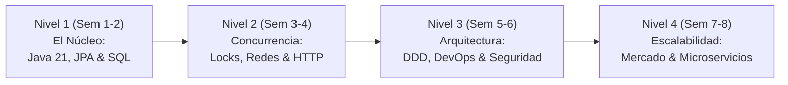
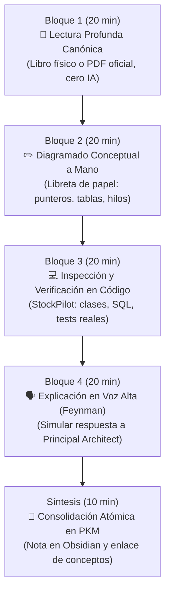

# 🗺️ Módulo 8: Hoja de Ruta de Estudio por Niveles de Madurez (Syllabus)

> **Módulo 8 de la Guía Maestra de Estudio de StockPilot**  
> **Propósito**: Cronograma de estudio estructurado de 8 semanas y protocolo activo de la Ventana Dorada (90 minutos diarios de 07:00 a 08:30 AM) para erradicar la deuda cognitiva y dominar los fundamentos.

---

Para transformar este conocimiento en una competencia técnica indeleble que erradique definitivamente la deuda cognitiva, se establece el siguiente **Syllabus de 8 Semanas**, diseñado específicamente para ejecutarse en tu **Ventana Dorada de 90 minutos diarios (07:00 a 08:30 AM)** con la disciplina del "Suelo Inviolable" de tu sistema personal.

---

### 8.1 Los 4 Niveles de Madurez Técnica (Semanas 1 a 8)

#### Nivel 1: El Núcleo de Software y Base de Datos Relacional (Semanas 1 y 2)
* **Objetivo de Dominio**: Desmitificar por completo la persistencia, las formas normales, las transacciones ACID y el costo oculto de los ORMs.
* **Temas a Dominar**:
  * Silberschatz: Cap. 14 (Transacciones ACID) y Cap. 16 (Write-Ahead Logging).
  * Mapeo objeto-relacional: Ciclo de vida de entidades JPA (`MANAGED`, `DETACHED`), dirty checking en RAM y el problema $N+1$.
  * PostgreSQL 16: Índices B-Tree, restricciones `CHECK`, claves foráneas con eliminación restringida y columnas generadas `STORED`.
* **Práctica en StockPilot**:
  * Analizar la clase `StockLevel.java` y `V2__create_inventory_and_ledger.sql`.
  * Escribir a mano en papel el flujo de un `INSERT` desde Java Heap hasta el archivo WAL de PostgreSQL en disco.
* **Criterio de Éxito**: Explicar sin titubear por qué `available_qty` se delega a PostgreSQL y qué significa `insertable = false, updatable = false` a nivel de bytecode y SQL.

#### Nivel 2: Concurrencia, Bloqueos y Protocolos de Red (Semanas 3 y 4)
* **Objetivo de Dominio**: Dominar las condiciones de carrera, la exclusión mutua a nivel de procesador y base de datos, y la semántica del protocolo HTTP.
* **Temas a Dominar**:
  * Silberschatz: Cap. 15 (Control de Concurrencia, Two-Phase Locking, Deadlock Handling).
  * Cormen (CLRS): Cap. 22 (Grafos Acíclicos Dirigidos y Ordenamiento Topológico).
  * Kurose & Ross: Cap. 2 (HTTP/1.1, métodos seguros e idempotentes) y Cap. 3 (TCP retransmisiones).
  * Goetz: *Java Concurrency in Practice* (Cap. 2, 3 y 15: `CountDownLatch`, `AtomicInteger`, `LOCK CMPXCHG`).
* **Práctica en StockPilot**:
  * Ejecutar y depurar paso a paso `ReservationConcurrencyIntegrationTest.java`.
  * Analizar la prevención matemática de Deadlocks mediante `productId ASC` en `ReservationService.java`.
  * Estudiar el ciclo de vida del centinela `status = 0` en `IdempotencyFilter.java`.
* **Criterio de Éxito**: Dibujar en la libreta el Grafo de Espera (*Wait-For Graph*) de dos transacciones cruzadas y demostrar matemáticamente por qué el ordenamiento ascendente elimina los ciclos.

#### Nivel 3: Arquitectura Empresarial, DevOps y Ciberseguridad (Semanas 5 y 6)
* **Objetivo de Dominio**: Dominar el diseño dirigido por el dominio (DDD), la construcción de monolitos modulares robustos, pipelines de entrega continua y modelos de ciberseguridad industrial.
* **Temas a Dominar**:
  * Eric Evans: *Domain-Driven Design* (Cap. 5 y 6: Entidades, Value Objects, Agregados y Raíces de Agregado).
  * CertiProf DevOps & Cybersecurity Tracks: Shift-Left Testing, hardening de contenedores OCI (`non-root 1001`), modelo STRIDE y normativas de no repudio (ISO 27001, SOX).
  * Martin Fowler: *Monolith First* y *Bounded Contexts*.
* **Práctica en StockPilot**:
  * Inspeccionar la separación de paquetes `catalog`, `inventory` y `ordering`.
  * Validar las reglas de agregación dentro de `PurchaseOrder.java` (prohibición de mutar líneas fuera de `DRAFT`).
  * Inspeccionar el Dockerfile multi-stage y el pipeline `.github/workflows/ci.yml`.
* **Criterio de Éxito**: Justificar con solvencia por qué StockPilot arrancó como Monolito Modular en lugar de microservicios distribuidos, y detallar cómo el Ledger Inmutable mitiga amenazas de manipulación (*Tampering*) y repudio (*Repudiation*).

#### Nivel 4: Herramientas del Mercado y Transición a Sistemas Distribuidos (Semanas 7 y 8)
* **Objetivo de Dominio**: Conocer a fondo las herramientas industriales del mercado (Redis, Kafka, Debezium, Liquibase, OpenTelemetry) y saber exactamente cuándo y cómo migrar hacia ellas.
* **Temas a Dominar**:
  * Kleppmann: *Designing Data-Intensive Applications* (Cap. 7 Transacciones Distribuidas y Cap. 11 Procesamiento de Flujos).
  * El patrón Transactional Outbox y Change Data Capture (CDC).
  * Algoritmo Redlock y sus limitaciones formales (Kleppmann vs. Antirez).
* **Práctica en StockPilot**:
  * Contrastar cada una de las 8 secciones del **Módulo 5 (Panorama Industrial)**.
  * Diseñar en papel el diagrama de migración futura: cómo se desacoplaría el módulo de `ordering` a un microservicio independiente publicando eventos de dominio en Apache Kafka mediante Debezium sin generar inconsistencias de inventario.
* **Criterio de Éxito**: Responder las preguntas de fuego del Simulador de Entrevista (Módulo 9) con soltura, rigor técnico y postura de Solutions Architect.

---

### 8.2 El Protocolo de la Ventana Dorada: 90 Minutos Diarios (07:00 a 08:30 AM)

Para garantizar un aprendizaje activo de alto rendimiento y cero desgaste improductivo, la sesión diaria de 90 minutos se subdivide en **4 bloques estructurados de 20 minutos + 10 minutos finales de síntesis**:

1. **Bloque 1 (20 min) — Lectura Profunda Canónica**:
   - Lectura exclusiva en el libro oficial de la materia (Silberschatz, Elmasri, CLRS, Kurose o Kleppmann).
   - **Regla Inviolable**: Cero atajos de IA. Cero resúmenes prefabricados. Lectura de las fuentes primarias de computación.
2. **Bloque 2 (20 min) — Diagramado Conceptual a Mano**:
   - Con lápiz y papel en tu libreta de apuntes, dibuja el flujo físico: la memoria RAM, los registros del procesador, los buffers de socket TCP, o las páginas de almacenamiento en disco.
   - Si no puedes dibujarlo con rectángulos, flechas y registros de datos, no lo has entendido.
3. **Bloque 3 (20 min) — Inspección y Verificación en el Código Fuente**:
   - Abre la clase correspondiente en StockPilot (ej. `ReservationService.java` o `IdempotencyFilter.java`).
   - Verifica cómo el concepto teórico leído en el Bloque 1 se materializa en una anotación, un método o un script SQL.
4. **Bloque 4 (20 min) — Explicación en Voz Alta (Técnica Feynman)**:
   - Ponte de pie y explica en voz alta el concepto como si estuvieras en una entrevista técnica defendiendo tu arquitectura ante un tribunal de arquitectos.
   - Sigue la estructura de 3 capas: Metáfora intuitiva -> Mecánica de RAM al Disco -> Decisión de arquitectura y trade-offs.
5. **Síntesis (10 min) — Consolidación Atómica en tu PKM de Obsidian**:
   - Redacta una breve nota de síntesis personal en tu bóveda de Obsidian (`3_Recursos/Conocimientos y Certificaciones/StockPilot - Arquitectura y Soberanía Técnica.md`).
   - Marca la casilla de progreso en tu tablero de estudio y cierra la sesión con la satisfacción del deber cumplido.

---

[⬅️ Módulo 7: Ciencia del Testing](07-ciencia-del-testing-sistemas-criticos.md) | [Índice Principal](../MASTER_STUDY_GUIDE.md) | [Siguiente Módulo: Simulador STAR ➡️](09-simulador-entrevistas-star.md)
