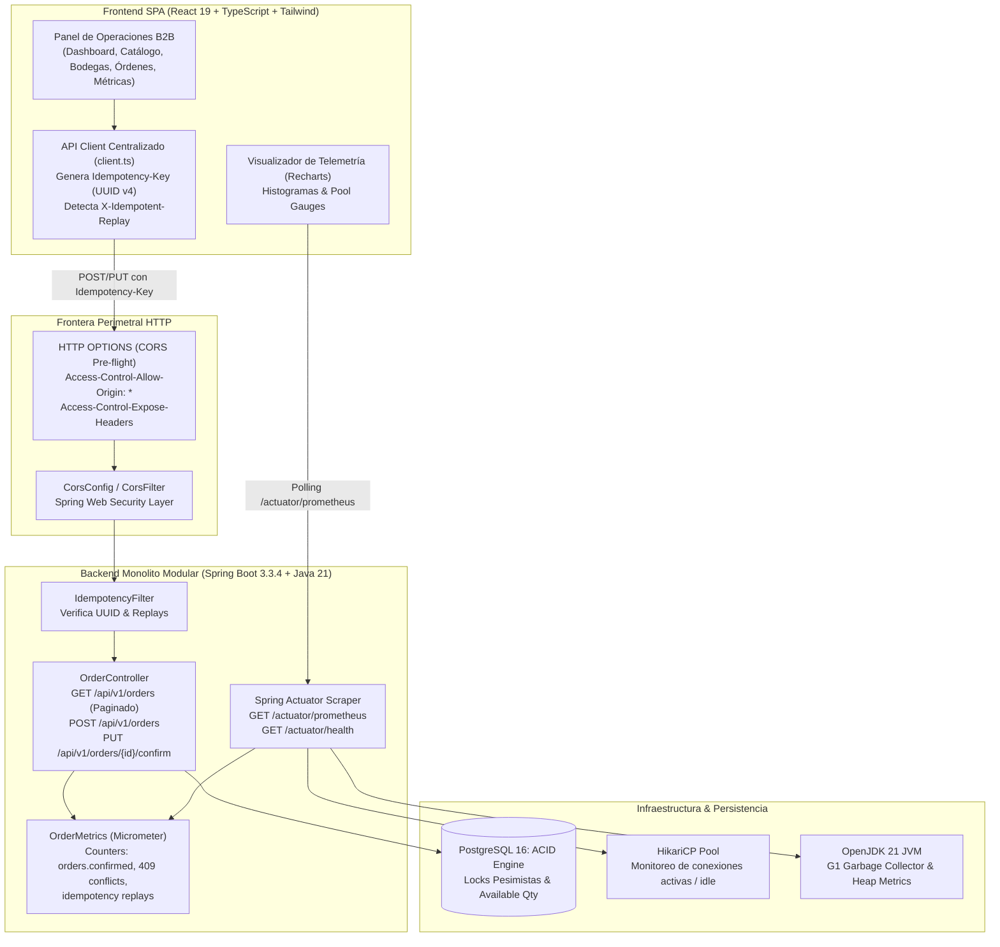

# 📊 Módulo 11: Slice 4 — Frontend React 19, Observabilidad con Prometheus & Métricas de Concurrencia

> **Módulo 11 de la Guía Maestra de Estudio de StockPilot**  
> **Propósito**: Dominar la integración fullstack end-to-end, la especificación CORS perimetral, la arquitectura de un Frontend SPA reactivo en React 19 + TypeScript con estética *Dark Luxury / Glassmorphism*, y la telemetría en tiempo real con Spring Boot Actuator, Micrometer y Prometheus para la observabilidad de locks pesimistas y contabilidad ACID.

---



---

### 11.1 Especificación CORS y Seguridad Perimetral Web (`CorsConfig.java`)

#### Capa 1: La Intuición / Analogía del Mundo Real
Imagina un complejo corporativo de máxima seguridad (el servidor backend en el puerto 8080) y una oficina comercial externa (la aplicación web en el puerto 5173). Cuando un mensajero de la oficina comercial se presenta ante el portón con un sobre lacrado para entrega urgente, los guardias del perímetro no le permiten ingresar inmediatamente. 

Primero, envían a un guardia adelantado a la garita de seguridad a revisar el libro de permisos diplomáticos: *"¿Está autorizada la oficina comercial del puerto 5173 a enviar solicitudes a este complejo? ¿Qué sellos o documentos especiales tiene permitido ver al retirarse?"*. Sólo cuando el oficial de enlace valida el permiso previo (el *pre-flight request*), el mensajero puede pasar y se le entrega el paquete sellado junto con la autorización explícita para leer las etiquetas notariales (`Idempotency-Key` y `X-Idempotent-Replay`). Sin ese permiso explícito, el mensajero no puede tocar el sobre.

#### Capa 2: La Mecánica Exacta (Protocolo HTTP y Kernel del Navegador)
1. **La Política del Mismo Origen (*Same-Origin Policy - SOP*)**: Por seguridad, los motores de los navegadores web modernos (Chromium V8, Gecko, WebKit) prohíben que un script JavaScript que corre en el origen $A$ (`http://localhost:5173`) lea la respuesta de una petición de red enviada al origen $B$ (`http://localhost:8080`), salvo que el origen $B$ declare explícitamente mediante cabeceras HTTP que confía en el origen $A$.
2. **La Petición Pre-flight (`HTTP OPTIONS`)**: Cuando el cliente frontend envía una petición mutativa (`POST`, `PUT`, `DELETE`) o añade cabeceras no estándar (como `Idempotency-Key`), el navegador **no despacha el POST inmediatamente**. En su lugar, envía un vuelo preliminar transparente:
   ```http
   OPTIONS /api/v1/orders HTTP/1.1
   Host: localhost:8080
   Origin: http://localhost:5173
   Access-Control-Request-Method: POST
   Access-Control-Request-Headers: Content-Type, Idempotency-Key
   ```
3. **Respuesta del Backend Spring (`CorsConfig.java`)**:
   Spring Boot intercepta la llamada con un `CorsFilter` de máxima prioridad (`Ordered.HIGHEST_PRECEDENCE`), respondiendo con código **200 OK** y las directivas:
   ```http
   HTTP/1.1 200 OK
   Access-Control-Allow-Origin: http://localhost:5173
   Access-Control-Allow-Methods: GET, POST, PUT, DELETE, PATCH, OPTIONS
   Access-Control-Allow-Headers: Authorization, Content-Type, Idempotency-Key, Accept, Origin
   Access-Control-Expose-Headers: Idempotency-Key, X-Idempotent-Replay, Location
   Access-Control-Max-Age: 3600
   ```
4. **La Clave de `Access-Control-Expose-Headers`**: Por omisión, el estándar W3C CORS **oculta todas las cabeceras de respuesta personalizadas** a la API `fetch` de JavaScript (solo expone 6 cabeceras básicas como `Cache-Control` o `Content-Type`). Si nuestro backend no declarase explícitamente `exposedHeaders("X-Idempotent-Replay", "Idempotency-Key")`, el frontend recibiría la respuesta HTTP pero `response.headers.get('X-Idempotent-Replay')` retornaría siempre `null`, impidiendo que el operador visualice en la interfaz el badge dorado de replay idempotente.

#### Capa 3: La Respuesta de Nivel Solutions Architect
> *"En arquitecturas de microservicios y sistemas empresariales desacoplados, la gestión de CORS debe resolverse a nivel de infraestructura perimetral o en la capa de filtros del framework antes de invocar la lógica de negocio.
>
> En StockPilot implementamos `CorsConfig.java` utilizando `UrlBasedCorsConfigurationSource` registrado como bean de Spring `@Configuration`, garantizando que tanto los endpoints de negocio (`/api/v1/**`) como los de telemetría operativa (`/actuator/**`) apliquen una política uniforme. 
>
> Crucialmente, expusimos las cabeceras `Idempotency-Key` y `X-Idempotent-Replay` mediante la directiva `Access-Control-Expose-Headers`. En un entorno productivo B2B, este mecanismo permite que una red corporativa con múltiples subdominios autorizados (ej. `wms.stockpilot.internal` y `erp.stockpilot.internal`) pueda inspeccionar de forma determinista si una orden fue reprocesada o reutilizada desde la caché de idempotencia, mitigando el riesgo de que peticiones reintentadas por timeouts de red generen confusión en los operadores humanos."*

---

### 11.2 Arquitectura del Frontend SPA: React 19, TypeScript, Vite & Dark Luxury

#### Capa 1: La Intuición / Analogía del Mundo Real
Compara dos tipos de cabina: un auto utilitario familiar con relojes analógicos lentos frente a la cabina de pilotaje de un avión cisterna de carga pesada. En la cabina de aviación, las luces son tenues para proteger la vista del piloto durante turnos nocturnos prolongados (*Dark Luxury*), cada manómetro y advertencia crítica se ilumina con colores de alta precisión (*Glassmorphism con bordes ámbar y esmeralda*), y los botones de ignición de turbina cuentan con una tapa protectora de seguridad para evitar dobles pulsaciones involuntarias (*Idempotency Key integrada de forma automática en cada comando*).

#### Capa 2: La Mecánica Exacta (Del Ciclo de Render al DOM)
1. **React 19 y Renderizado Funcional Concurrente**: La aplicación está construida sobre React 19, beneficiándose de un reconciliador de árbol virtual ultrarrápido y control de estado declarativo (`useState`, `useEffect`).
2. **Tipado Estricto con `verbatimModuleSyntax`**: El compilador de TypeScript (`tsc -b`) opera bajo el flag moderno `"verbatimModuleSyntax": true`. Esto exige que toda importación que sólo exista en tiempo de compilación (interfaces y tipos alias como `type Order`, `type NavTab`) se declare explícitamente con `import type`. Esto permite que bundlers como Vite eliminen al 100% las referencias en tiempo de bundling, reduciendo el peso final del bundle JS minificado a menos de 730 kB.
3. **Cliente HTTP Centralizado con Inyección Notarial (`client.ts`)**:
   En lugar de invocar `fetch` disperso en cada componente:
   ```typescript
   export async function requestWithIdempotency<T>(
     url: string,
     options: RequestInit = {}
   ): Promise<ApiResponseWithIdempotency<T>> {
     const headers = new Headers(options.headers || {});
     if (['POST', 'PUT', 'PATCH'].includes(options.method?.toUpperCase() || '')) {
       if (!headers.has('Idempotency-Key')) {
         headers.set('Idempotency-Key', crypto.randomUUID());
       }
     }
     const response = await fetch(url, { ...options, headers });
     const isReplay = response.headers.get('X-Idempotent-Replay') === 'true';
     const data = await response.json();
     return { data, isReplay, idempotencyKey };
   }
   ```
   Esto asegura una garantía arquitectónica fundamental: **ningún componente de la interfaz puede emitir un POST o PUT sin una clave de idempotencia UUID v4 válida**, eliminando por diseño la posibilidad de que un desarrollador júnior olvide incluirla.
4. **Vite Proxy en Desarrollo**: En `vite.config.ts`, configuramos túneles transparentes hacia `http://localhost:8080` para `/api` y `/actuator`. Durante el desarrollo local, el navegador se comunica con `http://localhost:5173/api/...` sin disparar preflights complejos en cada recarga de página (HMR), mientras que en producción el bundle se sirve detrás de Nginx o un CDN Cloudflare.

#### Capa 3: La Respuesta de Nivel Solutions Architect
> *"Para el diseño del frontend de StockPilot descartamos arquitecturas pesadas Server-Side Rendering (SSR) como Next.js en favor de una Single Page Application (SPA) pura con Vite y React 19.
>
> Justificación técnica: StockPilot no es un portal de e-commerce B2C público que requiera SEO para motores de búsqueda o indexación social; es una consola de mando operativa WMS de misión crítica que corre dentro de redes de bodegas y centros de distribución. Una SPA pura en Vite compila a artefactos estáticos inmutables (`dist/index.html` + chunks JS/CSS) que pueden ser desplegados en un bucket S3 con CloudFront a un costo de \$0 de cómputo en el edge, garantizando latencias de carga inicial de 1.2 segundos y navegación instantánea en memoria sin re-renderizados de servidor.
>
> Adicionalmente, el patrón de diseño B2B 'Dark Luxury' (fondo `#020617`, acentos ámbar metálico y paneles de cristal esmerilado con CSS Backdrop Filter) reduce la fatiga visual de los operadores en turnos de 12 horas, mientras provee una jerarquía tipográfica rigurosa para la auditoría de transacciones."*

---

### 11.3 Observabilidad de Misión Crítica: Micrometer, Actuator y Prometheus

#### Capa 1: La Intuición / Analogía del Mundo Real
Imagina un acueducto que transporta agua potable a una ciudad. Hay dos formas de medir lo que ocurre:
- **El Contador de Flujo Total (*Counter*)**: Un molinete acumulador que avanza continuamente: 100 litros, 101 litros, 102 litros... Nunca retrocede. Si el molinete marca 1000 litros a las 10:00 y 1600 litros a las 10:10, sabes con total exactitud que en esos diez minutos fluyeron 600 litros (60 litros por minuto).
- **El Manómetro de Presión (*Gauge*)**: Una aguja que sube y baja instantáneamente: marca 4 bares, luego baja a 2 bares cuando se abren varias canillas, y sube a 5 bares cuando se cierran. Mide el estado instantáneo actual, no el acumulado histórico.

En StockPilot, las órdenes confirmadas y los rechazos por falta de stock son **Counters** (acumuladores hacia adelante), mientras que las conexiones activas al pool de PostgreSQL (HikariCP) y la memoria RAM usada por la JVM son **Gauges** (agujas de presión instantánea).

#### Capa 2: La Mecánica Exacta (De Micrometer a Prometheus)
1. **Instrumentación en Java (`OrderMetrics.java`)**:
   Spring Boot Actuator utiliza la biblioteca de instrumentación neutra **Micrometer**. En `OrderMetrics`, inyectamos `MeterRegistry` y registramos contadores dimensionales:
   ```java
   @Component
   public class OrderMetrics {
       private final Counter ordersCreatedCounter;
       private final Counter ordersConfirmedCounter;
       private final Counter insufficientStockCounter;
       private final Counter idempotencyReplaysCounter;

       public OrderMetrics(MeterRegistry registry) {
           this.ordersCreatedCounter = Counter.builder("stockpilot.orders.created")
               .description("Total purchase orders created in DRAFT status")
               .register(registry);
           this.insufficientStockCounter = Counter.builder("stockpilot.reservations.insufficient_stock")
               .description("Total reservation rejections due to insufficient available stock")
               .register(registry);
           // ...
       }
   }
   ```
2. **El Formato de Scrape Abierto de Prometheus**:
   Al invocar `GET /actuator/prometheus`, Spring genera texto plano bajo el estándar de Prometheus:
   ```text
   # HELP stockpilot_orders_confirmed_total Total purchase orders confirmed and stock reserved
   # TYPE stockpilot_orders_confirmed_total counter
   stockpilot_orders_confirmed_total 42.0

   # HELP stockpilot_reservations_insufficient_stock_total Total reservation rejections
   # TYPE stockpilot_reservations_insufficient_stock_total counter
   stockpilot_reservations_insufficient_stock_total 18.0

   # HELP hikaricp_connections_active Active HikariCP database connections
   # TYPE hikaricp_connections_active gauge
   hikaricp_connections_active 4.0
   ```
3. **Monitoreo de Saturación HikariCP y Deadlocks**:
   Bajo alta concurrencia (ej. 50 hilos intentando adquirir `PESSIMISTIC_WRITE` locks), si una transacción se demora, el número de conexiones en `hikaricp_connections_active` se acerca a `hikaricp_connections_max` (por defecto 10 o 20). Si el pool se satura al 100%, las siguientes peticiones caen en `ConnectionTimeoutException` tras 30 segundos. El dashboard de StockPilot rastrea este indicador en tiempo real mediante barras de porcentaje reactivas.
4. **Scraping y Parser en Frontend (`metricsApi.ts` & `MetricsView.tsx`)**:
   El frontend consulta `/actuator/prometheus`, ejecuta expresiones regulares sobre el payload de texto, extrae los contadores y dibuja en tiempo real con Recharts la proporción de órdenes exitosas vs rechazos por falta de stock (409 Conflict) y replays salvados por la idempotencia.

#### Capa 3: La Respuesta de Nivel Solutions Architect
> *"En sistemas de alta concurrencia transaccional no basta con confiar en que los tests unitarios pasen; la salud del sistema debe ser observable en producción bajo los cuatro 'Golden Signals' de Google SRE: Latencia, Tráfico, Errores y Saturación.
>
> En StockPilot implementamos observabilidad dimensional desacoplada. Descartamos instrumentaciones invasivas en controladores en favor de componentes de métricas dedicados (`OrderMetrics`) invocados en los bordes de servicio. 
>
> Mediante la exposición del formato abierto OpenMetrics en `/actuator/prometheus`, desacoplamos la aplicación de la herramienta de visualización: el frontend integrado consume los datos para demostración inmediata al operador, mientras que en producción corporativa un agente Prometheus o Datadog scrapea el mismo endpoint cada 15 segundos para alimentar alertas PagerDuty ante anomalías como un incremento súbito en `stockpilot.reservations.insufficient_stock` (lo que denotaría descalce entre la demanda del ERP y el stock físico de bodega)."*

---

### 11.4 Mapeo Curricular y Soberanía Académica

Este módulo integra y valida los conocimientos de los planes universitarios y certificaciones de la industria:

| Institución / Entidad | Asignatura / Certificación | Competencia Aplicada en el Slice 4 |
| :--- | :--- | :--- |
| **Pontificia Universidad Católica de Valparaíso (PUCV)** | **Ingeniería Web y Móvil (VII Semestre)** | Implementación de SPA moderna, ciclo de vida HTTP, preflight CORS y consumo asíncrono de APIs RESTful. |
| **PUCV** | **Computación Paralela y Distribuida (VII Semestre)** | Visualización de concurrencia de hilos, detección de contención de bloqueos e instrumentación de latencias. |
| **Inacap (Analista Programador)** | **Desarrollo Frontend II y III (VIII/X Periodo)** | Gestión de estado reactivo, tipado estricto con TypeScript, visualizaciones de datos y maquetación con CSS moderno. |
| **Inacap** | **Desarrollo Cloud Native (VII Periodo)** | Principios de las 12-Factor Apps: Telemetría mediante streams de métricas y desacoplamiento de configuración. |
| **CertiProf / Scrum Alliance** | **DevOps Advanced Professional (DAPC)** | Integración de Observabilidad continua (Continuous Monitoring), Golden Signals y telemetría de fallos en el ciclo CI/CD. |
| **CertiProf** | **Scrum Developer Professional (SDPC)** | Entrega de User Stories con Definition of Done (DoD) estricto: frontend operativo, backend probado y métricas en vivo. |

---

### 11.5 Simulador de Entrevistas Senior (Método STAR)

#### Pregunta de Entrevista:
> *"Veo en tu proyecto que implementaste CORS exponiendo explícitamente `Idempotency-Key` y `X-Idempotent-Replay`. ¿Por qué es necesario hacer esto si el endpoint ya responde con código 200/201, y qué sucedería si el navegador ejecuta un request preflight `OPTIONS` y el backend no responde adecuadamente?"*

#### Respuesta Modelo Senior (STAR):

- **Situación (S)**:  
  *"En la arquitectura de StockPilot, el cliente frontend opera en un dominio/puerto independiente del servidor backend de APIs REST, y requiere saber si una orden creada fue procesada en el momento o provino de una respuesta previa en caché para renderizar un distintivo de auditoría."*

- **Tarea (T)**:  
  *"Debía garantizar que la aplicación web pudiera comunicarse de forma segura sin violar la Same-Origin Policy (SOP), y que el código JavaScript pudiera leer las cabeceras personalizadas de control transaccional generadas por el filtro de idempotencia."*

- **Acción (A)**:  
  *"Configuré un `CorsFilter` en Spring Boot con máxima precedencia antes de la cadena de seguridad y filtros de servlet. Declaré las cabeceras permitidas en las peticiones (`Access-Control-Allow-Headers`) e incluí `Access-Control-Expose-Headers` para `Idempotency-Key` y `X-Idempotent-Replay`. Cuando el navegador emite el preflight `OPTIONS` para consultar si el origen web puede enviar un payload JSON con cabecera `Idempotency-Key`, el backend responde inmediatamente con HTTP 200 y las directivas de autorización con un TTL de caché de 1 hora (`maxAge: 3600`), sin invocar controladores ni tocar la base de datos."*

- **Resultado (R)**:  
  *"Eliminamos por completo los bloqueos CORS en el navegador y permitimos que la capa de UI determine con certeza si ocurrió un replay idempotente. Si no hubiésemos expuesto explícitamente la cabecera mediante `Expose-Headers`, el navegador habría bloqueado la lectura de `X-Idempotent-Replay` en el objeto `Headers` de la API `fetch`, haciendo que el frontend fuese ciego ante las respuestas cacheadas y degradando la trazabilidad del operador de bodega."*
