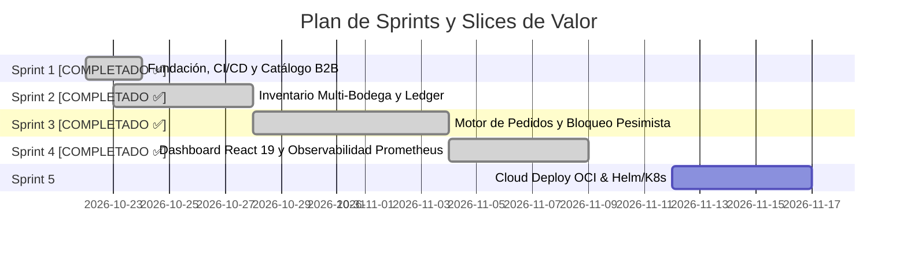

# Backlog de Producto Priorizado (Scrum) — StockPilot

> **Product Owner**: Víctor Venegas (SPOPC, SMPC)  
> **Metodología de Priorización**: Valor de Negocio, Dependencias Técnicas y MoSCoW  
> **Criterio de Estimación**: Fibonacci Planning Poker (1, 2, 3, 5, 8, 13)

---

## 🗺️ Mapa de Releases y Sprints



---

## 📋 Estado de Historias de Usuario

| ID | User Story | SP | Sprint | Prioridad | Estado |
|---|---|---|---|---|---|
| **US-001** | Registro y Mantenimiento de SKUs Industriales | 3 | Sprint 1 | 🔴 Must Have | ✅ DONE |
| **US-002** | Consulta Paginada del Catálogo con Filtrado | 2 | Sprint 1 | 🔴 Must Have | ✅ DONE |
| **US-003** | Inicialización y Ajuste de Stock en Bodega Física | 3 | Sprint 2 | 🔴 Must Have | ✅ DONE |
| **US-004** | Consulta de Disponibilidad de Inventario por Bodega | 2 | Sprint 2 | 🔴 Must Have | ✅ DONE |
| **US-005** | Trazabilidad Completa mediante Ledger de Inventario | 3 | Sprint 2 | 🟡 Should Have | ✅ DONE |
| **US-006** | Creación de Orden de Compra en Estado Borrador (DRAFT) | 5 | Sprint 3 | 🔴 Must Have | ✅ DONE |
| **US-007** | Confirmación de Pedido con Reserva Atómica Pesimista | 8 | Sprint 3 | 🔴 Must Have | ✅ DONE |
| **US-008** | Cancelación de Pedido y Liberación Determinista | 5 | Sprint 3 | 🔴 Must Have | ✅ DONE |
| **US-009** | Despacho Físico de Pedido (Fulfillment) | 5 | Sprint 3 | 🟡 Should Have | ✅ DONE |
| **US-010** | Dashboard de Operaciones en React 19 | 5 | Sprint 4 | 🔴 Must Have | ✅ DONE |
| **US-011** | Métricas de Concurrencia en Prometheus | 3 | Sprint 4 | 🟢 Could Have | ✅ DONE |

---

## 📋 Historias de Usuario Detalladas

### Sprint 1: Fundación y Catálogo Industrial

#### US-001: Registro y Mantenimiento de SKUs Industriales
- **Como** Gestor de Catálogo B2B,
- **Quiero** registrar nuevos productos industriales con código SKU único, especificaciones técnicas y precio unitario,
- **Para** alimentar el inventario disponible y permitir a los clientes cotizar componentes normalizados.

##### Criterios de Aceptación (Gherkin):
```gherkin
Scenario: Registro exitoso de SKU único
  Given un catálogo activo y la categoría "PLCs y Controladores" existente
  When el gestor envía un POST /api/v1/products con SKU "PLC-SIEM-S71500", nombre "Siemens S7-1500 CPU", precio 1250000.00
  Then la API responde 201 Created con el ID asignado
    And el producto queda registrado en la base de datos con version=0 y active=true

Scenario: Intento de registro con SKU duplicado
  Given un producto existente con SKU "PLC-SIEM-S71500"
  When el gestor envía un POST /api/v1/products con el mismo SKU "PLC-SIEM-S71500"
  Then la API rechaza la solicitud con HTTP 409 Conflict
    And el cuerpo ProblemDetail indica "Duplicate SKU: PLC-SIEM-S71500 already exists"
```
- **Story Points**: 3 | **Prioridad**: 🔴 Must Have | **Módulo**: `catalog`

---

#### US-002: Consulta Paginada del Catálogo con Filtrado por Categoría
- **Como** Comprador B2B,
- **Quiero** listar productos del catálogo mediante paginación y filtros por categoría o término de búsqueda,
- **Para** localizar rápidamente los repuestos y controladores requeridos para mi proyecto.

##### Criterios de Aceptación (Gherkin):
```gherkin
Scenario: Consulta paginada estándar
  Given existen 45 productos registrados en la base de datos
  When el cliente consulta GET /api/v1/products?page=0&size=10&sort=name,asc
  Then la API responde 200 OK con un JSON Page conteniendo 10 elementos
    And totalElements es 45 y totalPages es 5

Scenario: Filtrado por categoría sin resultados o página fuera de límites
  Given un catálogo industrial con productos clasificados
  When el cliente solicita GET /api/v1/products?category=ROBOTICA&page=99&size=20
  Then la API responde HTTP 200 OK
    And el cuerpo contiene una lista vacía de items "[]"
    And los metadatos de paginación indican "totalPages: 0", "totalElements: 0" y "empty: true"
```
- **Story Points**: 2 | **Prioridad**: 🔴 Must Have | **Módulo**: `catalog`

---

### Sprint 2: Inventario Multi-Bodega y Auditoría Inmutable

#### US-003: Inicialización y Ajuste de Stock en Bodega Física
- **Como** Jefe de Almacén,
- **Quiero** registrar entradas de mercadería (Inbound) o ajustes por inventario físico en una bodega específica,
- **Para** reflejar la disponibilidad real de componentes en las estanterías de cada centro logístico.

##### Criterios de Aceptación (Gherkin):
```gherkin
Scenario: Ingreso de nuevo lote de mercadería
  Given el SKU "VAR-ABB-ACS580" sin stock en la bodega "WH-SCL-CENTRAL"
  When el operador ejecuta POST /api/v1/stock/adjust con cantidad 20, motivo "Importación Lote CL-2026-A"
  Then el registro stock_level se crea con total_qty=20, reserved_qty=0, available_qty=20
    And se registra una fila en inventory_ledger con movement_type="INBOUND", delta=+20 y resulting_total=20

Scenario: Rechazo de ajuste con cantidad negativa o bodega inexistente
  Given una bodega no registrada en el sistema "WH-INEXISTENTE"
  When el operador intenta enviar un ajuste POST /api/v1/stock/adjust con cantidad negativa "-10"
  Then el backend valida las restricciones de dominio
    And rechaza la solicitud con HTTP 400 Bad Request y RFC 7807 ProblemDetail
    And el ledger contable no registra ningún movimiento
```
- **Story Points**: 3 | **Prioridad**: 🔴 Must Have | **Módulo**: `inventory` & `audit`

---

#### US-004: Consulta de Disponibilidad de Inventario por Bodega
- **Como** Comprador B2B,
- **Quiero** verificar el stock disponible de un SKU específico segregado por cada bodega regional,
- **Para** seleccionar el centro de distribución más conveniente para el despacho logístico.

##### Criterios de Aceptación (Gherkin):
```gherkin
Scenario: Consulta de stock disponible
  Given el SKU "SEN-IFM-IND01" con 15 unidades en "WH-SCL-CENTRAL" y 0 unidades en "WH-ANF-MINER"
  When el cliente invoca GET /api/v1/products/{id}/stock
  Then la respuesta lista ambas bodegas con sus respectivos total_qty, reserved_qty y available_qty

Scenario: Consulta de SKU sin inventario asignado en bodega regional
  Given un producto existente en catálogo pero sin stock aprovisionado en "WH-ANF-MINER"
  When el cliente consulta el stock específico para esa bodega
  Then la API responde HTTP 200 OK
    And retorna total_qty = 0, reserved_qty = 0 y available_qty = 0
    And no arroja excepciones de puntero nulo ni errores 500
```
- **Story Points**: 2 | **Prioridad**: 🔴 Must Have | **Módulo**: `inventory`

---

#### US-005: Trazabilidad Completa mediante Ledger de Inventario
- **Como** Auditor Interno de Operaciones,
- **Quiero** consultar el historial cronológico e inmutable de todos los movimientos de inventario de un producto,
- **Para** auditar discrepancias físicas y garantizar el cumplimiento normativo.

##### Criterios de Aceptación (Gherkin):
```gherkin
Scenario: Auditoría de movimientos de un SKU
  Given un SKU con historial de 1 INBOUND, 2 RESERVATION y 1 RELEASE
  When el auditor solicita GET /api/v1/ledger/product/{id}?page=0&size=20
  Then la API entrega los 4 movimientos ordenados descendentemente por created_at
    And cada registro incluye timestamp, delta, saldo resultante, usuario responsable y motivo

Scenario: Inmutabilidad estricta ante intento de modificación o borrado
  Given un asiento contable previamente registrado en "inventory_ledger" con id "LEDG-001"
  When un atacante o proceso interno intenta ejecutar un UPDATE o DELETE sobre dicho registro
  Then la protección de persistencia "@Immutable" y las reglas de base de datos rechazan la operación
    And se arroja una excepción de violación de inmutabilidad
    And el historial histórico de auditoría permanece inalterado
```
- **Story Points**: 3 | **Prioridad**: 🟡 Should Have | **Módulo**: `audit`

---

### Sprint 3: Motor de Pedidos y Reserva Concurrente de Alta Criticidad

#### US-006: Creación de Orden de Compra en Estado Borrador (DRAFT)
- **Como** Comprador B2B,
- **Quiero** crear una orden de compra con múltiples líneas de productos indicando la bodega de despacho,
- **Para** consolidar los componentes necesarios antes de comprometer el stock.

##### Criterios de Aceptación (Gherkin):
```gherkin
Scenario: Creación exitosa de orden DRAFT con Idempotency-Key
  Given una cabecera "Idempotency-Key: e4b2c1a8-1234-4567-89ab-cdef01234567"
    And líneas válidas de productos pertenecientes al catálogo
  When el cliente envía POST /api/v1/orders
  Then se crea la orden en estado "DRAFT" con un número correlativo "ORD-YYYYMMDD-XXXX"
    And no se efectúa ninguna reserva de stock en este estado

Scenario: Rechazo de orden con líneas vacías o SKU no registrado
  Given una solicitud de creación de orden con lista de líneas vacía o con SKU inexistente "SKU-FANTASMA"
  When el cliente envía POST /api/v1/orders con cabecera Idempotency-Key
  Then el validador de contratos rechaza la petición con HTTP 400 Bad Request
    And retorna ProblemDetail con detalle de la violación de validación
    And ninguna orden en estado DRAFT es persistida en la base de datos
```
- **Story Points**: 5 | **Prioridad**: 🔴 Must Have | **Módulo**: `ordering`

---

#### US-007: Confirmación de Pedido con Reserva Atómica Pesimista (Anti-Sobreventa)
- **Como** Comprador B2B,
- **Quiero** confirmar mi orden de compra para asegurar la reserva inmediata y exclusiva de los productos,
- **Para** tener certeza de que el pedido será surtido y ningún otro cliente podrá tomar las unidades asignadas.

##### Criterios de Aceptación (Gherkin):
```gherkin
Scenario: Confirmación exitosa con stock suficiente
  Given una orden en estado "DRAFT" con 2 unidades de "PLC-SIEM-S71500"
    And stock disponible en "WH-SCL-CENTRAL" igual a 5 unidades
  When se ejecuta PUT /api/v1/orders/{id}/confirm con cabecera Idempotency-Key
  Then la orden transiciona a estado "CONFIRMED"
    And stock_level.reserved_qty aumenta en 2 (available_qty baja a 3)
    And se crea un registro stock_reservation en estado "ACTIVE"
    And se registra una entrada en inventory_ledger con tipo "RESERVATION"

Scenario: Conflicto por concurrencia y stock insuficiente
  Given una orden solicitando 1 unidad de "PLC-SIEM-S71500"
    And otra transacción concurrente acaba de reservar la última unidad disponible
  When el sistema ejecuta la reserva bajo SELECT ... FOR UPDATE
  Then al adquirir el bloqueo lee available_qty = 0
    And la transacción realiza ROLLBACK total
    And la API retorna HTTP 409 Conflict con RFC 7807 ProblemDetail
    And el estado de la orden permanece en "DRAFT"
```
- **Story Points**: 8 | **Prioridad**: 🔴 Must Have | **Módulo**: `ordering` & `inventory`

---

#### US-008: Cancelación de Pedido y Liberación Determinista de Reservas
- **Como** Comprador B2B u Operador,
- **Quiero** cancelar una orden previamente confirmada,
- **Para** liberar las reservas activas y devolver el stock a disponibilidad general inmediatamente.

##### Criterios de Aceptación (Gherkin):
```gherkin
Scenario: Cancelación y restitución de disponibilidad
  Given una orden en estado "CONFIRMED" con 3 unidades reservadas
  When se invoca PUT /api/v1/orders/{id}/cancel
  Then la orden pasa a estado "CANCELLED"
    And las reservas vinculadas pasan a estado "RELEASED"
    And stock_level.reserved_qty disminuye en 3 (available_qty aumenta en 3)
    And se registra un movimiento "RELEASE" en el ledger

Scenario: Intento ilegal de cancelar una orden ya despachada (FULFILLED)
  Given una orden de compra que ya transitó al estado terminal "FULFILLED"
  When el cliente o el operador intenta ejecutar PUT /api/v1/orders/{id}/cancel
  Then la máquina de estados finita (FSM) detecta la transición ilegal
    And rechaza la solicitud con HTTP 409 Conflict
    And el estado de la orden permanece inalterado en "FULFILLED"
    And el inventario total no sufre modificaciones compensatorias erróneas
```
- **Story Points**: 5 | **Prioridad**: 🔴 Must Have | **Módulo**: `ordering` & `inventory`

---

#### US-009: Despacho Físico de Pedido (Fulfillment)
- **Como** Operador de Bodega,
- **Quiero** marcar una orden confirmada como despachada (FULFILLED),
- **Para** rebajar definitivamente el inventario físico total y cerrar el ciclo de la reserva.

##### Criterios de Aceptación (Gherkin):
```gherkin
Scenario: Despacho de mercadería en bodega
  Given una orden "CONFIRMED" con reservas "ACTIVE"
  When el operador ejecuta PUT /api/v1/orders/{id}/fulfill
  Then la orden transiciona a estado "FULFILLED"
    And las reservas pasan a estado "FULFILLED"
    And stock_level.total_qty disminuye en la cantidad despachada
    And stock_level.reserved_qty disminuye en la misma cantidad
    And se registra un movimiento "FULFILLMENT" en el ledger

Scenario: Intento de despacho sobre orden en estado ilegal (DRAFT o CANCELLED)
  Given una orden en estado "DRAFT" o "CANCELLED"
  When el operador de bodega intenta ejecutar PUT /api/v1/orders/{id}/fulfill
  Then el motor de estados finitos intercepta la acción no permitida
    And responde HTTP 422 Unprocessable Entity
    And las existencias físicas en bodega permanecen protegidas e inalteradas
```
- **Story Points**: 5 | **Prioridad**: 🟡 Should Have | **Módulo**: `ordering` & `inventory`

---

### Sprint 4: Frontend React 19, Observabilidad y Despliegue OCI

#### US-010: Dashboard de Operaciones y Catálogo Interactivo en React 19
- **Como** Operador Logístico / Comprador B2B,
- **Quiero** una interfaz web reactiva con componentes Shadcn y feedback en tiempo real de inventario,
- **Para** operar la plataforma con fluidez, visualizar alertas de stock y gestionar pedidos sin fricción.

##### Criterios de Aceptación (Gherkin):
```gherkin
Scenario: Inyección automática de Idempotency-Key en peticiones mutativas
  Given un usuario interactuando con la Mesa de Órdenes en la SPA React 19
  When el usuario pulsa el botón "Crear Orden de Compra"
  Then el cliente HTTP ("client.ts") genera e inyecta un UUID v4 en la cabecera "Idempotency-Key"
    And despacha la petición POST /api/v1/orders
    And si el servidor responde HTTP 201 Created, la orden se visualiza de inmediato en estado "DRAFT"

Scenario: Detección y notificación visual de reintento de orden (X-Idempotent-Replay)
  Given una orden previamente confirmada con una clave de idempotencia
  When el usuario o la red reenvía la petición de confirmación con la misma clave
  Then el backend procesa el filtro de idempotencia y retorna HTTP 200 OK
    And incluye la cabecera expuesta por CORS "X-Idempotent-Replay: true"
    And la interfaz de React 19 detecta la cabecera y muestra un banner dorado de auditoría: "Respuesta recuperada de caché de idempotencia"

Scenario: Visualización reactiva de niveles de inventario y bloqueo ante falta de stock
  Given un producto en el catálogo con available_qty igual a 0
  When el operador visualiza la ficha del producto o intenta seleccionarlo para una orden
  Then la interfaz muestra el indicador de stock en rojo "Agotado"
    And deshabilita la acción de agregar al pedido para prevenir errores humanos antes de llegar al backend
```
- **Story Points**: 5 | **Prioridad**: 🔴 Must Have | **Módulo**: `frontend`

---

#### US-011: Métricas de Concurrencia y Salud en Prometheus / Actuator
- **Como** Ingeniero DevOps / SRE,
- **Quiero** exponer métricas de locks, reservas y estados de pedidos en `/actuator/prometheus`,
- **Para** supervisar la contención de base de datos y la salud del sistema en tiempo real.

##### Criterios de Aceptación (Gherkin):
```gherkin
Scenario: Exposición de contadores de negocio y rechazos por sobreventa
  Given transacciones concurrentes ejecutándose contra el motor de órdenes
  When se ejecuta un scrape HTTP GET sobre el endpoint "/actuator/prometheus"
  Then la respuesta retorna formato OpenMetrics con código HTTP 200 OK
    And incluye la métrica dimensional "stockpilot_orders_created_total"
    And incluye "stockpilot_orders_confirmed_total"
    And incrementa "stockpilot_reservations_insufficient_stock_total" ante cada rechazo por concurrencia HTTP 409

Scenario: Monitoreo de contención de base de datos en el pool HikariCP
  Given una carga de 50 hilos concurrentes compitiendo por reservas de inventario
  When Prometheus sondea las métricas de infraestructura del backend
  Then se exponen las métricas "hikaricp_connections_active", "hikaricp_connections_pending" y "hikaricp_connections_timeout_total"
    And el panel de operaciones en React 19 grafica en tiempo real el porcentaje de saturación del pool
```
- **Story Points**: 3 | **Prioridad**: 🟢 Could Have | **Módulo**: `shared / devops`
