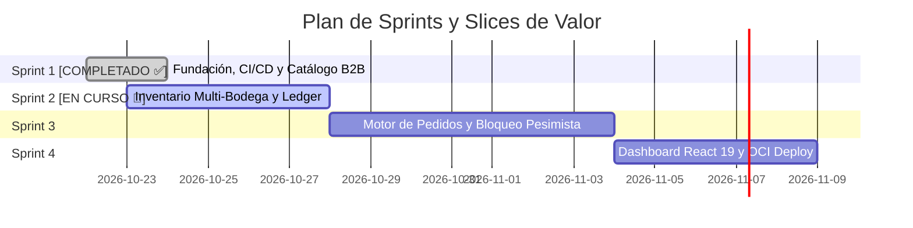

# Backlog de Producto Priorizado (Scrum) — StockPilot

> **Product Owner**: Víctor Venegas (SPOPC, SMPC)  
> **Metodología de Priorización**: Valor de Negocio, Dependencias Técnicas y MoSCoW  
> **Criterio de Estimación**: Fibonacci Planning Poker (1, 2, 3, 5, 8, 13)

---

## 🗺️ Mapa de Releases y Sprints



---

## 📋 Estado de Historias de Usuario

| ID | User Story | SP | Sprint | Prioridad | Estado |
|---|---|---|---|---|---|
| **US-001** | Registro y Mantenimiento de SKUs Industriales | 3 | Sprint 1 | 🔴 Must Have | ✅ DONE |
| **US-002** | Consulta Paginada del Catálogo con Filtrado | 2 | Sprint 1 | 🔴 Must Have | ✅ DONE |
| **US-003** | Inicialización y Ajuste de Stock en Bodega Física | 3 | Sprint 2 | 🔴 Must Have | 🚀 IN PROGRESS |
| **US-004** | Consulta de Disponibilidad de Inventario por Bodega | 2 | Sprint 2 | 🔴 Must Have | 🚀 IN PROGRESS |
| **US-005** | Trazabilidad Completa mediante Ledger de Inventario | 3 | Sprint 2 | 🟡 Should Have | 🚀 IN PROGRESS |
| **US-006** | Creación de Orden de Compra en Estado Borrador (DRAFT) | 5 | Sprint 3 | 🔴 Must Have | ⏳ TO DO |
| **US-007** | Confirmación de Pedido con Reserva Atómica Pesimista | 8 | Sprint 3 | 🔴 Must Have | ⏳ TO DO |
| **US-008** | Cancelación de Pedido y Liberación Determinista | 5 | Sprint 3 | 🔴 Must Have | ⏳ TO DO |
| **US-009** | Despacho Físico de Pedido (Fulfillment) | 5 | Sprint 3 | 🟡 Should Have | ⏳ TO DO |
| **US-010** | Dashboard de Operaciones en React 19 | 5 | Sprint 4 | 🔴 Must Have | ⏳ TO DO |
| **US-011** | Métricas de Concurrencia en Prometheus | 3 | Sprint 4 | 🟢 Could Have | ⏳ TO DO |

---

## 📋 Historias de Usuario Detalladas

### Sprint 1: Fundación y Catálogo Industrial

#### US-001: Registro y Mantenimiento de SKUs Industriales
- **Como** Gestor de Catálogo B2B,
- **Quiero** registrar nuevos productos industriales con código SKU único, especificaciones técnicas y precio unitario,
- **Para** alimentar el inventario disponible y permitir a los clientes cotizar componentes normalizados.

##### Criterios de Aceptación (Gherkin):
```gherkin
Scenario: Registro exitoso de SKU único
  Given un catálogo activo y la categoría "PLCs y Controladores" existente
  When el gestor envía un POST /api/v1/products con SKU "PLC-SIEM-S71500", nombre "Siemens S7-1500 CPU", precio 1250000.00
  Then la API responde 201 Created con el ID asignado
    And el producto queda registrado en la base de datos con version=0 y active=true

Scenario: Intento de registro con SKU duplicado
  Given un producto existente con SKU "PLC-SIEM-S71500"
  When el gestor envía un POST /api/v1/products con el mismo SKU "PLC-SIEM-S71500"
  Then la API rechaza la solicitud con HTTP 409 Conflict
    And el cuerpo ProblemDetail indica "Duplicate SKU: PLC-SIEM-S71500 already exists"
```
- **Story Points**: 3 | **Prioridad**: 🔴 Must Have | **Módulo**: `catalog`

---

#### US-002: Consulta Paginada del Catálogo con Filtrado por Categoría
- **Como** Comprador B2B,
- **Quiero** listar productos del catálogo mediante paginación y filtros por categoría o término de búsqueda,
- **Para** localizar rápidamente los repuestos y controladores requeridos para mi proyecto.

##### Criterios de Aceptación (Gherkin):
```gherkin
Scenario: Consulta paginada estándar
  Given existen 45 productos registrados en la base de datos
  When el cliente consulta GET /api/v1/products?page=0&size=10&sort=name,asc
  Then la API responde 200 OK con un JSON Page conteniendo 10 elementos
    And totalElements es 45 y totalPages es 5
```
- **Story Points**: 2 | **Prioridad**: 🔴 Must Have | **Módulo**: `catalog`

---

### Sprint 2: Inventario Multi-Bodega y Auditoría Inmutable

#### US-003: Inicialización y Ajuste de Stock en Bodega Física
- **Como** Jefe de Almacén,
- **Quiero** registrar entradas de mercadería (Inbound) o ajustes por inventario físico en una bodega específica,
- **Para** reflejar la disponibilidad real de componentes en las estanterías de cada centro logístico.

##### Criterios de Aceptación (Gherkin):
```gherkin
Scenario: Ingreso de nuevo lote de mercadería
  Given el SKU "VAR-ABB-ACS580" sin stock en la bodega "WH-SCL-CENTRAL"
  When el operador ejecuta POST /api/v1/stock/adjust con cantidad 20, motivo "Importación Lote CL-2026-A"
  Then el registro stock_level se crea con total_qty=20, reserved_qty=0, available_qty=20
    And se registra una fila en inventory_ledger con movement_type="INBOUND", delta=+20 y resulting_total=20
```
- **Story Points**: 3 | **Prioridad**: 🔴 Must Have | **Módulo**: `inventory` & `audit`

---

#### US-004: Consulta de Disponibilidad de Inventario por Bodega
- **Como** Comprador B2B,
- **Quiero** verificar el stock disponible de un SKU específico segregado por cada bodega regional,
- **Para** seleccionar el centro de distribución más conveniente para el despacho logístico.

##### Criterios de Aceptación (Gherkin):
```gherkin
Scenario: Consulta de stock disponible
  Given el SKU "SEN-IFM-IND01" con 15 unidades en "WH-SCL-CENTRAL" y 0 unidades en "WH-ANF-MINER"
  When el cliente invoca GET /api/v1/products/{id}/stock
  Then la respuesta lista ambas bodegas con sus respectivos total_qty, reserved_qty y available_qty
```
- **Story Points**: 2 | **Prioridad**: 🔴 Must Have | **Módulo**: `inventory`

---

#### US-005: Trazabilidad Completa mediante Ledger de Inventario
- **Como** Auditor Interno de Operaciones,
- **Quiero** consultar el historial cronológico e inmutable de todos los movimientos de inventario de un producto,
- **Para** auditar discrepancias físicas y garantizar el cumplimiento normativo.

##### Criterios de Aceptación (Gherkin):
```gherkin
Scenario: Auditoría de movimientos de un SKU
  Given un SKU con historial de 1 INBOUND, 2 RESERVATION y 1 RELEASE
  When el auditor solicita GET /api/v1/ledger/product/{id}?page=0&size=20
  Then la API entrega los 4 movimientos ordenados descendentemente por created_at
    And cada registro incluye timestamp, delta, saldo resultante, usuario responsable y motivo
```
- **Story Points**: 3 | **Prioridad**: 🟡 Should Have | **Módulo**: `audit`

---

### Sprint 3: Motor de Pedidos y Reserva Concurrente de Alta Criticidad

#### US-006: Creación de Orden de Compra en Estado Borrador (DRAFT)
- **Como** Comprador B2B,
- **Quiero** crear una orden de compra con múltiples líneas de productos indicando la bodega de despacho,
- **Para** consolidar los componentes necesarios antes de comprometer el stock.

##### Criterios de Aceptación (Gherkin):
```gherkin
Scenario: Creación exitosa de orden DRAFT con Idempotency-Key
  Given una cabecera "Idempotency-Key: e4b2c1a8-1234-4567-89ab-cdef01234567"
    And líneas válidas de productos pertenecientes al catálogo
  When el cliente envía POST /api/v1/orders
  Then se crea la orden en estado "DRAFT" con un número correlativo "ORD-YYYYMMDD-XXXX"
    And no se efectúa ninguna reserva de stock en este estado
```
- **Story Points**: 5 | **Prioridad**: 🔴 Must Have | **Módulo**: `ordering`

---

#### US-007: Confirmación de Pedido con Reserva Atómica Pesimista (Anti-Sobreventa)
- **Como** Comprador B2B,
- **Quiero** confirmar mi orden de compra para asegurar la reserva inmediata y exclusiva de los productos,
- **Para** tener certeza de que el pedido será surtido y ningún otro cliente podrá tomar las unidades asignadas.

##### Criterios de Aceptación (Gherkin):
```gherkin
Scenario: Confirmación exitosa con stock suficiente
  Given una orden en estado "DRAFT" con 2 unidades de "PLC-SIEM-S71500"
    And stock disponible en "WH-SCL-CENTRAL" igual a 5 unidades
  When se ejecuta PUT /api/v1/orders/{id}/confirm con cabecera Idempotency-Key
  Then la orden transiciona a estado "CONFIRMED"
    And stock_level.reserved_qty aumenta en 2 (available_qty baja a 3)
    And se crea un registro stock_reservation en estado "ACTIVE"
    And se registra una entrada en inventory_ledger con tipo "RESERVATION"

Scenario: Conflicto por concurrencia y stock insuficiente
  Given una orden solicitando 1 unidad de "PLC-SIEM-S71500"
    And otra transacción concurrente acaba de reservar la última unidad disponible
  When el sistema ejecuta la reserva bajo SELECT ... FOR UPDATE
  Then al adquirir el bloqueo lee available_qty = 0
    And la transacción realiza ROLLBACK total
    And la API retorna HTTP 409 Conflict con RFC 7807 ProblemDetail
    And el estado de la orden permanece en "DRAFT"
```
- **Story Points**: 8 | **Prioridad**: 🔴 Must Have | **Módulo**: `ordering` & `inventory`

---

#### US-008: Cancelación de Pedido y Liberación Determinista de Reservas
- **Como** Comprador B2B u Operador,
- **Quiero** cancelar una orden previamente confirmada,
- **Para** liberar las reservas activas y devolver el stock a disponibilidad general inmediatamente.

##### Criterios de Aceptación (Gherkin):
```gherkin
Scenario: Cancelación y restitución de disponibilidad
  Given una orden en estado "CONFIRMED" con 3 unidades reservadas
  When se invoca PUT /api/v1/orders/{id}/cancel
  Then la orden pasa a estado "CANCELLED"
    And las reservas vinculadas pasan a estado "RELEASED"
    And stock_level.reserved_qty disminuye en 3 (available_qty aumenta en 3)
    And se registra un movimiento "RELEASE" en el ledger
```
- **Story Points**: 5 | **Prioridad**: 🔴 Must Have | **Módulo**: `ordering` & `inventory`

---

#### US-009: Despacho Físico de Pedido (Fulfillment)
- **Como** Operador de Bodega,
- **Quiero** marcar una orden confirmada como despachada (FULFILLED),
- **Para** rebajar definitivamente el inventario físico total y cerrar el ciclo de la reserva.

##### Criterios de Aceptación (Gherkin):
```gherkin
Scenario: Despacho de mercadería en bodega
  Given una orden "CONFIRMED" con reservas "ACTIVE"
  When el operador ejecuta PUT /api/v1/orders/{id}/fulfill
  Then la orden transiciona a estado "FULFILLED"
    And las reservas pasan a estado "FULFILLED"
    And stock_level.total_qty disminuye en la cantidad despachada
    And stock_level.reserved_qty disminuye en la misma cantidad
    And se registra un movimiento "FULFILLMENT" en el ledger
```
- **Story Points**: 5 | **Prioridad**: 🟡 Should Have | **Módulo**: `ordering` & `inventory`

---

### Sprint 4: Frontend React 19, Observabilidad y Despliegue OCI

#### US-010: Dashboard de Operaciones y Catálogo Interactivo en React 19
- **Como** Operador Logístico / Comprador,
- **Quiero** una interfaz web reactiva con componentes Shadcn y feedback en tiempo real de inventario,
- **Para** operar la plataforma con fluidez, visualizar alertas de stock y gestionar pedidos sin fricción.
- **Story Points**: 5 | **Prioridad**: 🔴 Must Have | **Módulo**: `frontend`

#### US-011: Métricas de Concurrencia y Salud en Prometheus / Actuator
- **Como** Ingeniero DevOps / SRE,
- **Quiero** exponer métricas de locks, reservas y estados de pedidos en `/actuator/prometheus`,
- **Para** supervisar la contención de base de datos y la salud del sistema en tiempo real.
- **Story Points**: 3 | **Prioridad**: 🟢 Could Have | **Módulo**: `shared / devops`
